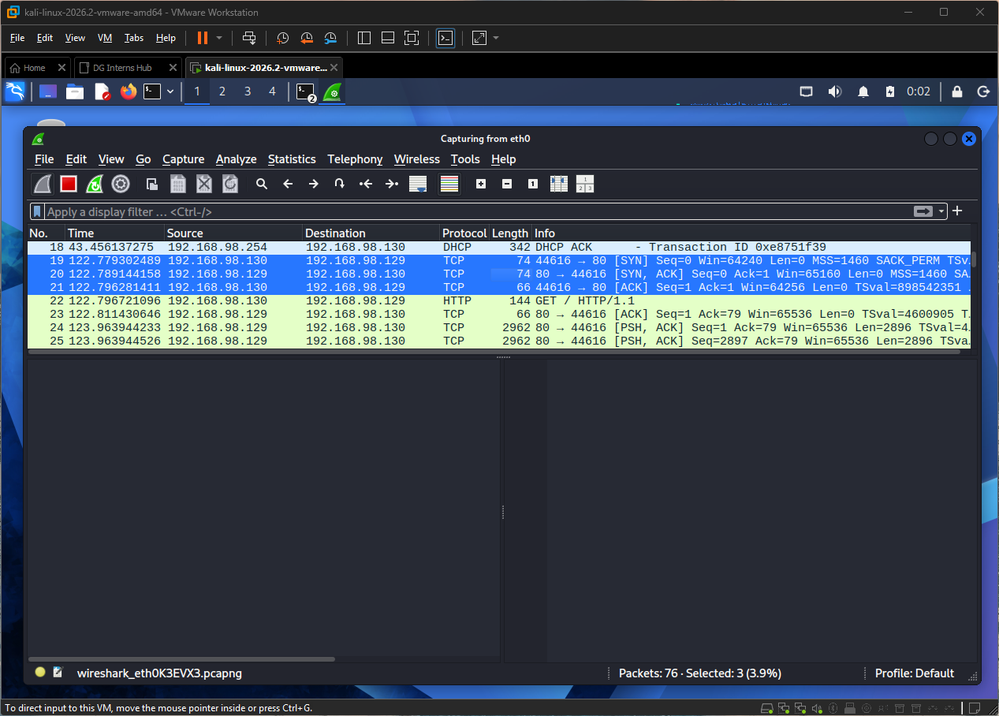
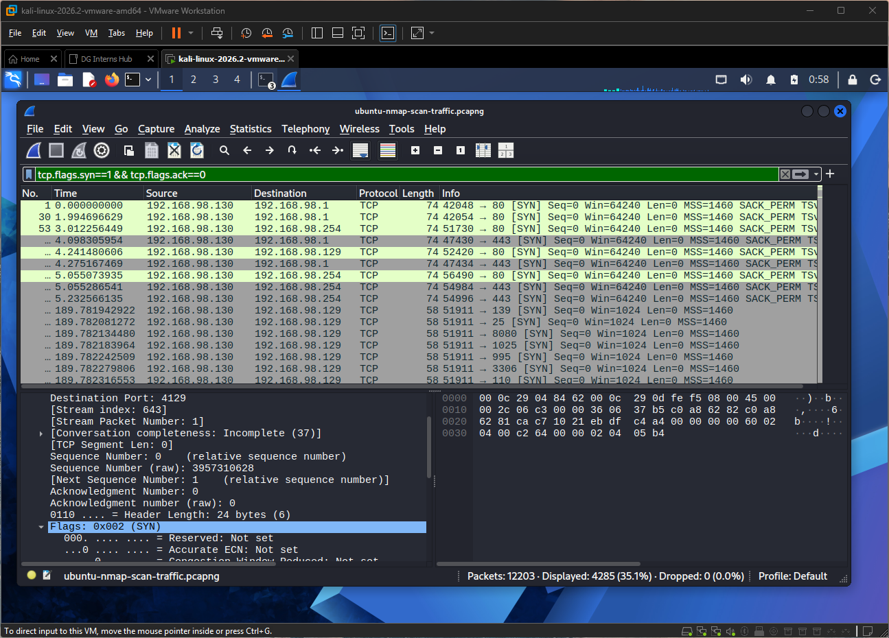

# Q1. TCP three-way handshake and teardown

## Three-way handshake (connection setup)
| Step | Direction | Flags | Meaning |
|---|---|---|---|
| 1 | Client to server | SYN | "I want to connect." Sends an initial sequence number |
| 2 | Server to client | SYN, ACK | "OK, I accept." Sends its own sequence number |
| 3 | Client to server | ACK | "Confirmed." Connection is established |

## Teardown
- **Graceful close:** each side sends FIN and the other answers with ACK (often seen as FIN/ACK, ACK, FIN/ACK, ACK).
- **Abrupt close:** one side sends RST, and the connection ends at once with no further exchange.
- A port that is closed answers a SYN with RST, which is how scanners tell open from closed.

## TCP flags
| Flag | Name | What it does | Where an analyst sees it |
|---|---|---|---|
| SYN | Synchronize | Starts a connection, syncs sequence numbers | Handshake step 1; a burst of SYNs with no ACK can mean a scan |
| ACK | Acknowledge | Confirms received data | Almost every packet after the first SYN |
| FIN | Finish | Closes the connection politely | Teardown; odd FIN-only packets can be a FIN scan |
| RST | Reset | Ends the connection immediately | Closed ports, rejected connections, scan replies |
| PSH | Push | Asks the receiver to pass data to the application now | Interactive traffic, HTTP requests |
| URG | Urgent | Marks urgent data (urgent pointer) | Rare; part of Xmas scans (FIN, PSH, URG) |

## Why it matters to a SOC analyst
- A **completed** handshake means a real connection; a SYN followed by RST or silence means a probe or blocked port.
- Many SYNs from one source to many ports is port-scan behaviour.

## How this shows up in my lab
- I captured the SYN, SYN/ACK, ACK handshake when Kali ran `curl` against Apache on my Ubuntu VM (192.168.98.129). 

    

- My Nmap `-sS` scan showed a burst of SYN packets with RST replies from closed ports, found with `tcp.flags.syn==1 && tcp.flags.ack==0` (`ubuntu-nmap-scan-traffic.pcapng`).

    