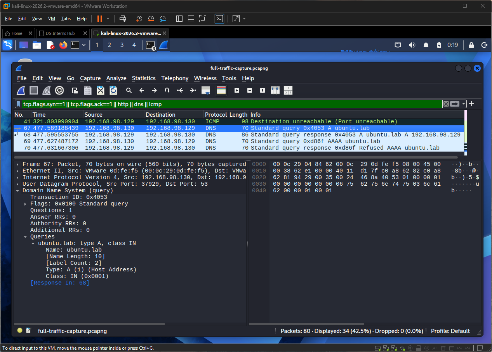
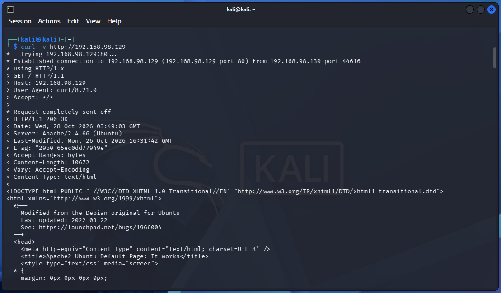
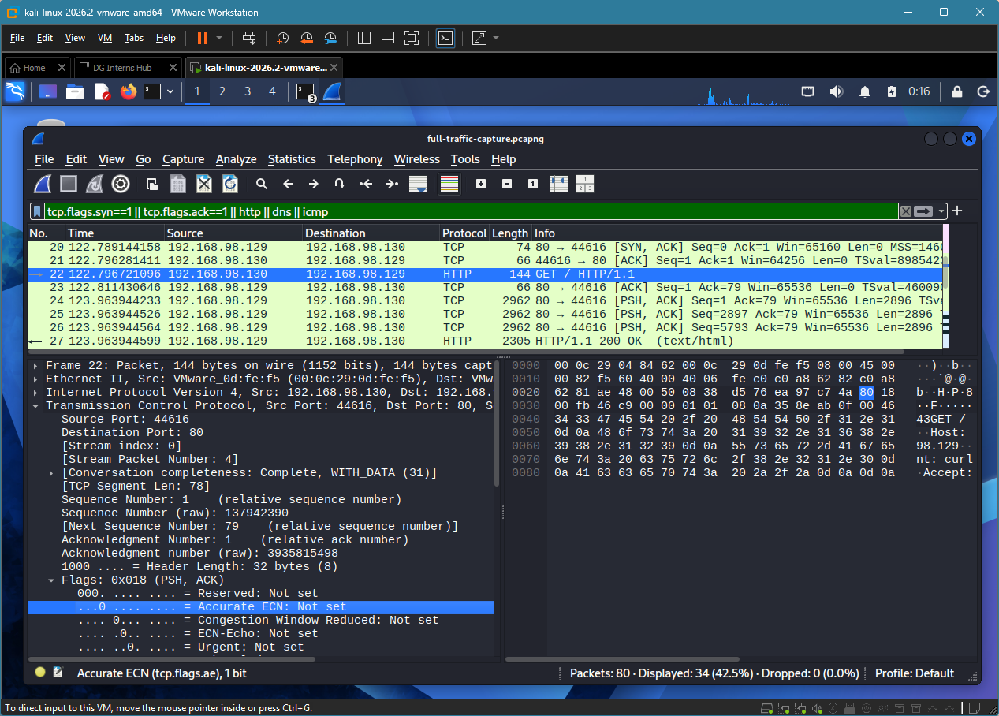
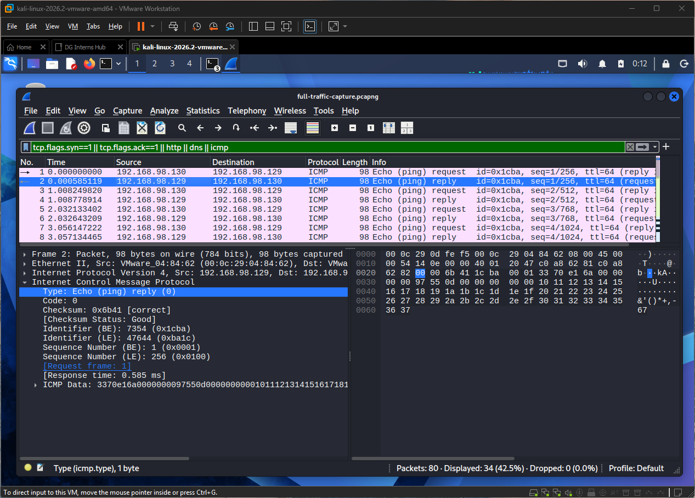
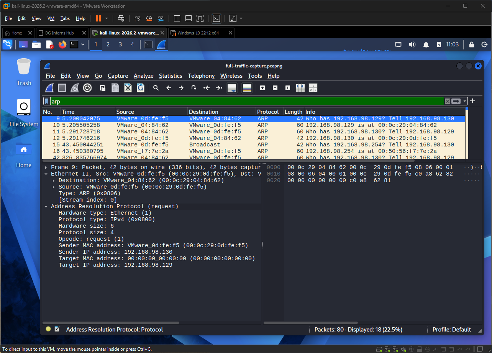
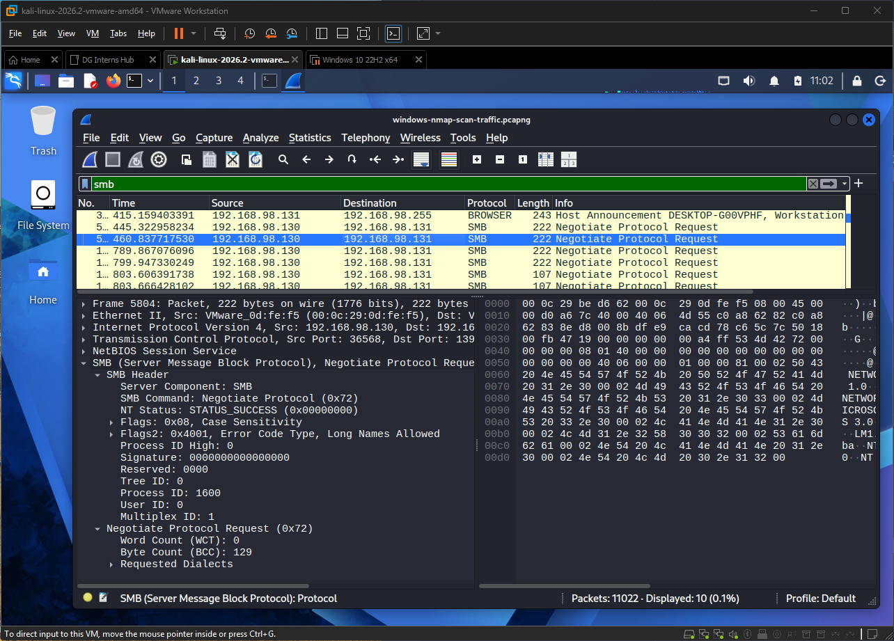

<!-- DRAFT: rewrite in your own words. Fill every [[ ]]. -->
# Q2. What to look for in DNS, HTTP, HTTPS/TLS, ARP, ICMP and SMB

| Protocol | Normal behaviour | Suspicious behaviour |
|---|---|---|
| DNS | Short queries to your resolver, answers returned, few failures | Very long or random-looking subdomains, many NXDOMAIN replies, lots of TXT queries, queries to unexpected resolvers, regular beaconing |
| HTTP | GET/POST to known sites, common user agents, expected status codes | Unusual user agents, POSTs to raw IP addresses, regular timed requests, credentials in clear text, encoded data in URLs |
| HTTPS/TLS | Valid certificates, server name matches the site, standard port 443 | Self-signed or expired certificates, name mismatch, TLS on odd ports, regular small connections (beaconing) |
| ARP | Request/reply pairs when hosts first talk | One MAC claiming many IPs, an IP changing MAC, replies nobody asked for (spoofing), one host asking for every address (sweep) |
| ICMP | Echo request/reply (ping), time exceeded during traceroute | Ping sweeps across a subnet, very large or odd payloads (tunnelling), unexpected redirects |
| SMB | File and printer sharing between internal Windows hosts, negotiate then session setup then tree connect | SMB to or from the internet, access to admin shares (C$, ADMIN$) from workstations, many failed logins, old SMBv1, one host reaching many others |

## What to check first
- **Who** talks to whom (source and destination), **how often**, and **how much** data.
- Whether it matches your baseline (see Q8).

## How this shows up in my lab
- **DNS:** my `nslookup ubuntu.lab 192.168.98.129` showed a query and response in Wireshark (`full-traffic-capture.pcapng`). Before I set up dnsmasq, queries to 192.168.98.1 failed with "connection refused".

    

- **HTTP:** `curl` from Kali to Apache showed a GET request and response.
    
    

- **ICMP:** `ping` from Kali showed echo request and reply.

    

- **ARP:** to resolve IP addresses to MAC addresses on the network, host send or broadcast arp request and replies.

    

- **SMB:** consists of the data exchanged between clients and servers using the SMB protocol which confirms inter-process communication across devices on the network. 

    
