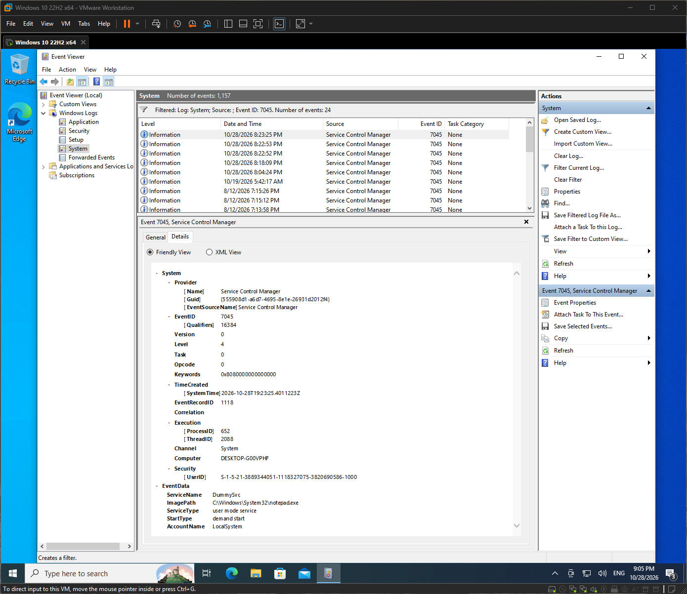
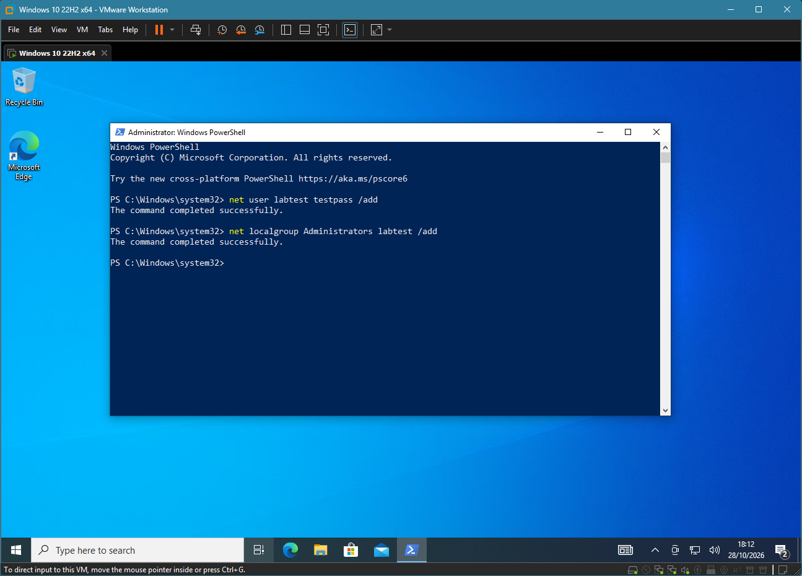
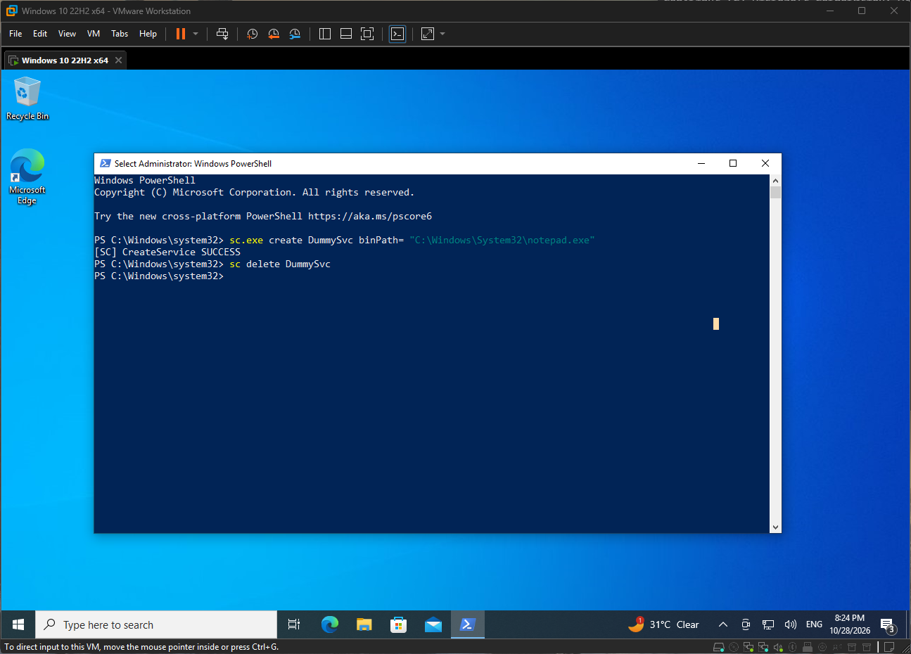

# Q5. Windows basics

| Concept | What it is | Why a defender cares |
|---|---|---|
| Processes | Running programs, each with a process ID and a parent | Odd parent/child pairs and unknown processes can signal malware |
| Services | Background programs, often starting at boot, often as SYSTEM | New or oddly named services are a common persistence method |
| Registry | Database of system and user settings, in hives (HKLM, HKCU, HKCR, HKU, HKCC) | Run keys and similar locations are used to persist after reboot |
| Users and groups | Local accounts and groups such as Administrators and Users | New accounts or additions to Administrators are high-value events |
| UAC | User Account Control asks for approval before admin-level actions | Limits damage from running as a standard user; bypasses are an attacker goal |

## The three main Event Viewer logs
| Log | What it records | Example |
|---|---|---|
| Application | Events from installed applications | An app crash |
| Security | Logons, account changes, auditing (needs audit policy) | 4624, 4625, 4720, 1102 |
| System | Windows components, drivers and services | 7045 (service installed) |

## How this shows up in my lab
- I used Event Viewer on my Windows VM to find 4625, 4624, 4720, 4732, 7045 and 1102.

- 7045 was in the **System** log; the rest were in the **Security** log.

    

- I created `labtest` with `net user` and added it to Administrators, then deleted it afterwards.

    

- I created and deleted a service with `sc.exe`. In PowerShell plain `sc` didn't work because it is an alias for `Set-Content`.

    