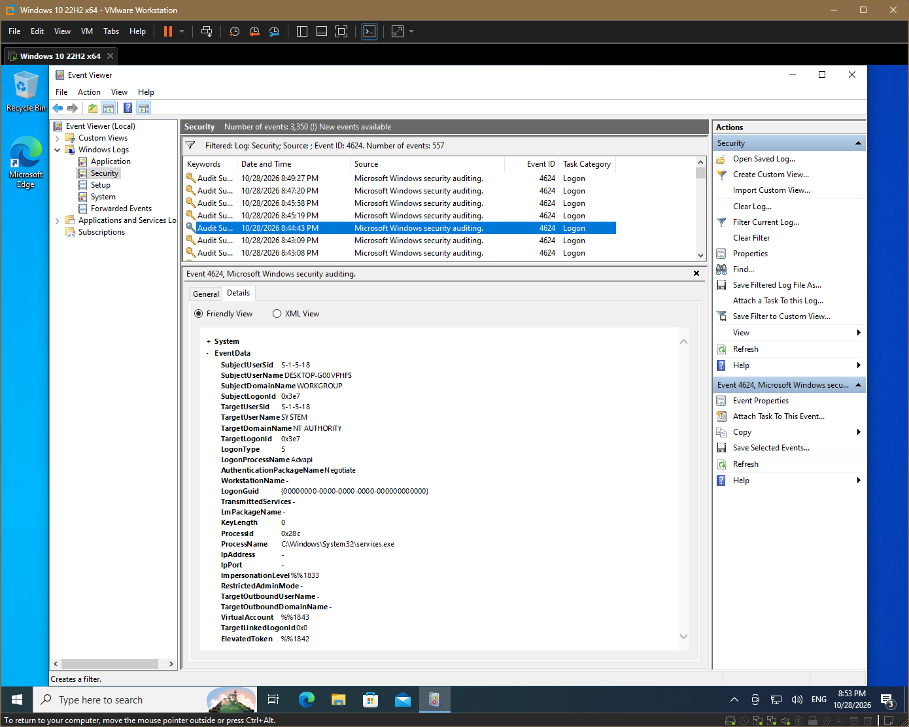
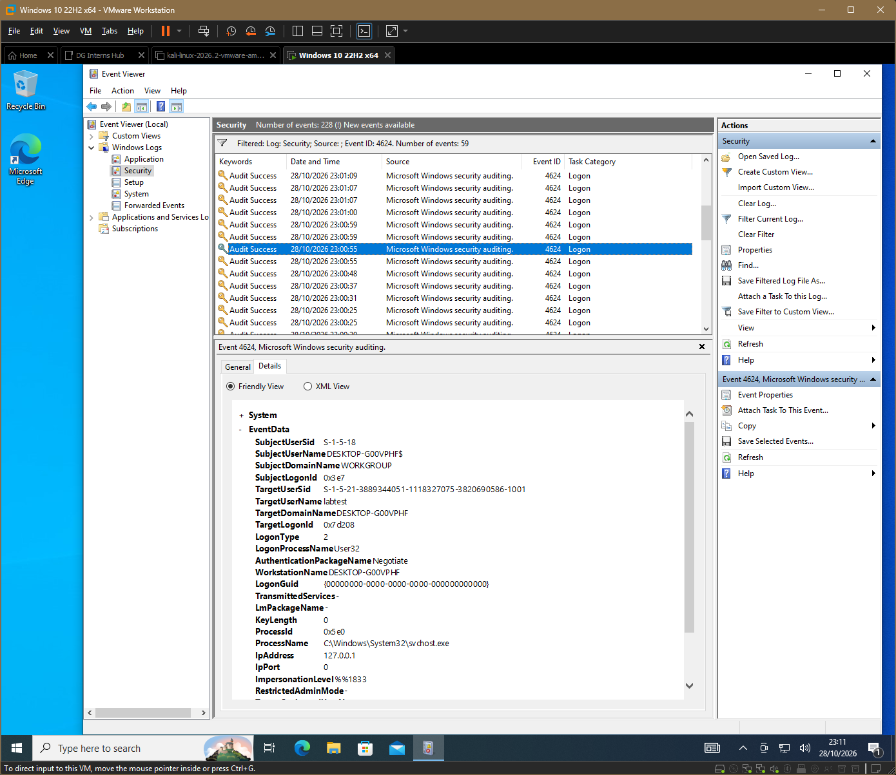

# Q7. Windows logon types

| Type | Name | Meaning | Normal example | Suspicious example |
|---|---|---|---|---|
| 2 | Interactive | Someone signs in at the keyboard | A user signs in at their PC | A server console login at 3 a.m. by an account that never does that |
| 3 | Network | Access to a shared resource over the network | Opening a file share | Many failed type 3 logons from one IP across many accounts |
| 4 | Batch | A scheduled task runs | A nightly backup job | A new scheduled task running as an admin account |
| 5 | Service | A service starts under its account | Windows services starting at boot | An unknown service account or a service created minutes earlier |
| 7 | Unlock | A locked workstation is unlocked | A user returns from a break | Unlock activity on a machine nobody should be using |
| 10 | RemoteInteractive | Remote Desktop (RDP) | Admin connects to a server from a jump host | RDP from an unfamiliar external IP |
| 11 | CachedInteractive | Sign-in using cached credentials | Laptop user off the office network | Cached admin sign-in on a machine they never use |

## How to read it
- Look at the logon type together with the account, source IP and time.
- Type 5 is very common and mostly noise; type 3 and 10 deserve attention from unknown sources.

## How this shows up in my lab
- The first 4624 I found was **type 5** (a service logon), which is normal background noise.

    

- Signing in as the new `labtest` user gave me **type 2**.

    

- My failed `net use` attempts were network logons (type 3); my lock-screen failure was logon (type 2).
    
    Check [failed-4625](../Findings/windows-events/failed-4625.csv)