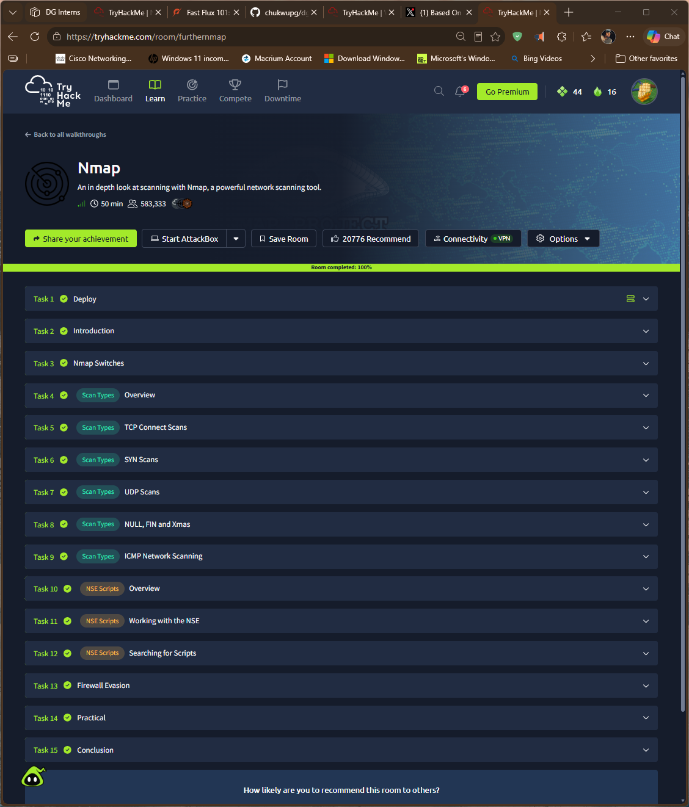
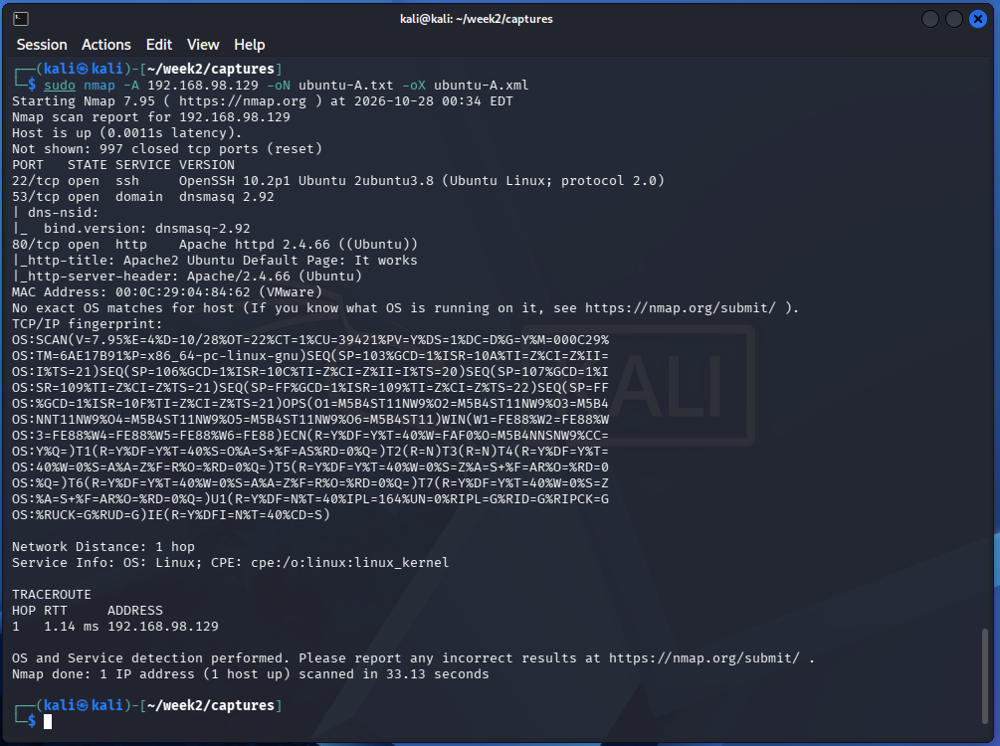
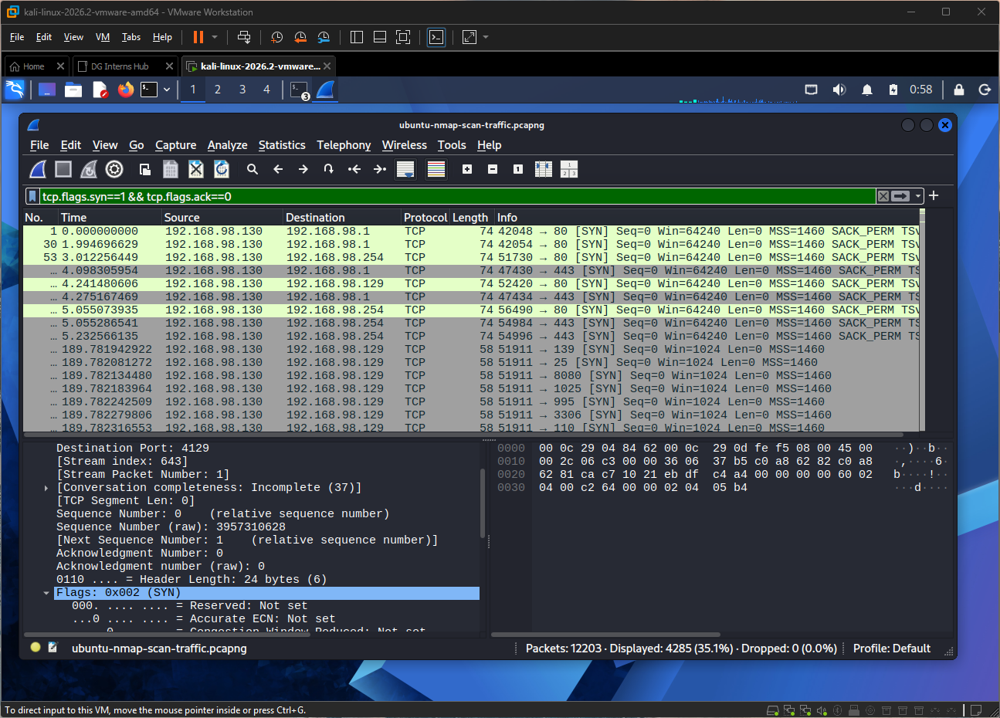

# Nmap (TryHackMe)

**Link:** https://tryhackme.com/room/furthernmap 

## Goal
Learn the main Nmap switches and scan types, how NSE scripts work, and how scans are tuned around firewalls. 

## Task-by-task
| Task | What it covered | My note |
|---|---|---|
| 1 Deploy | Starting the target machine | Deployed the provided lab machine, connected the THM network using VPN, and tested reachability to the lab machine using ping |
| 2 Introduction | What Nmap is and why port scanning matters | Introduces port scanning as a fundamental enumeration technique for identifying open, closed, and filtered ports on target systems. Explains how Nmap discovers network services and why port scanning is essential before attempting exploitation. |
| 3 Nmap Switches | Options for help, ports, output, timing, service and OS detection. | Introduces Nmap command-line switches and how they modify scan behaviour. Covers using nmap -h and man nmap to explore available options and understand scan configurations. |
| 4 Scan Types Overview | The scan types and which need root | Introduces Nmap's major port scanning techniques: TCP Connect (-sT), SYN Stealth (-sS), and UDP (-sU) scans, alongside Null (-sN), FIN (-sF), and Xmas (-sX) scans. Also introduces ICMP ping scanning for host discovery. |
| 5 TCP Connect (-sT) | Full three-way handshake scan | Explains how TCP Connect scans establish a complete TCP three-way handshake (SYN, SYN/ACK, ACK) with target ports to determine their states. Open ports respond with SYN/ACK, closed ports respond with RST, while firewalls that silently drop packets cause ports to be classified as filtered. |
| 6 SYN Scans (-sS) | Half-open scan: SYN, then RST after SYN/ACK | Explains how SYN scans perform half-open TCP connections by sending a SYN packet and responding to the target's SYN/ACK with an RST packet instead of completing the three-way handshake. This makes SYN scans faster and less likely to be logged by applications than TCP Connect scans. |
| 7 UDP Scans (-sU) | Slower; no reply often means open\|filtered | Explains how UDP scans identify open and closed UDP ports despite UDP being connectionless and lacking a handshake or guaranteed acknowledgements. Open ports may be classified as open|filtered when no response is received, while closed ports typically return an ICMP Destination Unreachable (Port Unreachable) message. |
| 8 NULL, FIN, Xmas | Unusual flag scans that depend on RFC behaviour | Explains three TCP scan techniques that send packets without the SYN flag to identify closed ports and potentially evade firewalls. NULL (-sN) sends no TCP flags, FIN (-sF) sends only the FIN flag, while Xmas (-sX) sends FIN, PSH and URG flags. |
| 9 ICMP Network Scanning | Ping sweeps to find live hosts (-sn) | Explains how Nmap performs host discovery using ping sweeps to identify active devices across a network without scanning their ports. The -sn switch uses ICMP echo requests, ARP requests on local networks (with sufficient privileges), and TCP probes to ports 80 and 443 to determine host availability. |
| 10-12 NSE | Script categories, running scripts, finding scripts | Explores the Nmap Scripting Engine (NSE), its Lua-based scripts, categories and practical usage for automated reconnaissance, vulnerability detection, authentication testing and exploitation. Covers executing individual or multiple scripts, passing script arguments, accessing script documentation, and locating or installing NSE scripts locally. |
| 13 Firewall Evasion | Options that change how probes look (-Pn, -f, decoys, and similar) | Explores Nmap techniques for scanning hosts protected by firewalls and IDS solutions. Introduces -Pn to skip host discovery when ICMP traffic is blocked, alongside packet fragmentation, scan delays and invalid checksums for testing firewall behaviour. |
| 14 Practical | Scanning and enumeration practice | Applied Nmap scanning techniques against the lab machine to identify host availability, enumerate port states and understand firewall behaviour. Practised ICMP ping checks, Xmas scans, TCP SYN scans, TCP Connect scans with Wireshark packet analysis, and NSE-based FTP anonymous authentication testing. |

## Commands used
| Command | What it does |
|---|---|
| `nmap -sT <target>` | TCP connect scan |
| `sudo nmap -sS <target>` | SYN scan |
| `sudo nmap -sU <target>` | UDP scan |
| `sudo nmap -sN/-sF/-sX <target>` | NULL / FIN / Xmas scans |
| `nmap -sn <range>` | Host discovery only |
| `nmap -sV -O -A <target>` | Version, OS, and aggressive detection |
| `nmap --script <name> <target>` | Run an NSE script |
| `nmap -Pn <target>` | Skip host discovery |

## Screenshot

## What I learned
## What I Learned

- Understood the importance of port scanning and network enumeration in identifying live hosts, open ports, running services and potential attack surfaces before exploitation.
- Learned the differences between TCP Connect (`-sT`), SYN (`-sS`), UDP (`-sU`), NULL (`-sN`), FIN (`-sF`) and Xmas (`-sX`) scans, including their packet behaviours, advantages and limitations.
- Learned how to perform ICMP host discovery and ping sweeps using `-sn` to identify active hosts across IP ranges and CIDR subnets.
- Understood TCP three-way handshake operations (SYN, SYN/ACK and ACK) and how Nmap interprets responses to determine port states: `open`, `closed`, `filtered` and `open|filtered`.
- Explored the Nmap Scripting Engine (NSE), its Lua-based scripts and categories, including `safe`, `intrusive`, `vuln`, `exploit`, `auth`, `brute` and `discovery`.
- Practised executing NSE scripts by category or name, passing script arguments, accessing script help and searching for installed scripts in `/usr/share/nmap/scripts/`.
- Learned firewall evasion techniques using `-Pn`, `-f`, `--mtu`, `--scan-delay` and `--badsum`, and how firewall configurations influence scan results.
- Understood how to use Wireshark to inspect Nmap scan traffic, analyse TCP connection behaviour and observe the three-way handshake.
- Applied Nmap enumeration techniques in a practical lab environment, including port scanning, host discovery and FTP anonymous authentication testing using the `ftp-anon` NSE script.

## How this shows up in my lab
- I ran -sn, -sS, -sV, -O and -A against my Ubuntu VM (192.168.98.129) and my Windows VM (192.168.98.131) and saved the output with -oN and -oX.

    

- I captured the -sS scans (`ubuntu-nmap-scan-traffic.pcapng`, `windows-nmap-scan-traffic.pcapng`) and found the SYN burst with `tcp.flags.syn==1 && tcp.flags.ack==0`.

    
