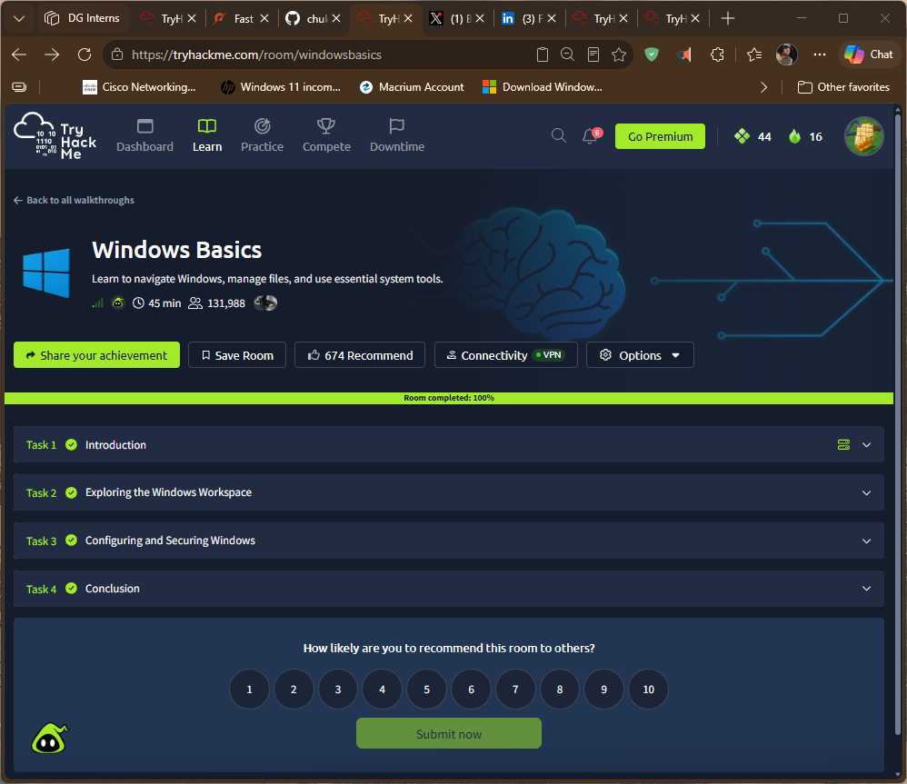
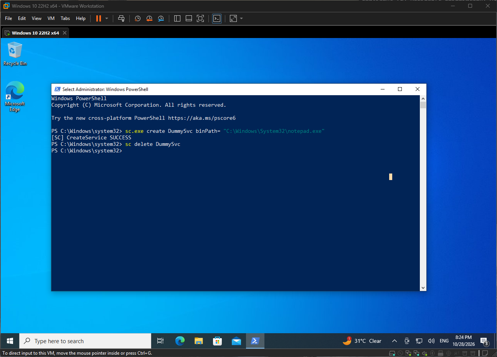
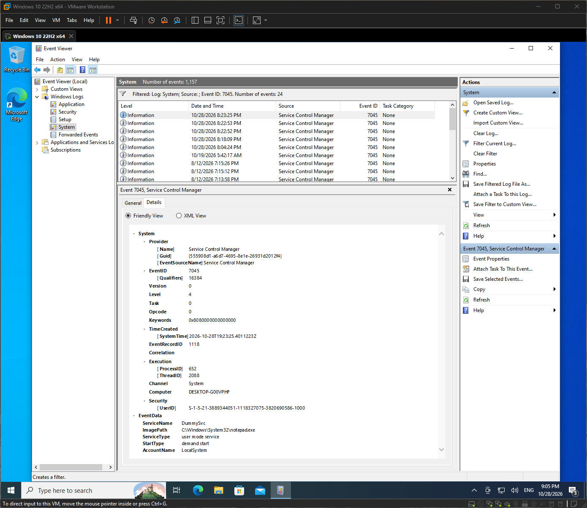

# Windows Basics (TryHackMe)

**Link:** https://tryhackme.com/room/windowsbasics

## Goal
Learn to navigate Windows, manage files, and use essential system tools.

## Task-by-task
| Task | What it | My note |
| ---- |-------- | -------- |
| 1. Introduction  | Windows fundamentals, learning objectives and onboarding scenario  | Introduced Windows as a desktop operating system and outlined the practical skills covered in the room, including desktop navigation, file management, system configuration, performance monitoring and basic security.                                                                                               |
| 2. Exploring the Windows Workspace  | Windows desktop, Start menu, built-in tools, system information and File Explorer | Explored Windows authentication and account types (Guest, Standard and Administrator), desktop components, Start menu, built-in applications and the Settings app. Used About your PC to inspect system information and File Explorer to navigate folders, locate files and understand Windows file paths.            |
| 3. Configuring and Securing Windows | Application management, system settings, Task Manager and native Windows security | Learned how to update, install and uninstall applications using Windows Update, trusted installers, Settings and Control Panel. Explored Task Manager for monitoring processes and resource usage, Windows Security for malware scans, and Windows Defender Firewall for managing network profiles and traffic rules. |

## Screenshot

## What I Learned

- Windows uses user accounts and authentication to control access to system resources. Standard and Administrator accounts have different permission levels, making account privileges an important part of system security.
- The Windows Desktop, Taskbar and Start menu provide access to applications, files, settings and system tools.
- File Explorer uses a hierarchical folder structure to organize files and directories. Understanding Windows paths, such as `C:\Users\Administrator\Desktop`, makes file navigation and management easier.
- Windows provides built-in tools such as Notepad, Calculator, Paint and File Explorer for everyday tasks.
- The Settings app and Control Panel provide different interfaces for configuring Windows. Settings handles modern system configurations, while Control Panel retains access to legacy management options.
- Keeping Windows and installed applications updated helps address security vulnerabilities, fix bugs and improve system stability.
- Applications can be installed through the Microsoft Store or trusted vendor installers, and removed through Settings, Control Panel or their built-in uninstallers.
- Task Manager helps monitor running applications, background processes, CPU and memory usage, logged-in users, process IDs and Windows services.
- Windows Security provides built-in protection through features such as Virus & threat protection, Firewall & network protection, App & browser control and Device security.
- Custom antivirus scans allow specific folders to be checked for potentially malicious files.
- Windows Defender Firewall controls inbound and outbound network traffic using rules and different network profiles: Domain, Private and Public.
- Understanding these built-in Windows tools provides a foundation for system administration, troubleshooting and identifying basic security issues in a Windows environment.

## How this shows up in my lab
- On my Windows VM I created and deleted a dummy service, opened Event Viewer and inspected the event log.

    
    