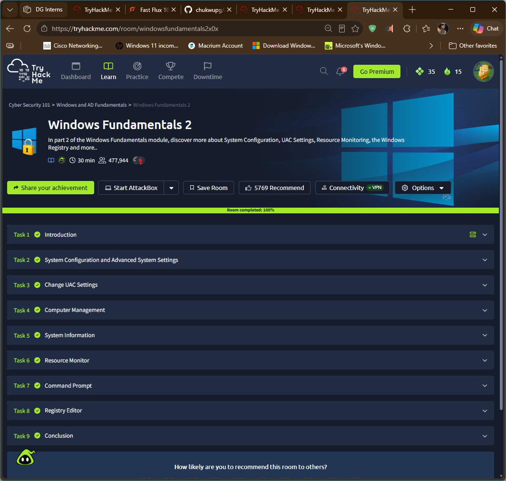
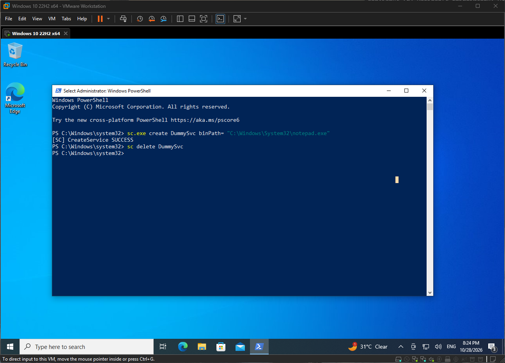
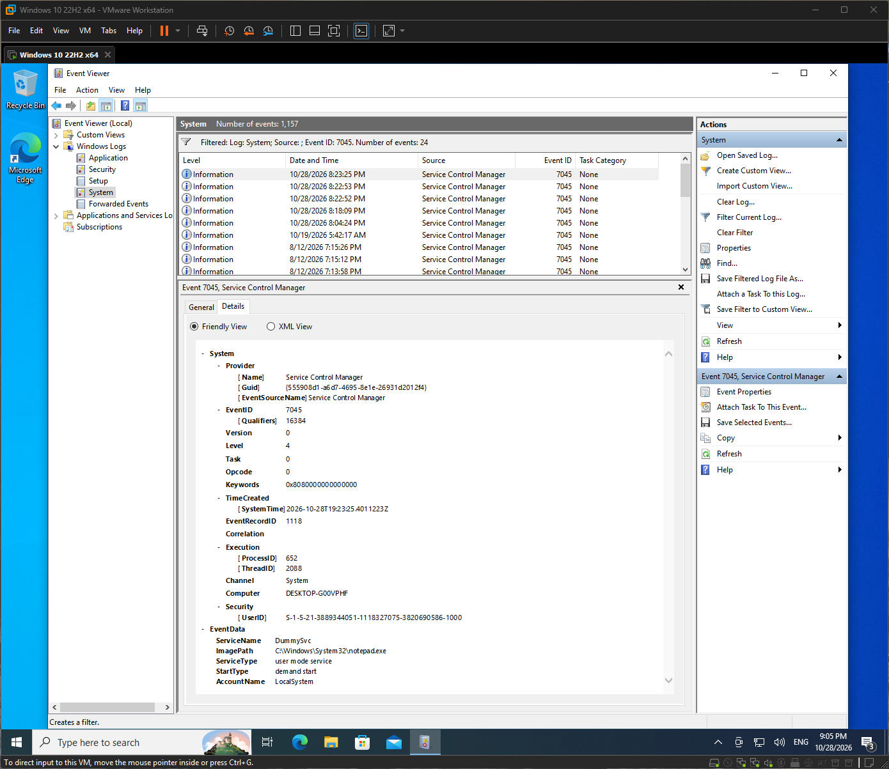

# Windows Fundamentals 2 (TryHackMe)

**Link:** https://tryhackme.com/room/windowsfundamentals2x0x

## Goal
Learn the built-in admin tools: system configuration, Computer Management, System Information, Resource Monitor, Command Prompt and the registry. 

## Task-by-task
| Task | What it covered | My note |
|---|---|---|
| 1. Introduction | Lab environment setup and overview of Windows utilities | Set up the AttackBox and Windows lab machine, with the option to connect through the browser or Remote Desktop Protocol (RDP). Introduced the Windows utilities and administrative tools covered in the room. |
| 2. System Configuration and Advanced System Settings | MSConfig, boot options, services, virtual memory and crash dumps | Explored System Configuration (`msconfig`) and its General, Boot, Services, Startup and Tools tabs. Also examined Advanced System Settings, including page file configuration and memory dump options used for crash troubleshooting. |
| 3. Change UAC Settings | User Account Control notification levels | Explored the four UAC notification levels, from Always Notify to Never Notify. Learned how UAC settings influence the warnings displayed when applications or users attempt system-level changes. |
| 4. Computer Management | Task Scheduler, Event Viewer, shared folders, users, performance, storage and services | Explored Computer Management (`compmgmt.msc`) and its System Tools, Storage, and Services and Applications sections. Learned to inspect scheduled tasks, review event logs, examine network shares and connected sessions, manage local users and groups, monitor performance, manage disks and inspect services. |
| 5. System Information | Hardware resources, system components, software environment and environment variables | Used System Information (`msinfo32`) to inspect hardware specifications, installed components, software details, network connections and environment variables. Also explored its search feature for locating specific system information. |
| 6. Resource Monitor | Per-process CPU, memory, disk and network activity | Explored Resource Monitor (`resmon`) to monitor system resource consumption in real time. Examined the CPU, Memory, Disk and Network tabs to identify processes using system resources and investigate performance issues. |
| 7. Command Prompt | Windows command-line utilities and network troubleshooting commands | Practised commands such as `hostname`, `whoami`, `ipconfig`, `netstat` and `net`. Learned how to access command help using `/?` or `net help`, depending on the command, and clear the terminal using `cls`. |
| 8. Registry Editor | Windows Registry structure and configuration data | Introduced the Windows Registry as a hierarchical database containing system, user, application and hardware configuration information. Explored Registry Editor (`regedit`) and the importance of caution when modifying registry entries. |

## Screenshot

## What I Learned
- System Configuration (msconfig) provides advanced troubleshooting options for diagnosing startup problems, configuring boot behaviour and inspecting system services.
- Windows uses a page file as virtual memory when physical RAM is insufficient. Understanding its configuration helps when investigating memory-related performance issues.
- Windows can generate memory dump files following critical system failures. These dumps provide diagnostic information that administrators can analyse to identify the cause of a crash.
- UAC provides a privilege-control mechanism that prompts users when administrative approval is required. Disabling or weakening these notifications increases the risk of unauthorized system changes.
- Computer Management consolidates several important administrative utilities, including Task Scheduler, Event Viewer, Device Manager, Disk Management and Services.
- Task Scheduler can execute applications and scripts automatically based on configured triggers. Reviewing scheduled tasks is useful when investigating persistence mechanisms used by attackers.
- Event Viewer maintains system and application event records that support troubleshooting, auditing and security investigations.
- Windows network shares, including administrative shares such as C$ and ADMIN$, provide remote access to system resources. Their permissions and active sessions should be reviewed to identify unauthorized access.
- Windows services run in the background and can be configured to start automatically, manually or remain disabled. Unexpected services and suspicious executable paths can indicate potential security issues.
- System Information (msinfo32) provides a detailed overview of hardware, software, system components and environment variables, making it useful for system profiling and troubleshooting.
- Resource Monitor (resmon) provides more detailed, per-process resource information than a general system overview. It helps identify processes responsible for high CPU, memory, disk or network usage.
- The Windows Command Prompt provides useful system and network information through commands such as hostname, whoami, ipconfig and netstat.
- netstat is particularly useful for examining active network connections and listening ports, which can help identify unexpected network activity.
- The Windows Registry stores important configuration data for the operating system, users, applications and hardware. Attackers may abuse registry entries to modify system behaviour or establish persistence, so registry changes require careful investigation.
- Familiarity with these utilities strengthens Windows administration and provides useful starting points for troubleshooting, system enumeration, incident response and security investigations.

## How this shows up in my lab
- I used Event Viewer (under Computer Management) to find 4625, 4624, 4720, 4732, 7045 and 1102 on my Windows VM.

- I created and deleted a service with `sc.exe` (event 7045).

    **Creating a dummy service**
    

    **7045 Triggered in event viewer**
    