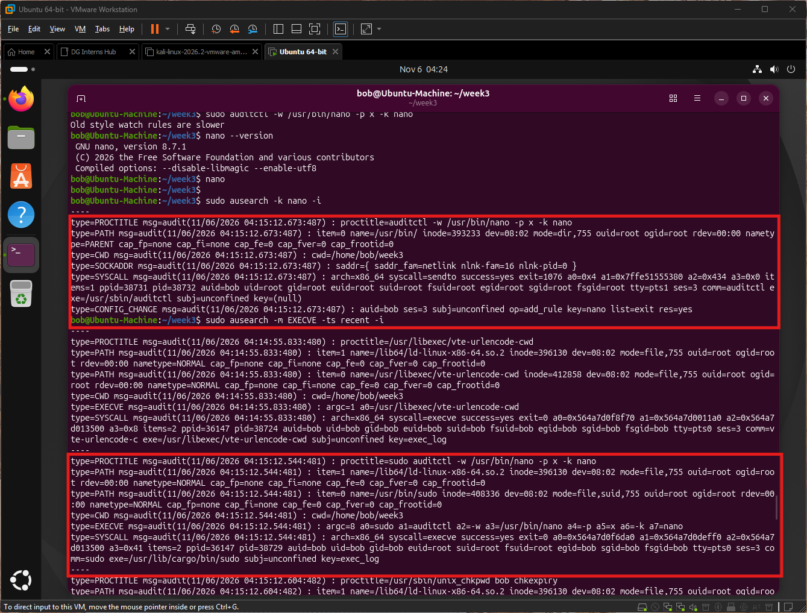

# auditd lab notes (Ubuntu)

## Setup
**OS:** Ubuntu 26.04 LTS (hostname `Ubuntu-Machine`)

**Tool:** auditd 4.1.2

**Lab user account:** `bob`

**Lab Network:** isolated VMware lab network 192.168.98.0/24.

## Steps and evidence
| # | Step | Command | Result |
|---|---|---|---|
| 1 | Install and start | `sudo apt install -y auditd` then `sudo systemctl enable auditd --now` | Service `active (running)` since Fri 2026-11-06 04:00:29 WAT |
| 2 | Log every command execution | `sudo auditctl -a always,exit -F arch=b64 -S execve -k exec_log` | Rule accepted |
| 3 | Watch the nano binary | `sudo auditctl -w /usr/bin/nano -p x -k nano` | Accepted, with the warning "Old style watch rules are slower" |
| 4 | Run nano | `nano --version`, then `nano` | Ran normally |
| 5 | Search the log | `sudo ausearch -k nano -i` and `sudo ausearch -m EXECVE -ts recent -i` | See evidence below |

## Evidence 1: command execution recorded (EXECVE, key=exec_log)
Trimmed from my `ausearch` output:
```
type=EXECVE msg=audit(11/06/2026 04:15:12.544:481) : argc=8 a0=sudo a1=auditctl a2=-w a3=/usr/bin/nano a4=-p a5=x a6=-k a7=nano
type=SYSCALL msg=audit(11/06/2026 04:15:12.544:481) : syscall=execve success=yes exit=0 ppid=36147 pid=38729 auid=bob uid=bob euid=root tty=pts0 ses=3 comm=sudo exe=/usr/lib/cargo/bin/sudo key=exec_log
```
- The full command and every argument were recorded (`a0` to `a7`).
- `auid=bob` (who logged in) stayed the same while `euid=root` (who it ran as) changed because of sudo.

## Evidence 2: rule change recorded (CONFIG_CHANGE, key=nano)
```
type=CONFIG_CHANGE msg=audit(11/06/2026 04:15:12.673:487) : auid=bob ses=3 subj=unconfined op=add_rule key=nano list=exit res=yes
```
- auditd also logs changes to its own rules, which helps detect an attacker tampering with auditing.

### Screenshot


## Fields in the audit log
| Field | Example from my log | Why it is useful |
|---|---|---|
| `type` | EXECVE, SYSCALL, PATH, CWD, PROCTITLE, CONFIG_CHANGE | Kind of record, so I know what I am reading |
| `msg=audit(time:serial)` | `04:15:12.544:481` | Timestamp plus event number; records with the same serial belong to one event |
| `syscall` / `success` / `exit` | execve / yes / 0 | What the program asked the kernel to do, and whether it worked |
| `exe` | `/usr/lib/cargo/bin/sudo` | Full path of the binary that ran |
| `comm` | `sudo` | Short command name |
| `a0, a1, ...` (EXECVE) | `a0=sudo a1=auditctl ...` | The command and its arguments |
| `proctitle` | `sudo auditctl -w /usr/bin/nano -p x -k nano` | Readable command line (shown in full with `-i`) |
| `uid / euid` | `uid=bob euid=root` | Real vs effective user, which shows privilege use |
| `auid` | `bob` | Original login user, which survives sudo |
| `gid` | `bob` | Group of the process |
| `pid / ppid` | 38729 / 36147 | Process and parent, for building a process tree |
| `tty`, `ses` | `pts0`, `3` | Terminal and login session, tying activity to one session |
| `cwd` | `/home/bob/week3` | Directory the command ran from |
| `key` | `exec_log`, `nano` | My own label for searching with `ausearch -k` |
| `subj` | `unconfined` | Security context (AppArmor/SELinux) |

## What I learned
- auditd does not log commands until rules exist, so I added an `execve` rule and a watch rule. The brief's `ausearch -k nano` only works with a rule that sets that key.
- The `-w` watch syntax is the old style. auditd warned it is slower than a syscall rule.
- One event is made of several records (SYSCALL, EXECVE, PATH, CWD, PROCTITLE) that share a serial number.
- `auid` shows who really did the action even after `sudo`, which matters for investigations.
- Rules added with `auditctl` last until reboot, so persistent rules belong in `/etc/audit/rules.d/`.