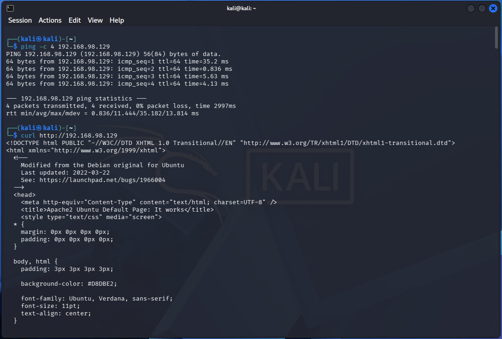
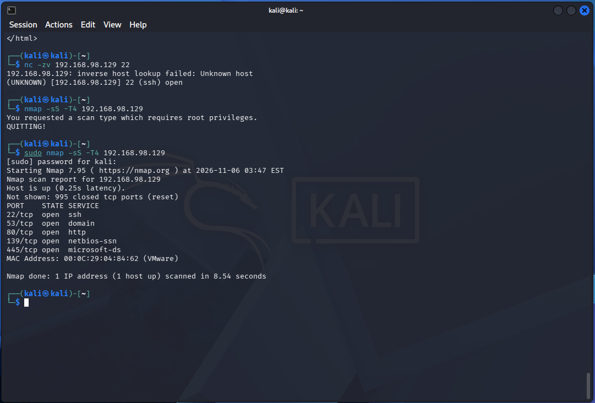
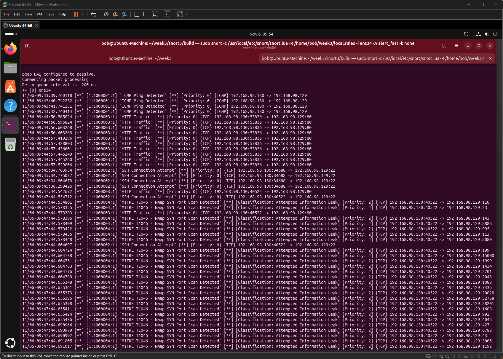

# Snort lab notes

## Setup
| Item | Value |
|---|---|
| Snort | 3.13.2.0, built from source (Ubuntu 26.04 has no Snort apt package) |
| Sensor / target | Ubuntu VM, 192.168.98.129, interface `ens34` |
| Attacker | Kali VM, 192.168.98.130 |
| HOME_NET | `192.168.98.129/32` |
| EXTERNAL_NET | `!$HOME_NET` |
| Config / rules | `/usr/local/etc/snort/snort.lua`, `~/week3/local.rules` loaded with `-R` |
| Mode | Passive (`pcap DAQ configured to passive`), so IDS only |

Why HOME_NET is /32: Kali and Ubuntu share 192.168.98.0/24. If HOME_NET were the whole subnet, Kali would count as home network and the `$EXTERNAL_NET` T1046 rule could never match it.

## Rules (`local.rules`)
```
alert icmp any any -> $HOME_NET any (msg:"ICMP Ping Detected"; sid:1000001; rev:1;)
alert tcp any any -> $HOME_NET 22 (msg:"SSH Connection Attempt"; sid:1000002; rev:1;)
alert tcp any any -> $HOME_NET 80 (msg:"HTTP Traffic"; sid:1000003; rev:1;)
alert tcp $EXTERNAL_NET any -> $HOME_NET any (msg:"MITRE T1046 - Nmap SYN Port Scan Detected"; flags:S; detection_filter:track by_src, count 20, seconds 1; classtype:attempted-recon; metadata:mitre_technique T1046; reference:url,attack.mitre.org/techniques/T1046/; sid:1000004; rev:1;)
```
Validation: `sudo snort -c /usr/local/etc/snort/snort.lua -R ~/week3/local.rules -T` ended with "Snort successfully validated the configuration (with 0 warnings)".

## Challenges and fixes
| Problem | Fix |
|---|---|
| `apt install snort` returned "Unable to locate package" on Ubuntu 26.04 | Built Snort 3 and LibDAQ from source |
| CMake error: dnet header not found | Installed the libdnet development package (`libdumbnet-dev`) |
| `ERROR: local.rules:4 unknown rule keyword: threshold` | Snort 3 does not accept `threshold` in a rule. Replaced it with `detection_filter:track by_src, count 20, seconds 1;` |

## Test results (alerts seen on the console)
| Test from Kali | Time (WAT) | Rule | What I saw |
|---|---|---|---|
| `ping -c 4 192.168.98.129` | 09:43:39 to 09:43:42 | 1000001 ICMP Ping Detected | 4 alerts, 1 per second |
| `curl http://192.168.98.129` | 09:44:56 to 09:44:57 | 1000003 HTTP Traffic | 10 alerts from one connection (source port 53836) |
| `nc -zv 192.168.98.129` | 09:45:34 to 09:45:36 | 1000002 SSH Connection Attempt | 4 alerts (source port 34688) |
| `nmap -sS -T4 192.168.98.129` | 09:47:44 | 1000004 MITRE T1046 | Many alerts across many destination ports (110, 23, 143, 8888, 995 ...), all from source port 40522 |

Example alert lines:
```
11/06-09:43:39.760118 [**] [1:1000001:1] "ICMP Ping Detected" [**] [Priority: 0] {ICMP} 192.168.98.130 -> 192.168.98.129
11/06-09:44:56.565824 [**] [1:1000003:1] "HTTP Traffic" [**] [Priority: 0] {TCP} 192.168.98.130:53836 -> 192.168.98.129:80
11/06-09:45:34.763934 [**] [1:1000002:1] "SSH Connection Attempt" [**] [Priority: 0] {TCP} 192.168.98.130:34688 -> 192.168.98.129:22
11/06-09:47:44.554801 [**] [1:1000004:1] "MITRE T1046 - Nmap SYN Port Scan Detected" [**] [Classification: Attempted Information Leak] [Priority: 2] {TCP} 192.168.98.130:40522 -> 192.168.98.129:110
```

## Screenshot
**Test `ping` and `curl`**


**Testing `SSH connection` and `nmap scan`**


**Logs**


## What I learned
- All four rules fired.
- The T1046 alerts carry `Classification: Attempted Information Leak` and `Priority: 2`. That comes from `classtype:attempted-recon`. The three starter rules have no classtype, so they show `Priority: 0`.
- Starter rules alert on every matching packet. One `curl` produced 10 HTTP alerts. In a real SOC that would be noisy, so rules need tuning with `flow`, content checks or rate limits.
- The scan also tripped the SSH and HTTP rules, because Nmap probed ports 22 and 80.
- All scan alerts share one source port (40522), which is a useful scan signature.
- Time zones: Snort and auditd times are local (WAT). Sysmon `UtcTime` is UTC. I need to convert before correlating them.