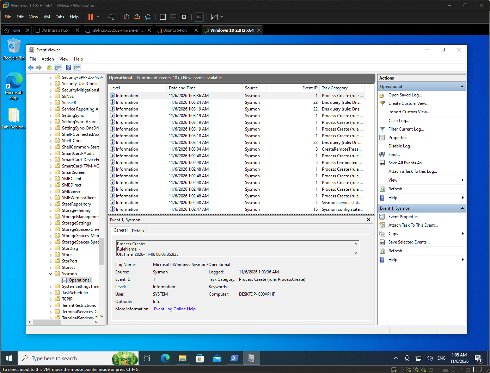

# Sysmon hands-on lab notes

Setup: Sysmon with the SwiftOnSecurity config on my Windows evaluation VM (192.168.98.131), isolated lab network.

| # | Action | EID | UTC time | Key fields | Why it matters to a SOC analyst |
|---|---|---|---|---|---|
| 1 | Open PowerShell | 1 | 2026-11-06 00:13:57 | Image `powershell.exe`, PID 2900, user BasedOnBelieve | Shows every PowerShell launch with hash and user, a common attacker tool. |
| 2 | Create a user | 1 | 2026-11-06 00:22:18 | Image `net1.exe`, CommandLine `net1 user testuser [redacted] /add` | Reveals account creation (persistence) and the exact command. |
| 3 | Network connection | 3 | 2026-11-06 00:43:17 | `powershell.exe`, 192.168.98.131:49910 to 192.168.98.129:8000 | Ties a process to a remote IP and port, helping detect C2 or lateral movement. |
| 4 | Create a file | 11 | 2026-11-06 01:17:51 | `powershell.exe`, `...\Desktop\test.bat` | Shows dropped files and the process that wrote them. |

## Lesson learned
- A `.txt` file created on the Desktop did not log EID 11.
- The SwiftOnSecurity config only logs certain extensions and locations for file creation.
- I found `.bat` in the `FileCreate` block, recreated the file as `test.bat`, and it logged.

- **Key lesson**: Sysmon is only as good as its config. No event can mean a filtering rule.

**Sysmon Operational logs**

See per event screenshots here: [`sysmon-events`](/week-3/Findings/sysmon-events/)