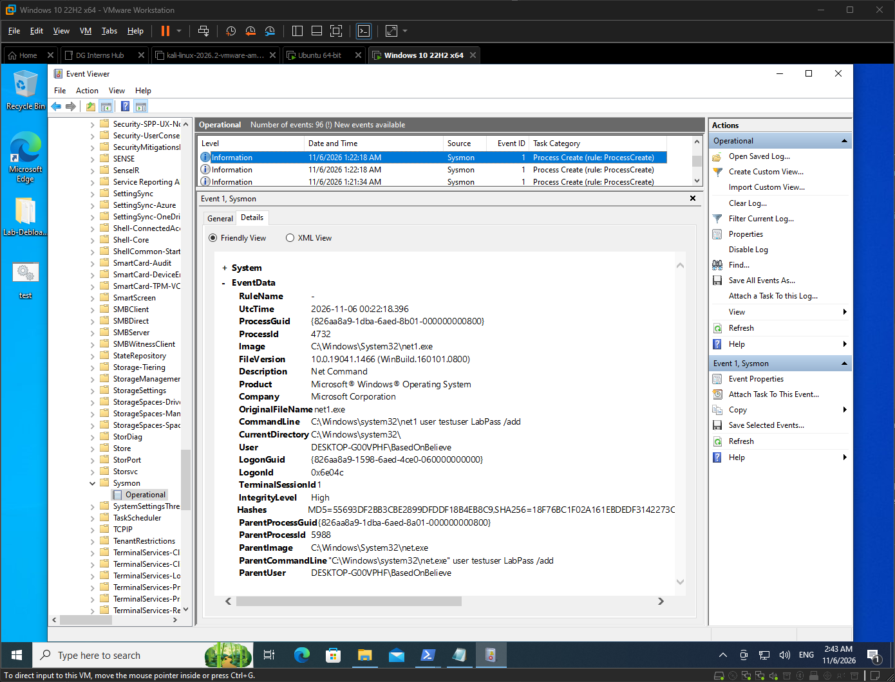
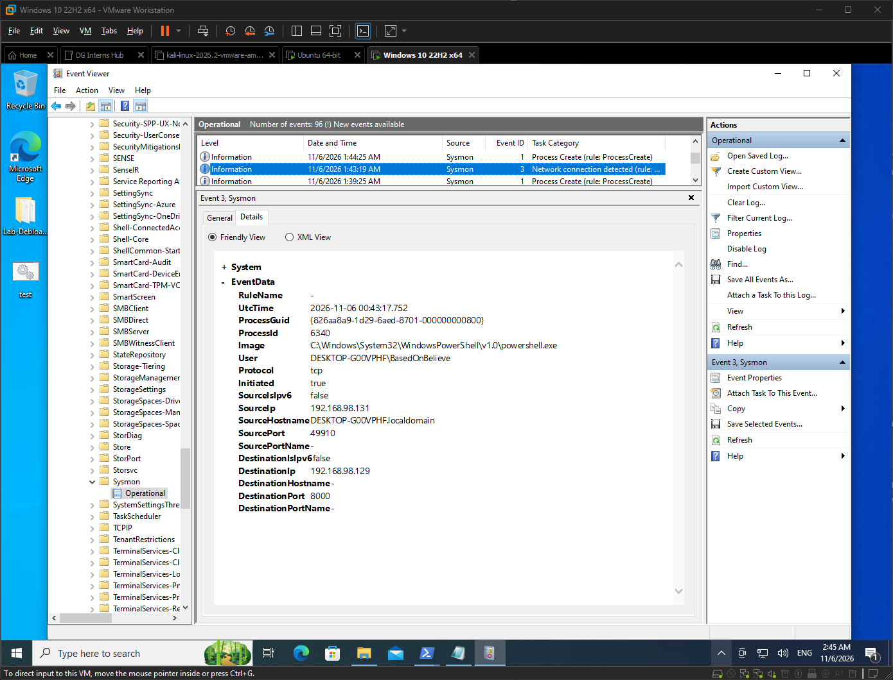

# Q1: What is EDR, and why is endpoint data critical for a SOC analyst?

## What is EDR?
- Endpoint Detection and Response (EDR) is a security tool installed on endpoints (laptops, servers).
- It continuously records endpoint activity, detects suspicious behaviour, and lets analysts investigate and respond.
- Typical capabilities: telemetry collection, behavioural detection, threat hunting, host isolation, process killing.

## Why endpoint data matters to a SOC analyst
- Most attacks end up running something on a host, so the endpoint shows what actually happened.
- Network logs show traffic. Endpoint data shows which process, user and command caused it.
- It helps rebuild an attack timeline (process tree, files dropped, persistence).
- It catches activity that never crosses the network, such as local privilege escalation.
- It gives context for alerts, so false positives can be closed faster.

## EDR vs traditional antivirus
| Area | Traditional antivirus | EDR |
|---|---|---|
| Main method | Signature matching of known malware | Behaviour analysis plus signatures |
| Visibility | Mostly blocks or quarantines files | Records process, network, file and registry activity |
| Unknown threats | Weak against new or fileless attacks | Better at spotting suspicious behaviour |
| Investigation | Limited | Full timeline and search |
| Response | Delete or quarantine | Isolate host, kill process, collect evidence |
| Analyst use | Low | High |

## How this shows up in my lab
- Sysmon on my Windows VM is not a full EDR, but it gives the same kind of endpoint telemetry (process, network, file events).
- Example: Sysmon EID 1 recorded `net1.exe` creating a user, with the full command line.
    

- Example: the same PowerShell process (PID 6340) made a network connection (EID 3) and created `test.bat` (EID 11).
    
    
- On Ubuntu, auditd records commands and logins: [[add your auditd finding]].