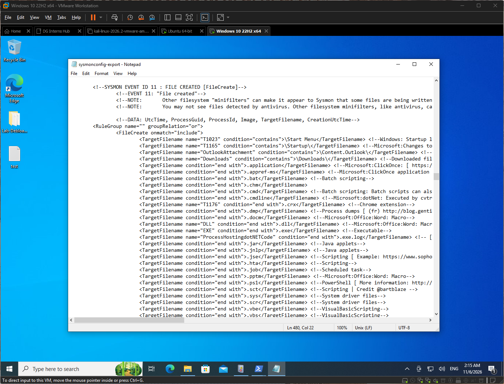
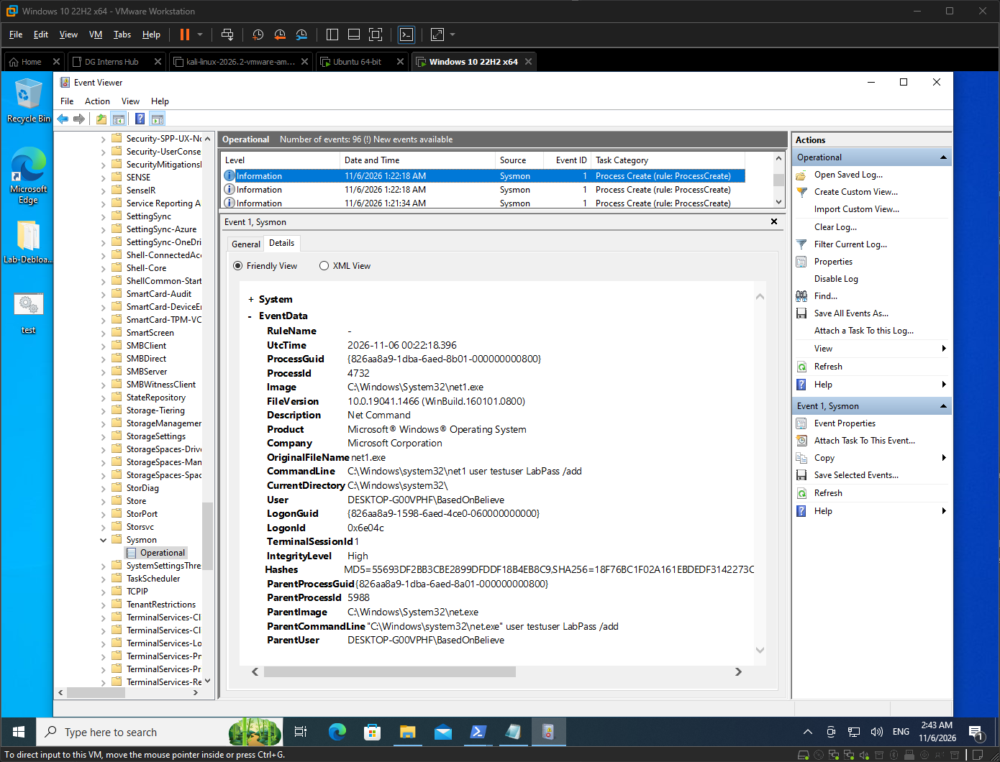
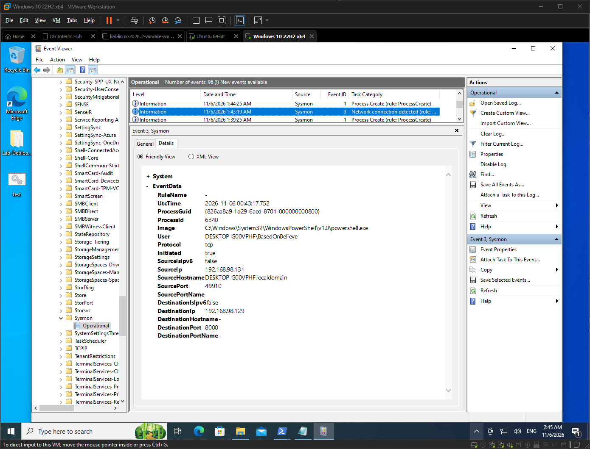
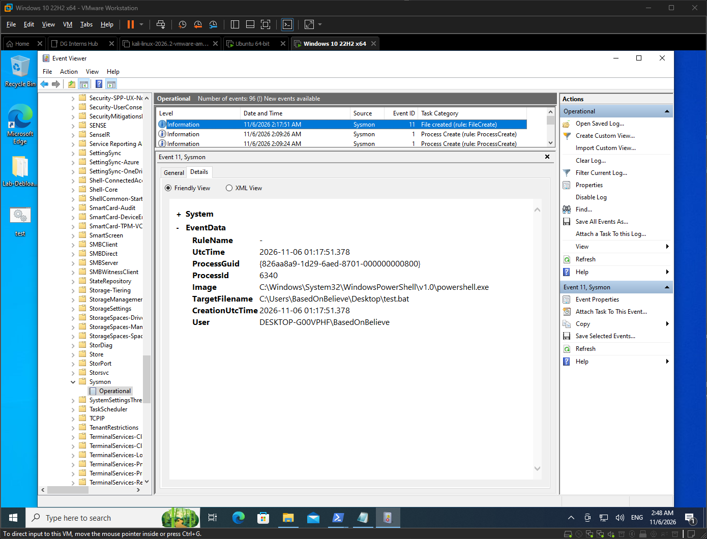

# Q2: What is Sysmon, and how does it differ from standard Windows Event Logs?

## What is Sysmon?
- System Monitor (Sysmon) is a free Microsoft Sysinternals tool.
- It installs as a service and driver and writes detailed endpoint events to its own log.
- Log location: Event Viewer > Applications and Services Logs > Microsoft > Windows > Sysmon > Operational.
- It is configured with an XML file that decides what to log.

## Sysmon vs standard Windows Event Logs
| Area | Standard Windows logs | Sysmon |
|---|---|---|
| Source | Built into Windows | Separate tool you install |
| Process detail | Limited (4688 needs extra policy for command line) | Full command line, parent process, hashes |
| Network connections | Not logged by default | Event ID 3 with process, IPs and ports |
| File/registry/DNS | Limited | Events 11, 13, 22 and more |
| Tuning | Audit policy | XML config with include/exclude rules |

## Key Sysmon Event IDs
| Event ID | Name | What it monitors |
|---|---|---|
| 1 | Process Create | New processes, command line, parent, hashes |
| 3 | Network Connection | Outbound/inbound TCP/UDP with process |
| 11 | File Create | Files created or overwritten |
| 13 | Registry Value Set | Registry values modified (persistence) |
| 22 | DNS Query | DNS lookups made by processes |

## Important: Sysmon only logs what the config says
- I used the SwiftOnSecurity config.
- My `.txt` file creation did not produce Event ID 11.
- I read the `FileCreate` block in the config and found `.bat` in the list.
- Creating `test.bat` logged EID 11 correctly.
- Lesson: "no event" can mean a filtering rule, not no activity. Test your telemetry after tuning.

**SwiftOnSecurity config showing included extensions**

## How this shows up in my lab
| Action | EID | Key detail |
|---|---|---|
| Open PowerShell | 1 | Image `powershell.exe`, user `BasedOnBelieve` |
| Create user | 1 | Image `net1.exe`, CommandLine shows the `user testuser [redacted] /add` command |
| Network check | 3 | 192.168.98.131 to 192.168.98.129:8000 |
| Create `.bat` file | 11 | TargetFilename `...\Desktop\test.bat` |

### Screenshots

**Open PowerShell**

**Create User**

**Network Check**

**Create `.bat` File**
