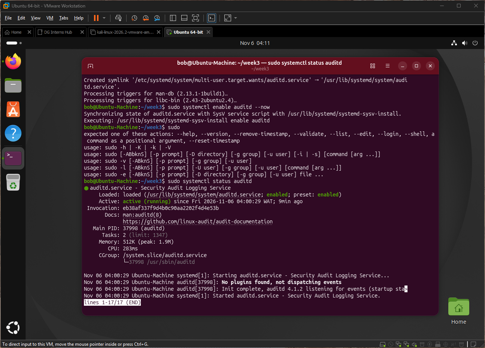
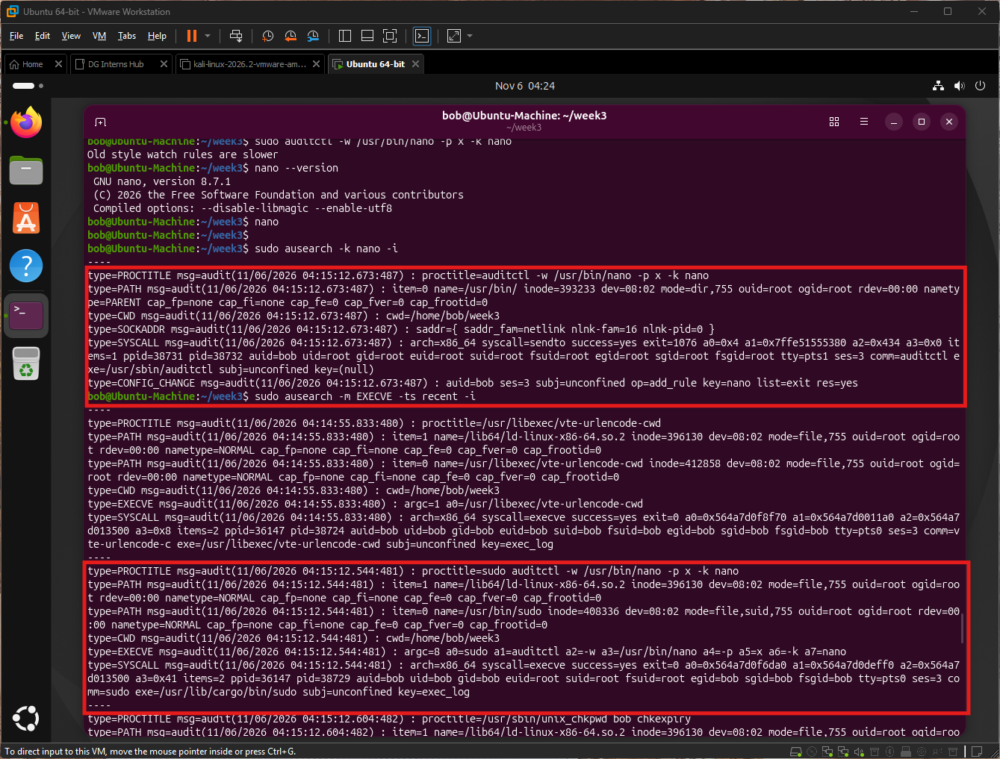

# Q3: What is auditd on Linux, and how does it differ from syslog?

## What is auditd?
- auditd is the user-space daemon of the Linux Audit framework.
- The kernel generates audit records (system calls, file access, logins, rule changes) and auditd writes them to `/var/log/audit/audit.log`.
- What gets recorded is controlled by rules (`auditctl` or files in `/etc/audit/rules.d/`).

## How it works
- Kernel audit subsystem detects an event that matches a rule.
- It sends a record to auditd, which writes it to the log file.
- Records share a serial number, so one event is made of several records (SYSCALL, EXECVE, PATH, CWD...).
- Tools: `ausearch` (search), `aureport` (summaries), `auditctl` (manage rules).

## auditd vs syslog
| Area | auditd | syslog (rsyslog) |
|---|---|---|
| Source of data | Kernel audit subsystem | Applications and system services |
| Focus | Security auditing: who did what, with which syscall | General system and app messages |
| Depends on the app? | No, the kernel records it even if the app says nothing | Yes, the app must send the message |
| Log file | `/var/log/audit/audit.log` | `/var/log/syslog`, `/var/log/auth.log` |
| Format | `key=value` records with timestamp and serial | Text line with timestamp, host, program, message |
| Detail | Very high (user IDs, process IDs, arguments) | Varies by application |
| Setup | Needs rules to be useful | Works out of the box |
| Volume | Can be very large | Usually moderate |
| Tools | `ausearch`, `aureport` | `grep`, `journalctl`, SIEM forwarding |

## When a SOC uses each
- auditd: investigate commands run, file access, privilege use, rule tampering.
- syslog: service errors, login messages, application behaviour, general troubleshooting.
- Best used together, forwarded to a SIEM.

## How this shows up in my lab
- I installed auditd 4.1.2 on Ubuntu 26.04. It was `active (running)` but had no rules until I added one.

    

- Rule `-a always,exit -F arch=b64 -S execve -k exec_log` recorded the full command `sudo auditctl -w /usr/bin/nano -p x -k nano` with `auid=bob`, `euid=root` and `exe`.

    

- Adding the watch rule produced a `CONFIG_CHANGE` record, so even auditing changes were audited.
- Snort and auditd times are local (WAT), a reminder to align time zones across sources.

