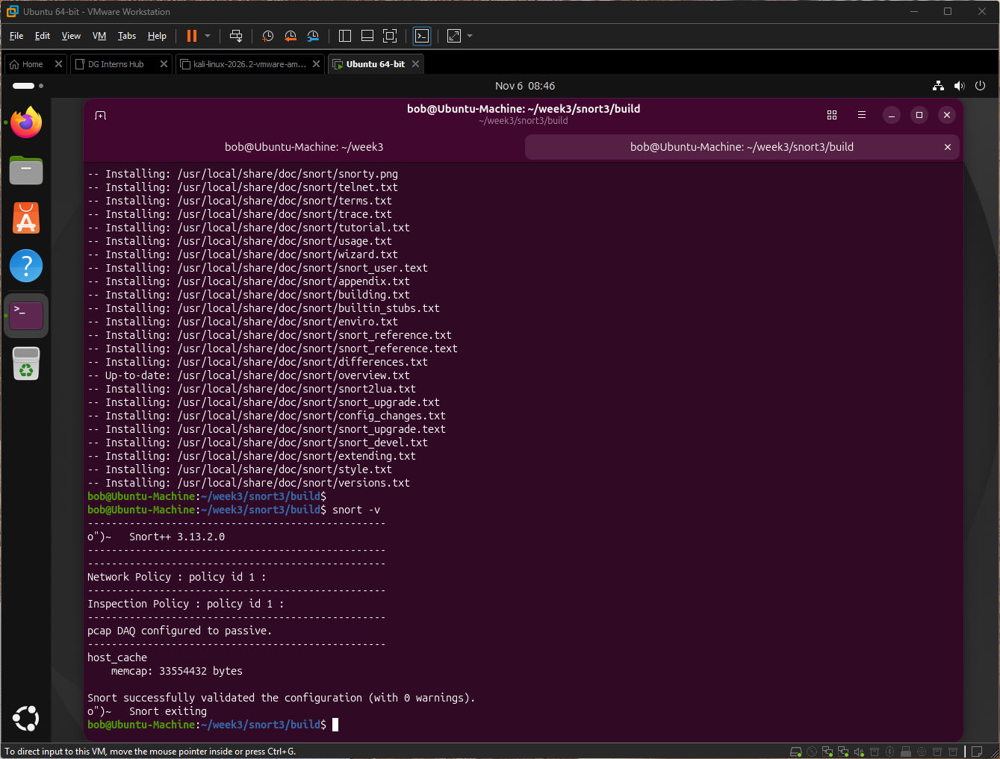
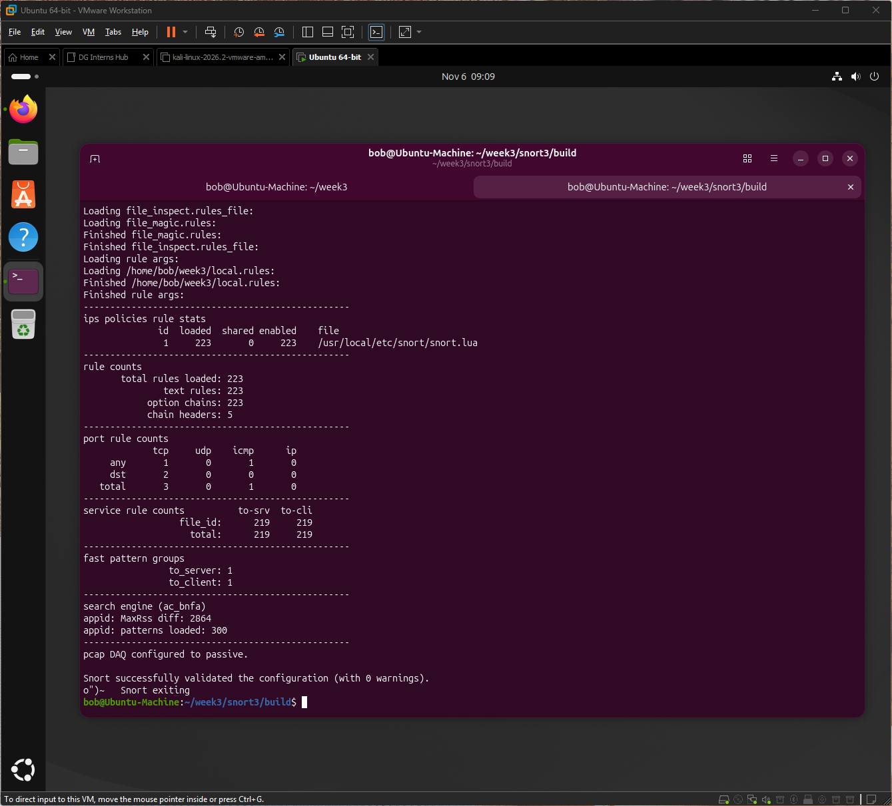
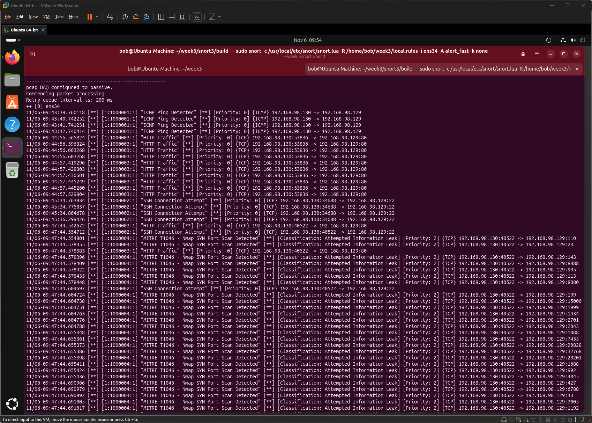
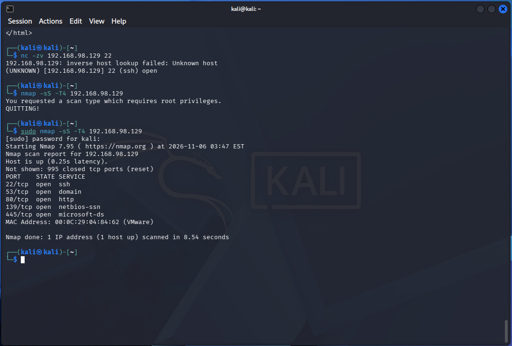

# Q4: How does Snort work, and what is IDS mode vs IPS mode?

## How Snort works
- Snort reads packets from the network interface using a DAQ (data acquisition) module.
- Packets are decoded, then inspectors/preprocessors reassemble streams and understand protocols.
- The detection engine compares traffic against rules.
- A match triggers an action (alert, log, or in IPS mode drop) and is written to the output.

| Stage | Role |
|---|---|
| Packet acquisition (DAQ) | Captures packets from an interface or queue |
| Decode / inspectors | Parse protocols and reassemble streams |
| Detection engine | Match packet data against rules |
| Output | Alerts and logs |

## IDS vs IPS mode
| Area | IDS (detection) | IPS (prevention) |
|---|---|---|
| Placement | Passive, watching a copy of traffic (span/tap) | Inline, traffic must pass through Snort |
| Action | Alert and log | Can drop or reject malicious packets |
| Effect on traffic | None | Can block legitimate traffic by mistake |
| Failure risk | May miss an attack if nobody reads alerts | A fault or bad rule can interrupt the network |
| Setup | Simple | Needs inline-capable DAQ and careful tuning |

## When a SOC uses each
- IDS: monitoring internal networks, testing and tuning new rules, gathering evidence, low risk to production.
- IPS: blocking well-tuned, high-confidence threats at the edge (for example known exploits or scans).
- Common practice: run new rules in IDS mode first, then move proven rules to IPS.

## How this shows up in my lab
- Snort 3.13.2.0 started with `pcap DAQ configured to passive`, so it ran as an IDS: it alerted but blocked nothing.

    

- Validation listed inspectors loaded, such as `stream`, `http_inspect`, `ssh` and `dns`.

    

- It watched interface `ens34` and alerted on Kali traffic: ping, curl, an SSH connection and an Nmap SYN scan.

    

- Because it was passive, the Nmap scan still completed. An IPS rule using `drop` could have stopped it.

    