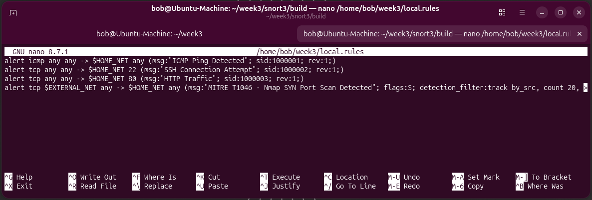
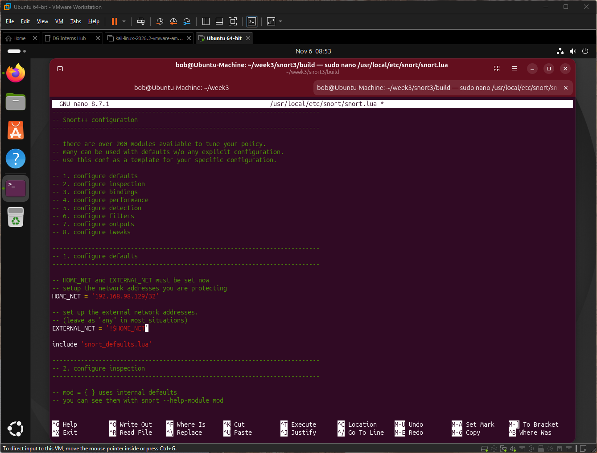

# Q5: Structure of a Snort rule

A rule has a **header** and **options** in parentheses:

`action protocol src_ip src_port direction dst_ip dst_port (option; option; ...)`

## Header breakdown
Using my rule `alert tcp any any -> $HOME_NET 22 (...)`:

| Part | Value | Meaning |
|---|---|---|
| Action | `alert` | What to do on a match (alert, log, pass, drop, reject...) |
| Protocol | `tcp` | tcp, udp, icmp or ip |
| Source IP / port | `any any` | Any source address and port |
| Direction | `->` | Source to destination |
| Destination IP / port | `$HOME_NET 22` | My protected host, port 22 |

## Rule options
| Option | Purpose | Example |
|---|---|---|
| `msg` | Text shown in the alert | `msg:"SSH Connection Attempt";` |
| `sid` | Unique rule ID (1,000,000 and above is the usual range for local rules) | `sid:1000002;` |
| `rev` | Rule revision number | `rev:1;` |
| `flags` | TCP flags to match | `flags:S;` (SYN) |
| `flow` | Direction and connection state | `flow:to_server,established;` |
| `threshold` | Limit alerts by count and time (Snort 2 rule option) | `threshold:type threshold, track by_src, count 20, seconds 1;` |
| `detection_filter` | Alert only after a rate is exceeded (works in Snort 3) | `detection_filter:track by_src, count 20, seconds 1;` |
| `classtype` | Category and priority from the classification file | `classtype:attempted-recon;` |
| `metadata` | Extra tags (for example MITRE) | `metadata:mitre_technique T1046;` |
| `reference` | Link to more info | `reference:url,attack.mitre.org/techniques/T1046/;` |

## Full example (my T1046 rule)
```
alert tcp $EXTERNAL_NET any -> $HOME_NET any (msg:"MITRE T1046 - Nmap SYN Port Scan Detected"; flags:S; detection_filter:track by_src, count 20, seconds 1; classtype:attempted-recon; metadata:mitre_technique T1046; reference:url,attack.mitre.org/techniques/T1046/; sid:1000004; rev:1;)
```
- Header: TCP traffic from outside my network to my network, any port.
- `flags:S` matches SYN packets, which Nmap's SYN scan sends.
- `detection_filter` alerts only when one source sends more than the set rate, which separates scans from normal connections.
- `classtype` sets the category, and `metadata`/`reference` map it to ATT&CK T1046.



## How this shows up in my lab
- The brief's rule used `threshold`. Snort 3.13.2.0 rejected it with `unknown rule keyword: threshold`, so I used `detection_filter`.
- The three starter rules have no `classtype`, so alerts showed `Priority: 0`. The T1046 rule showed `Classification: Attempted Information Leak` and `Priority: 2`.
- Starter rules have no `flow`, `flags` or content checks, so one `curl` produced 10 HTTP alerts.
- `HOME_NET` set to `192.168.98.129/32` so Kali counted as `$EXTERNAL_NET` in order for T1046 to trigger.

    

- Link to custom rule: [`rules.local`](/week-3/snort-rules/local.rules)