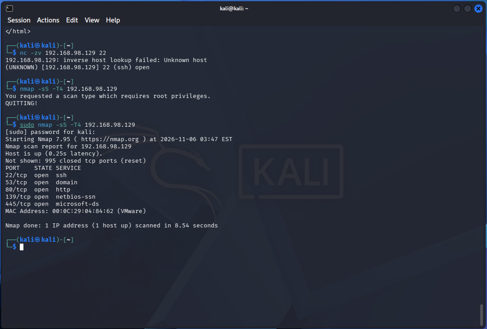
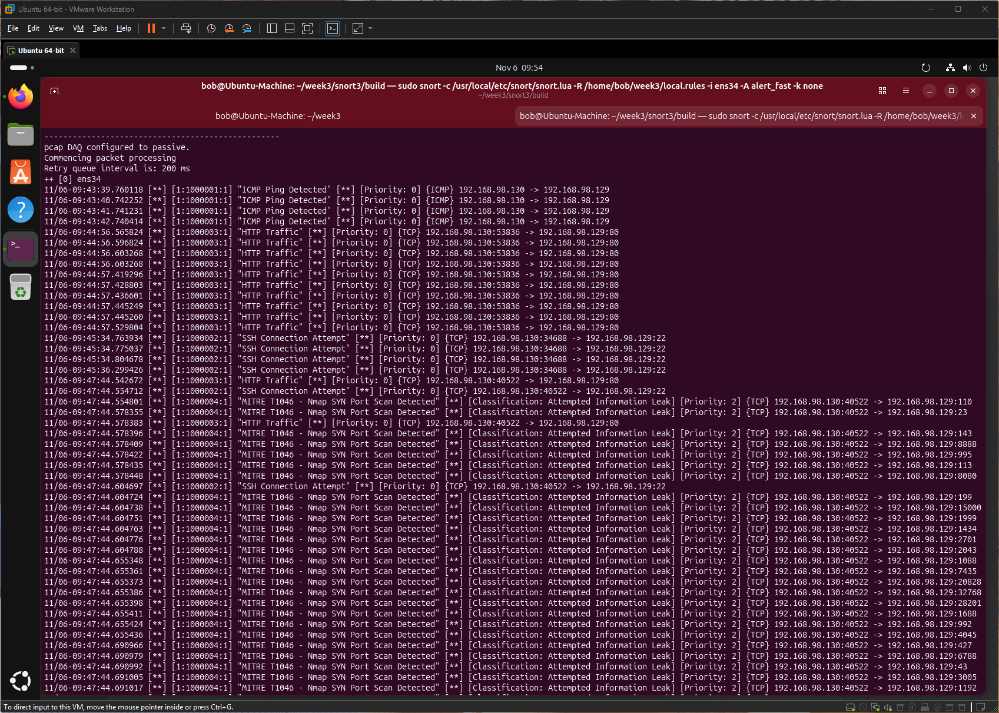

# Q7: MITRE ATT&CK T1046 and mapping Snort rules to techniques

## What is T1046?
| Item | Detail |
|---|---|
| Name | Network Service Discovery (previously named Network Service Scanning) |
| ID | T1046 |
| Tactic | Discovery (TA0007) |
| Sub-techniques | None |
| Idea | Attackers list services running on remote hosts and network devices, including ones that may be vulnerable |
| Typical tools | Port scanners such as Nmap, built-in utilities |
| Platforms | Includes Windows, Linux, macOS, containers, cloud, network devices |

- Goal for the attacker: build a map of which systems are reachable and what services they run, to pick the next target.
- Defender view: scanning from an unusual host or segment is a strong early warning.

## How Snort rules map to MITRE techniques
| Method | How it helps |
|---|---|
| `metadata:mitre_technique T1046;` | Tags the rule with the technique ID so tools can group alerts |
| `reference:url,attack.mitre.org/techniques/T1046/;` | Links the analyst to the official technique page |
| `msg:"MITRE T1046 - ..."` | Technique ID visible in every alert line |
| `classtype:attempted-recon;` | Puts it in the right category and priority |
| A mapping table (sid to technique) | Lets the SOC measure ATT&CK coverage |

## Example (my rule)
```
alert tcp $EXTERNAL_NET any -> $HOME_NET any (msg:"MITRE T1046 - Nmap SYN Port Scan Detected"; flags:S; detection_filter:track by_src, count 20, seconds 1; classtype:attempted-recon; metadata:mitre_technique T1046; reference:url,attack.mitre.org/techniques/T1046/; sid:1000004; rev:1;)
```
| Part | Why it maps to T1046 |
|---|---|
| `flags:S` | Nmap SYN scans send SYN packets to many ports |
| `detection_filter ... count 20, seconds 1` | Many SYNs in a short time from one source looks like service discovery |
| `metadata`, `reference`, `msg` | State the mapping explicitly |

## How this shows up in my lab
- I ran an Nmap SYN scan from Kali (192.168.98.130) against Ubuntu (192.168.98.129).

    

- Snort raised many `MITRE T1046 - Nmap SYN Port Scan Detected` alerts across ports such as 110, 23, 143, 8888 and 995, all from source port 40522.

    

- Alerts showed `Classification: Attempted Information Leak` and `Priority: 2`, which comes from `classtype:attempted-recon`.

- The brief's rule used `threshold`, which Snort 3.13.2.0 rejected, so I used `detection_filter` and kept the same metadata and reference.

- Evidence: [`Findings/snort-lab-notes.md`](/week-3/Findings/snort-lab-notes.md).
