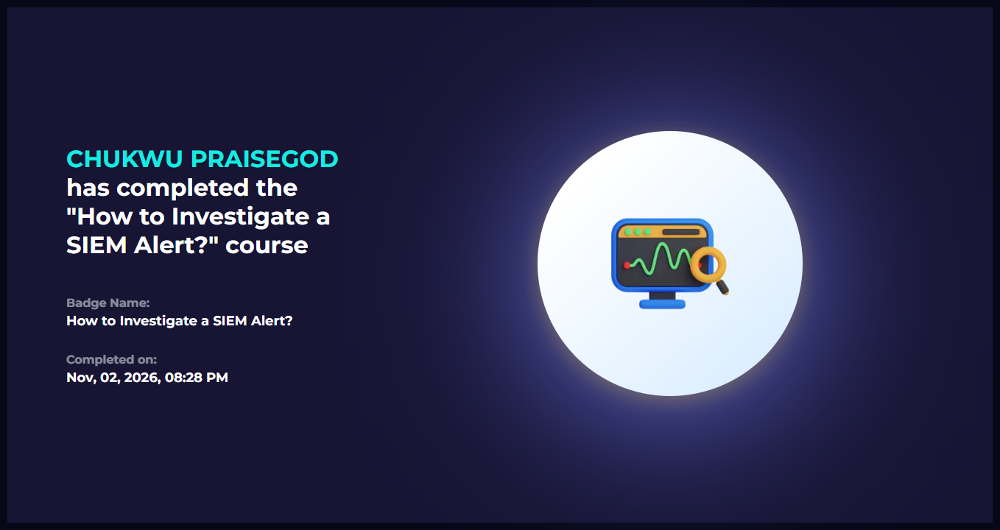

# LetsDefend: How to Investigate a SIEM Alert

- Lesson: https://app.letsdefend.io/training/lessons/how-to-investigate-a-siem-alert
- Status: completed
- Goal: learn how a SOC analyst takes a SIEM alert from first sight to a decision: false positive or real threat, and what to do next.

## Sections covered
| Section | Focus | What I learned |
|---|---|---|
| Introduction to SIEM Alerts | What an alert is and why it fires | An alert is a lead to verify, not a verdict |
| Detection | Telling false positives from True positives | Check the alert's context before deciding |
| Case Creation and Playbook Initiation | Opening a case and following a playbook | A playbook keeps investigations consistent |
| Email Analysis | Investigating suspicious emails | Look at sender, links and attachments |
| Network and Log Analysis | Checking traffic and logs related to the alert | Correlate the alert with network and log evidence |
| Endpoint Analysis | Analysing and containing the affected host | Endpoint data shows what actually ran |

## Evidence

## What I learned
- Investigation follows a path: understand the alert, decide if it is real, open a case, gather evidence from email, network and endpoint, then act.
- A false positive and a real threat can look similar at first, so context decides.
- Endpoint and log evidence is what confirms or rejects the alert.

## How this shows up in my lab
- My Snort T1046 alerts are the kind of alert I would triage: source 192.168.98.130 scanning 192.168.98.129.
- To investigate, I would check that the source is my own Kali VM (an authorised test), then compare with Sysmon and auditd on the target host.
- See [`Findings/snort-lab-notes.md`](/week-3/Findings/snort-lab-notes.md) and [`Notes/q08-windows-vs-sysmon-vs-auditd.md`](/week-3/Notes/q08-windows-vs-sysmon-vs-auditd.md).