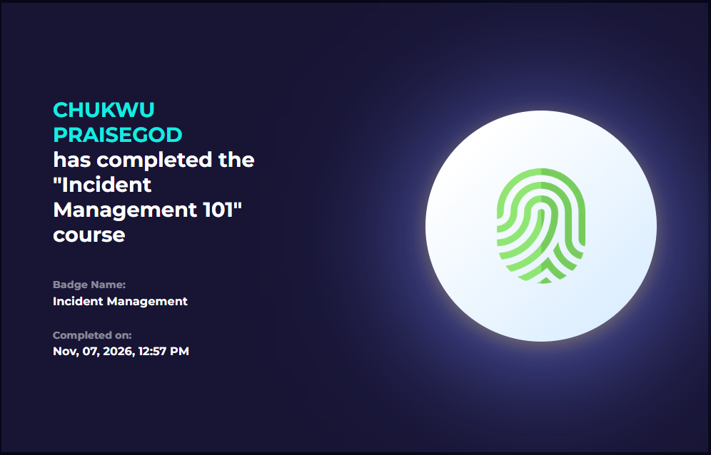

# LetsDefend: Incident Management 101

- Course: LetsDefend training library
- Status: completed
- Goal: learn the basics of how security incidents are managed in a SOC.

## Sections covered
| Section | Focus | What I learned |
|---|---|---|
| Introduction to Incident Management | Why it matters | Incidents need a structured response, not improvisation |
| Basic Definitions About Incident Management | Key terms | Shared vocabulary avoids confusion in a team |
| Incident Management Systems (IMS) | Tools for tracking incidents | One place to record and investigate cases |
| Case/Alert Naming | Naming conventions | Following a unified naming convention helps during investigations and retrospective inquiries by aiding quick search of relevant record or extracting statistics easily when an investigation is made. |
| Playbooks | Step-by-step response guides | Playbooks make response repeatable and consistent |
| What Does the SOC Analyst Do When An Alert Occurs? | Analyst workflow | Triage, investigate, document, escalate or close |

## Evidence

## What I learned
- Incident management is a process with roles, tools and documentation.
- Good naming and notes help the next analyst pick up a case.
- Playbooks reduce mistakes under pressure.

## How this shows up in my lab
- My weekly work followed a similar rhythm: detect (Snort alert), investigate (Sysmon and auditd), document (Findings notes).
- Writing clear titles like `MITRE T1046 - Nmap SYN Port Scan Detected` in my rule message is the same habit as clear case naming.
- See [`Findings/snort-lab-notes.md`](/week-3/Findings/snort-lab-notes.md).