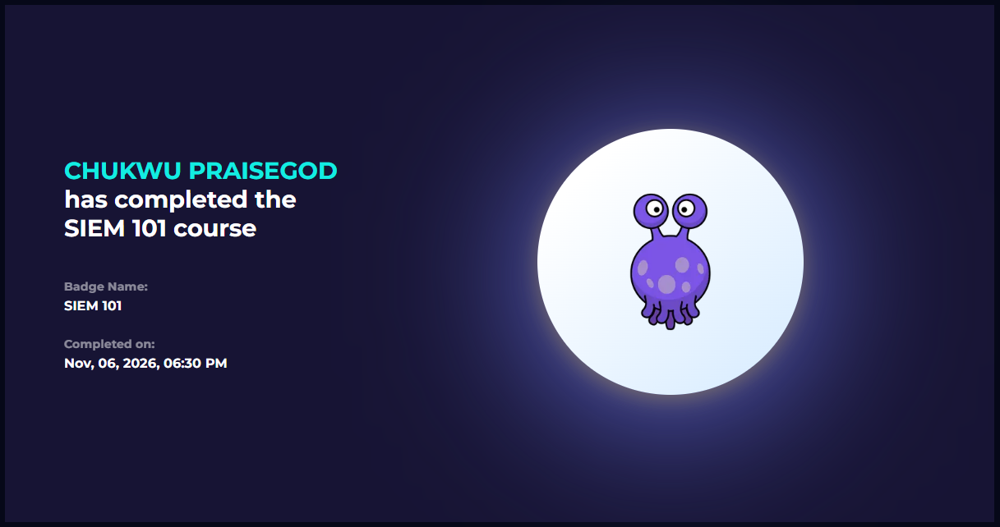

# LetsDefend: SIEM 101

- Course: LetsDefend training library
- Status: completed
- Goal: understand how a SIEM works, from collecting logs to creating alerts.

## Sections covered
| Section | Focus | What I learned |
|---|---|---|
| SIEM Introduction | What a SIEM is and does | A realtime solution to monitor, collect, detect potential threat, and alert on logs |
| Log Collection | How logs get into the SIEM | Agents, syslog and other methods bring logs in |
| Log Aggregation and Parsing | Combining and structuring logs | Raw text must be filtered/split into fields to be searchable |
| Log Storage | Where and how log data is stored | Storage and retention, and speed of accessing logs affect cost and investigations |
| Alerting | Detecting abnormal behavior using logs | Rules create alerts when patterns match |

## Evidence

## What I learned
- A SIEM is a pipeline: collect, parse, store, then detect and alert.
- Parsing makes logs from different sources comparable.
- Good alerts depend on good rules and clean data.

## How this shows up in my lab
- My log sources were Sysmon (Windows), auditd (Ubuntu) and Snort alerts, each in a different format and time zone.
- I did not install a SIEM this week. A Snort rule is similar to a SIEM alert rule, because both match a pattern and raise an alert.
- See [`Notes/q10-log-ingestion-to-siem.md`](/week-3/Notes/q10-log-ingestion-to-siem.md).