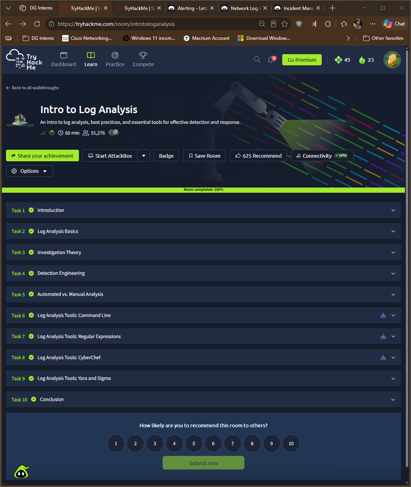

# TryHackMe: Intro to Log Analysis

- Room: https://tryhackme.com/room/introtologanalysis
- Status: completed 100%
- Goal: learn how analysts investigate logs, write detections, choose between manual and automated analysis, and use common tools.

## Tasks covered
| Task | Focus | What I took away (edit in my own words) |
|---|---|---|
| Log Analysis Basics | Core ideas | What I am looking for and why |
| Investigation Theory | How to approach an investigation | Work from a question or hypothesis to evidence |
| Detection Engineering | Turning findings into detections | A good detection is specific and testable |
| Automated vs. Manual Analysis | Where each fits | Automation for volume, manual for judgement |
| Command Line | Text tools for logs | Fast filtering and counting |
| Regular Expressions | Pattern matching | One pattern can match many log variations |
| CyberChef | Decoding and transforming data | Useful for encoded or obfuscated strings |
| Yara and Sigma | Rule formats | Yara for files, Sigma for log events |

## Commands and tools I used
| Command | Purpose |
|---|---|
| `cat` `grep`, `sort`, `uniq`, `cut` | Filter and summarise log text |
| `sed`, `awk` | manipulate, extract, and transform log data |
| `wc` | provides information about the number of lines, words, and characters in a log file |
| `less` | Page by page view of log files |
| `tail` | Viewing the end of log files |
| `sudo ausearch ...` | Search audit records |
| CyberChef | Used for Encoding and decoding data, encryption and hashing algorithms, data analysis; such as parsing log files and extracting data |
| Yara | Pattern-matching tool that identifies information based on binary and textual patterns | 
| Sigma | Describes log events in a structured format | 

## Evidence

## What I learned
- Detection engineering is writing rules that find known bad behaviour with few false alarms.
- Sigma describes detections for logs in a shareable format, similar to how Snort rules describe network detections.
- Regex and command-line tools do most daily log filtering.

## How this shows up in my lab
- Writing my Snort T1046 rule was detection engineering: a pattern (SYN flag), a threshold (`detection_filter`), a category and a MITRE tag.
- I tested it by running Nmap from Kali, then checked the alerts.
- See [`Notes/q06-signature-vs-anomaly-detection.md`](/week-3/Notes/q06-signature-vs-anomaly-detection.md) and [`Notes/q07-mitre-t1046-and-snort-mapping.md`](/week-3/Notes/q07-mitre-t1046-and-snort-mapping.md).