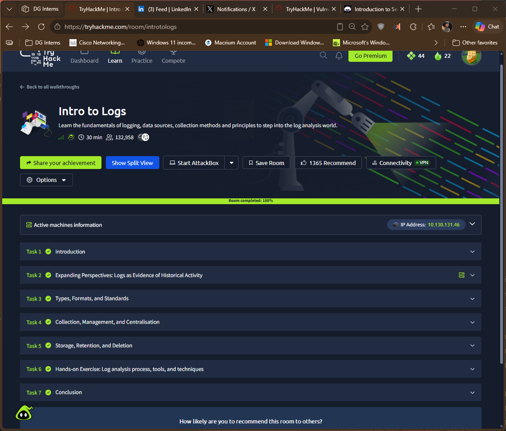

# TryHackMe: Intro to Logs

- Room: https://tryhackme.com/room/introtologs
- Status: completed
- Goal: understand what logs are, the types and formats they come in, how they are collected, stored and retained, and the basic process for analysing them.

## Tasks covered
| Task | Focus | What I took away (edit in my own words) |
|---|---|---|
| Logs as Evidence of Historical Activity | Logs as a record of what happened | Logs let an analyst rebuild a timeline after the fact |
| Types, Formats, and Standards | Kinds of logs and how they are written | Different sources use different formats, so they need parsing |
| Collection, Management, and Centralisation | Gathering logs in one place | Central collection makes searching and correlation possible |
| Storage, Retention, and Deletion | How long logs are kept and why | Retention balances investigation needs, cost and policy |
| Hands-on: Log analysis process, tools, techniques | Practical analysis | Follow a repeatable process, then use tools to find answers |

## Process and tools I used in task 6
| Command | Purpose |
|---|---|
| `cat` `grep`, `sort`, `uniq`, `cut` | View, filter, and summarise log text |
| `sed`, `awk` | manipulate, extract, and transform log data |
| `less` | Page by page view of log files |
| `tail` | Viewing the end of log files |
| `Get-FileHash`, `sha256sum` | Hashing log files | 

## Evidence

## What I learned
- A log is only useful if it is collected, kept long enough and understood.
- Different formats and clocks make correlation harder, so normalisation matters.
- Retention is a policy decision, not just a storage setting.

## How this shows up in my lab
- My three sources used three formats: Sysmon (Windows event log), auditd (`key=value` records) and Snort (`alert_fast` text lines).
- Timestamps differed too: Sysmon `UtcTime` is UTC, while auditd and Snort used local time (WAT).
- See `Notes/q10-log-ingestion-to-siem.md`.