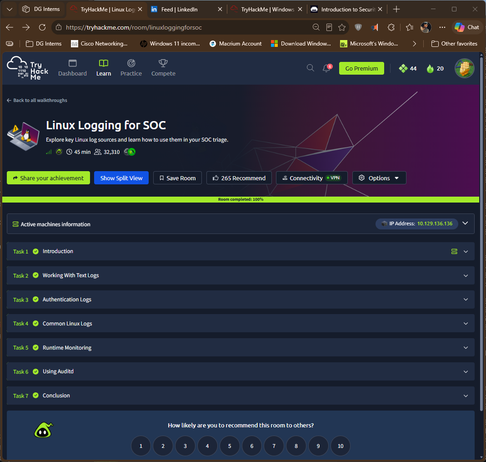

# TryHackMe: Linux Logging for SOC

- Room: https://tryhackme.com/room/linuxloggingforsoc
- Status: completed 100%
- Goal: learn how to read and investigate Linux logs, from text logs and authentication records to runtime monitoring and auditd.

## Tasks covered
| Task | Focus | What I Learned |
|---|---|---|
| Working With Text Logs | Command-line tools for reading logs | Filter and count log lines quickly instead of reading them by eye |
| Authentication Logs | Login, failed login and sudo records | Failed and successful logins show brute force and privilege use |
| Common Linux Logs | Where Linux keeps logs | Know which file answers which question |
| Runtime Monitoring | Watching activity as it happens | Live monitoring complements stored logs |
| Using Auditd | Audit rules and searching audit records | auditd records detail that normal logs do not |

## Commands I used
| Command | Purpose |
|---|---|
| `ls` `cat` `grep`, `head`| View and search log text |
| `sudo ausearch ...` | Search audit records |

## Evidence

## What I learned
- Text tools turn a large log into answers (who, how often, from where).
- Authentication logs are a first stop for brute force and suspicious sudo use.
- auditd gives command-level detail, with rules deciding what is recorded.

## How this shows up in my lab
- I installed auditd 4.1.2 on Ubuntu 26.04 and added `-a always,exit -F arch=b64 -S execve -k exec_log`.
- `ausearch` showed the full command, including `auid=bob` and `euid=root` after `sudo`.
- Details: [`Findings/auditd-lab-notes.md`](/week-3/Findings/auditd-lab-notes.md) and [`Notes/q03-auditd-vs-syslog.md`](/week-3/Notes/q03-auditd-vs-syslog.md)
