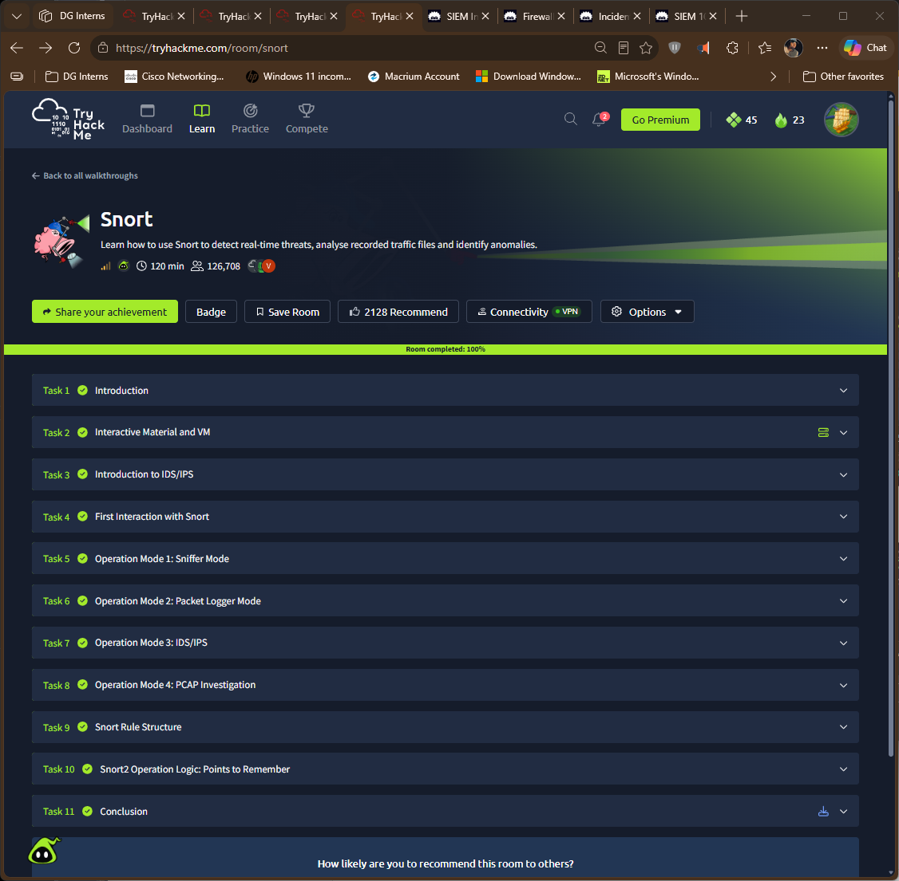

# TryHackMe: Snort

- Room: https://tryhackme.com/room/snort
- Status: completed
- Goal: learn how Snort works as an IDS/IPS and use its four operation modes: sniffer, packet logger, IDS/IPS and PCAP investigation, plus rule structure.

## Tasks covered
| Task | Focus | What I took away (edit in my own words) |
|---|---|---|
| Introduction to IDS/IPS | Concepts | IDS alerts, IPS can also block |
| First Interaction with Snort | Getting started | Checking the version and the configuration |
| Sniffer Mode | Live packet reading | Prints packets to the screen without detecting anything |
| Packet Logger Mode | Saving packets | Writes traffic to log files for later review |
| IDS/IPS Mode | Rule-based detection | Applies rules from a config file to generate alerts |
| PCAP Investigation | Reading saved captures | Run Snort against a recorded capture file |
| Snort Rule Structure | Rule header and options | Action, protocol, addresses, ports, then options |
| Snort2 Operation Logic | Points to remember | Rule order and behaviour details I need to keep in mind |

## Commands I used
| Command | Mode / purpose |
|---|---|
| `snort -V` | Shows the instance version |
| `snort -c <config> -T` | To test a config file | 
| `snort -v` (with `-d`, `-e` for more detail) | Sniffer mode |
| `snort -l <dir>` | Packet logger mode |
| `snort -c <config> -A console` | IDS mode with console alerts |
| `snort -r <file.pcap>` | Read a PCAP file |

## Evidence

## What I learned
- Snort has distinct modes, and the command-line options decide which one runs.
- Rules are simple: a header says which traffic, options say what to match and how to report it.
- Testing rules on a PCAP is a safe way to tune them before using them live.

## How this shows up in my lab
| Item | TryHackMe room | My lab |
|---|---|---|
| Snort version | Snort 2 (per the task title) | Snort 3.13.2.0, built from source |
| Config file | <!-- CHECK: write the config file the room used --> | `snort.lua`, rules loaded with `-R local.rules` |
| Rate limit in a rule | `threshold` (Snort 2 style) | Rejected as `unknown rule keyword: threshold`, replaced with `detection_filter` |
| Mode | IDS and others | Passive (`pcap DAQ configured to passive`), IDS only |
- I wrote four rules and all fired during ping, curl, SSH and Nmap tests from Kali.
- Details: `Findings/snort-lab-notes.md` and `Notes/q05-snort-rule-structure.md`.