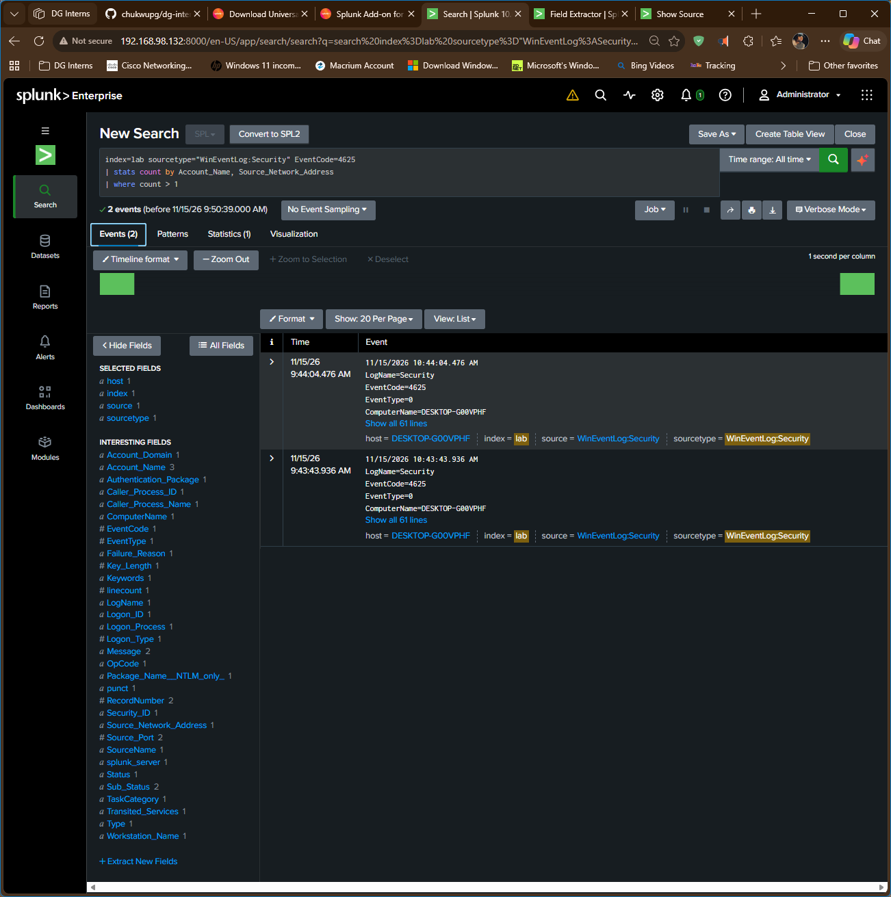
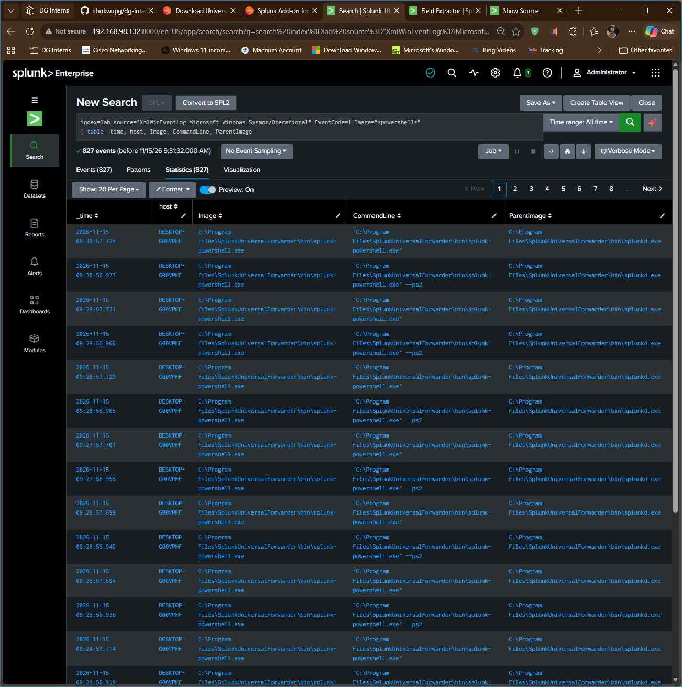
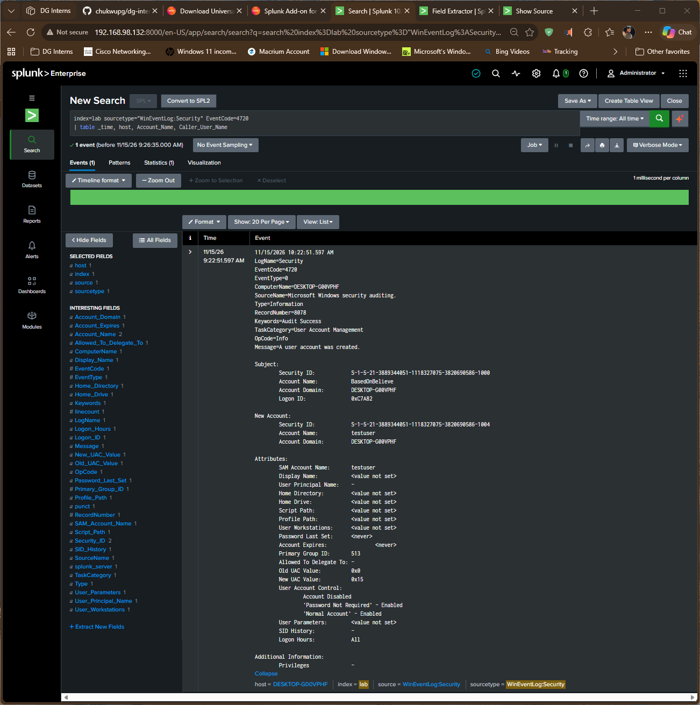
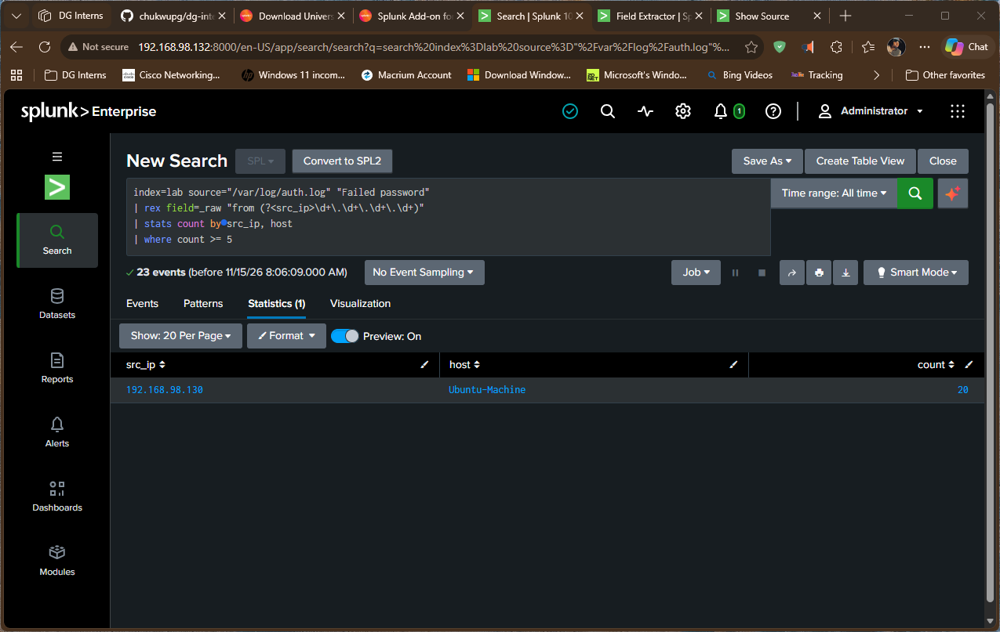
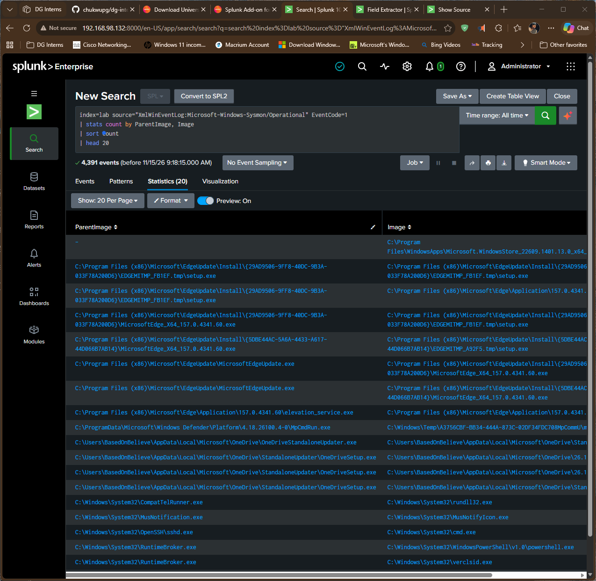
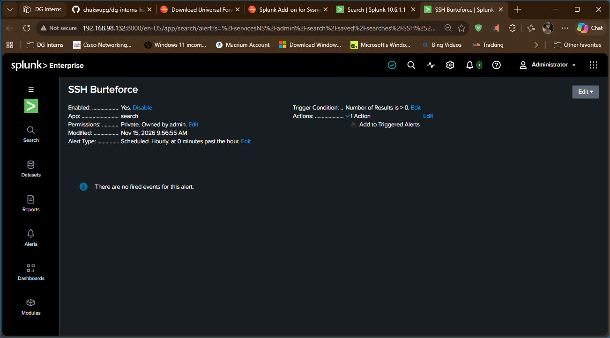
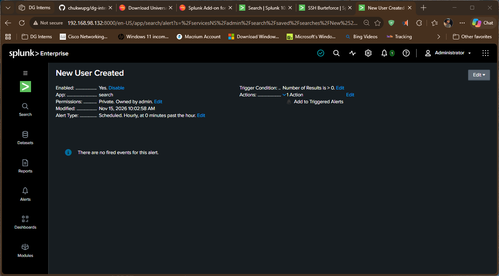

# Detections: SPL Searches and Custom Wazuh Rule

## SPL searches

### 1. Failed logons per user (Windows, EventCode 4625)
```spl
index=lab sourcetype="WinEventLog:Security" EventCode=4625
| stats count by Account_Name, Source_Network_Address
| where count > 1
```
- **Detects:** repeated failed Windows logons from the same or different sources.
- **MITRE:** T1110 (Brute Force).
- **Why useful for L1:** first-line triage for credential-guessing attempts; a quick pivot into `Source_Network_Address` tells L1 whether to escalate as external or internal.



### 2. PowerShell process creation (Sysmon Event ID 1)
```spl
index=lab source="XmlWinEventLog:Microsoft-Windows-Sysmon/Operational" EventCode=1 Image="*powershell*"
| table _time, host, Image, CommandLine, ParentImage
```
- **Detects:** any PowerShell process launch, including suspicious parent processes or obfuscated command lines.
- **MITRE:** T1059.001 (PowerShell).
- **Why useful for L1:** PowerShell is dual-use (admin tool and attacker tool) - this search gives L1 a fast first look at `CommandLine` to judge intent before escalating.



### 3. New user account creation (EventCode 4720)
```spl
index=lab sourcetype="WinEventLog:Security" EventCode=4720
| table _time, host, Account_Name, Caller_User_Name
```
- **Detects:** any new local account created on a monitored Windows host.
- **MITRE:** T1136.001 (Local Account).
- **Why useful for L1:** account creation outside a change window or by an unexpected caller is a classic persistence indicator - cheap to check, high value.



### 4. SSH failures per source IP (tested against my own Hydra run)
```spl
index=lab source="/var/log/auth.log" "Failed password"
| rex field=_raw "from (?<src_ip>\d+\.\d+\.\d+\.\d+)"
| stats count by src_ip, host
| where count >= 5
```
- **Detects:** repeated SSH authentication failures from one source IP.
- **MITRE:** T1110 (Brute Force).
- **Why useful for L1:** simple threshold, low false-positive rate, catches the most common SSH attack pattern - this one fired for real against my Hydra test (confirmed in Findings/Triage Note 1).



### 5. Rare parent-child process pairs (Sysmon Event ID 1)
```spl
index=lab source="XmlWinEventLog:Microsoft-Windows-Sysmon/Operational" EventCode=1
| stats count by ParentImage, Image
| sort count
| head 20
```
- **Detects:** unusual process lineage (a parent spawning a child it doesn't normally spawn).
- **MITRE:** no single technique, general hunting/anomaly query, often precedes techniques like T1055 (Process Injection) or T1059 (various command/scripting).
- **Why useful for L1:** not a direct alert, but a hunting query L1/L2 can run periodically to spot lineage that doesn't match a baseline.



## Scheduled alerts
- **"SSH Bruteforce"** - built from search #4, scheduled every 1 hour, triggers when results > 0. 


- **"New User Created"** - built from search #3, same schedule/trigger logic. 


## Custom Wazuh rule (documented, not installed/tested this week)
File: `/var/ossec/etc/rules/local_rules.xml`
```xml
<group name="local,syslog,sshd,">
  <rule id="100010" level="10">
    <if_matched_sid>5716</if_matched_sid>
    <same_source_ip />
    <description>SSH authentication failures from same source (possible brute force)</description>
    <mitre>
      <id>T1110</id>
    </mitre>
    <options>no_full_log</options>
  </rule>
</group>
```
- **ID 100010** (in the required 100000+ local range), level 10 (high severity).
- Builds on Wazuh's built-in base rule 5716 (SSHD authentication failed) and correlates repeats from the same source IP - the same brute-force pattern my SPL search #4 detects in Splunk.
- **Not run through `wazuh-logtest`** - Wazuh was not installed this week due to the 8 GB RAM limit (documented in the README and Q4). No `logtest` output is included here because none was captured; including a fabricated sample would misrepresent what was actually tested.