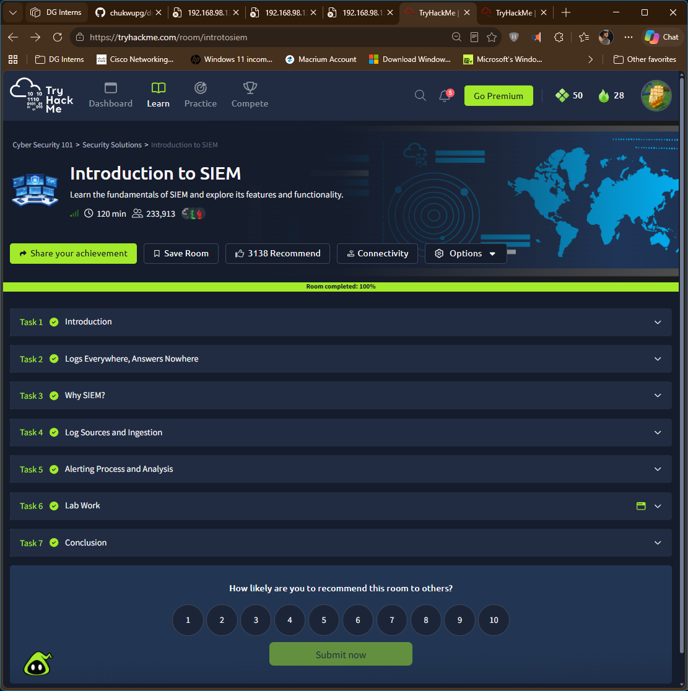

# TryHackMe: Introduction to SIEM

**Room:** https://tryhackme.com/room/introtosiem
**Goal:** Understand what a SIEM is, why organizations need one, how logs get ingested, and how alerts get triaged — then apply it in a short hands-on section.

## Task 1: Introduction
Room overview and objectives: understand SIEM fundamentals before touching a real platform.

## Task 2: Logs Everywhere, Answers Nowhere
Covers the core problem a SIEM solves: logs exist on every device (servers, firewalls, endpoints) but sit in separate silos, in different formats, with no single place to search or correlate them.

- **What I learned:** Having logs isn't the same as having visibility. Without centralization, an analyst would have to manually check dozens of systems to find one incident's trail.

## Task 3: Why SIEM?
Covers the value a SIEM adds over raw logs: centralization, normalization, correlation across sources, and alerting.

- **What I learned:** This matches what I wrote in Q1 of my notes — a SIEM isn't just storage, it's the correlation and alerting layer on top of storage.

## Task 4: Log Sources and Ingestion
Covers common log sources (endpoints, network devices, applications) and ingestion methods (agents, syslog, APIs).

- **What I learned:** Directly maps to my own Week 4 lab — I used the Splunk Universal Forwarder (an agent) for Windows Security/Sysmon and Ubuntu's `auth.log`, which is exactly the "agent + file monitoring" pattern this task describes.

## Task 5: Alerting Process and Analysis
Covers how raw events become alerts (thresholds, rules) and the basic analysis/triage process once one fires.

- **What I learned:** This lines up with my own alert lifecycle answer in Q8; alert generated, triaged, verdict given, escalated or closed.

## Task 6: Lab Work
Hands-on section inside the room's own environment.

## Evidence 

## Task 7: Conclusion
Room wrap-up, no new technical content.

## Lesson Learned
This room gave me the vocabulary and reasoning for why I built what I built this week: centralizing Windows and Linux logs into Splunk's `lab` index wasn't just an exercise — it's the first step every SIEM needs before any detection is possible.

**Note:** per the internship rules, room answers/flags are not included in this writeup. Keep them in a private note, not this file.