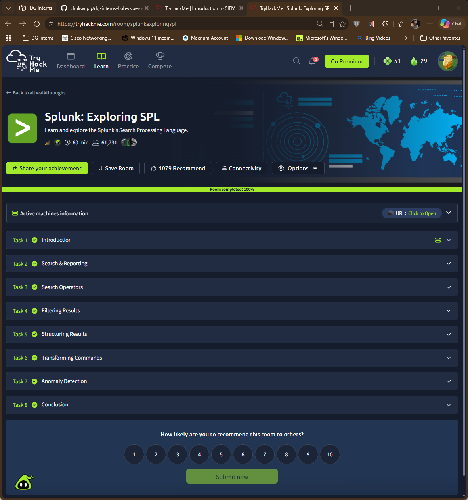

<!-- writeup-splunk-exploring-spl.md -->
# TryHackMe: Splunk - Exploring SPL

**Room:** https://tryhackme.com/room/splunkexploringspl
**Goal:** Learn core SPL syntax — searching, filtering, structuring, and transforming results — inside Splunk's own practice environment.

## Task 1: Introduction
Room overview: SPL as Splunk's query language for searching and shaping event data.

## Task 2: Search & Reporting
Covers the Search & Reporting app itself — the same interface I used all week for my own `index=lab` searches.

- **What I learned:** The time range picker and search bar behave exactly as I used them in my own lab (e.g. switching to "All time" when my events weren't showing up at first).

## Task 3: Search Operators
Covers base search syntax: `index=`, `sourcetype=`, boolean operators (`AND`/`OR`/`NOT`), wildcards.

- **What I learned:** This is the same syntax I used in every one of my own searches this week, e.g. `index=lab sourcetype="WinEventLog:Security" EventCode=4625`.

## Task 4: Filtering Results
Covers `where` and other filtering commands to narrow results after an initial search.

- **What I learned:** I used `where count >= 5` in my own brute-force detection (Q6/Task 5) — directly from this task's content.

## Task 5: Structuring Results
Covers `table` and `fields` for shaping which columns are shown.

- **What I learned:** I used `table _time, host, Image, CommandLine, ParentImage` for my PowerShell detection search.

## Task 6: Transforming Commands
Covers `stats`, `eval`, `timechart` - aggregating and computing new fields from results.

- **What I learned:** My `stats count by src_ip, host` command, used to count Hydra's failed attempts per source IP, is a direct application of this task.

## Task 7: Anomaly Detection
Covers using SPL to spot outliers; rare values, unusual counts, rather than just matching known-bad strings.

- **What I learned:** My "rare parent-child process pairs" search (`stats count by ParentImage, Image | sort count | head 20`) is this exact anomaly-detection pattern applied to Sysmon data.

## Task 8: Conclusion
Room wrap-up, no new technical content.

## Evidence 

## Lesson Learned
Every SPL command this room introduces; search operators, `where`, `table`, `stats`, `eval`, `timechart`, is one I actually used in my Week 4 lab detections. This room was the direct skill foundation for Task 5 of the brief.

**Note:** no room answers/flags are included here, per the internship rules.