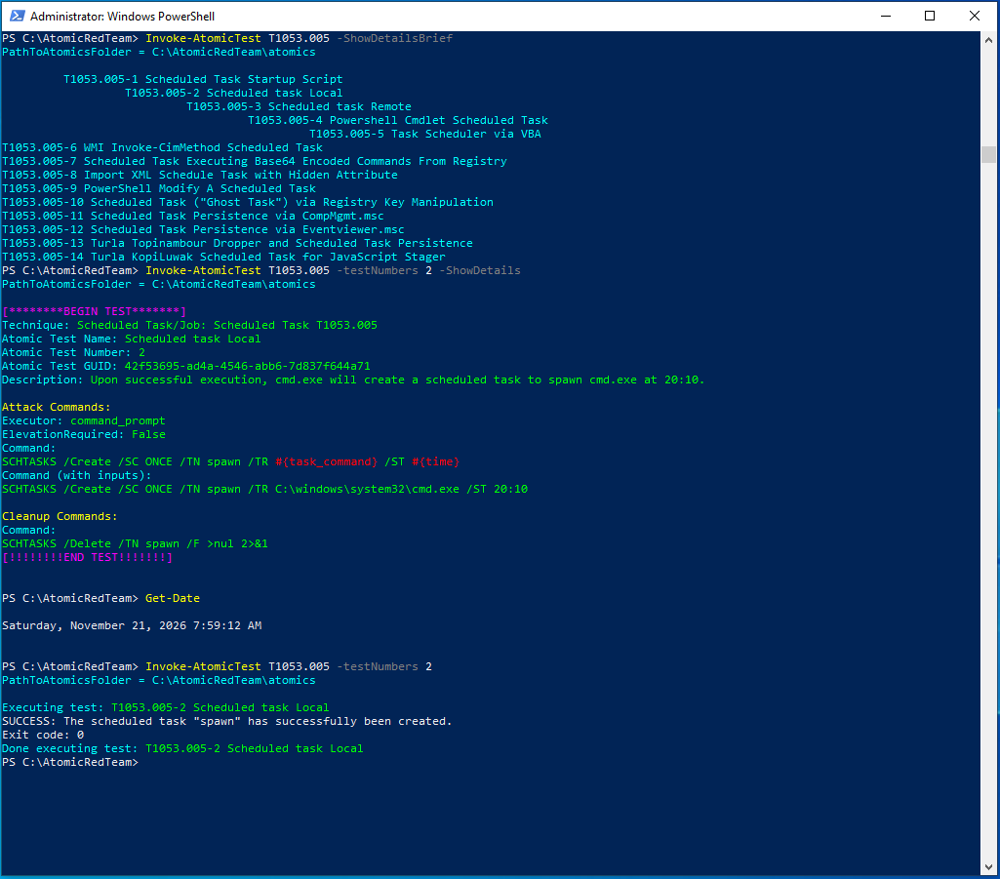
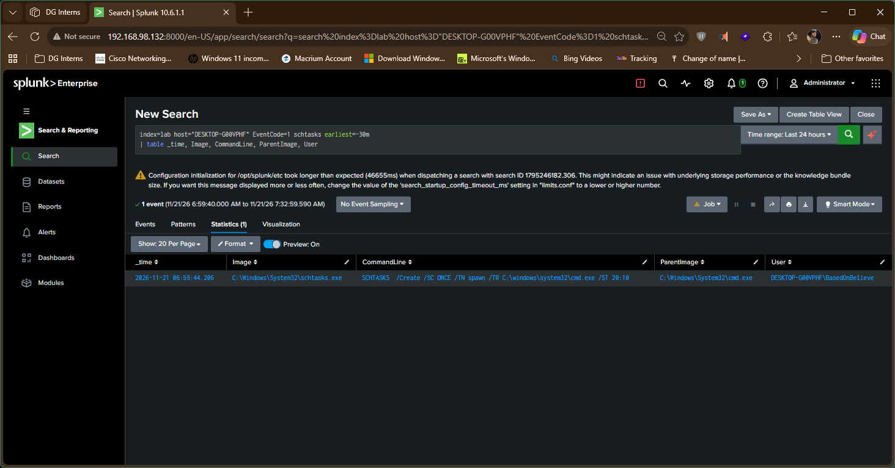
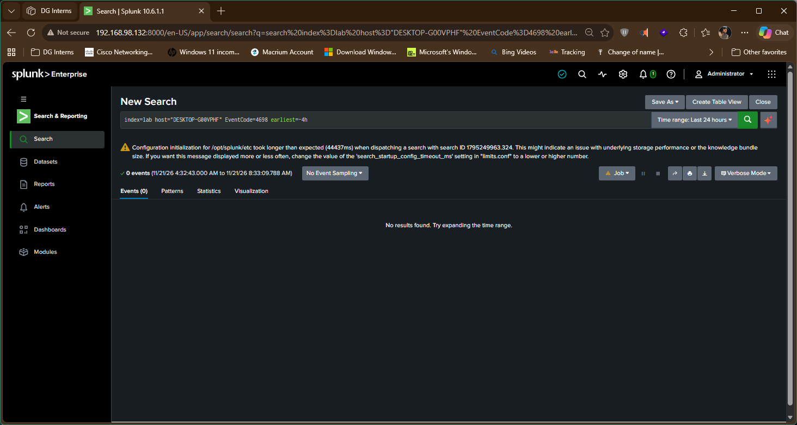
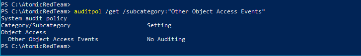
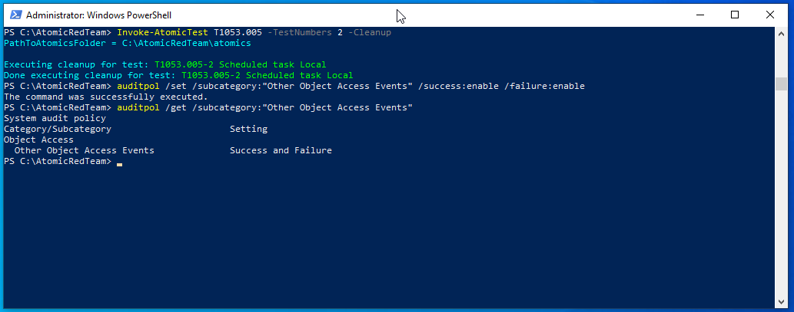
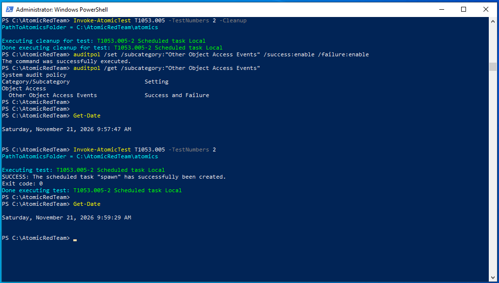
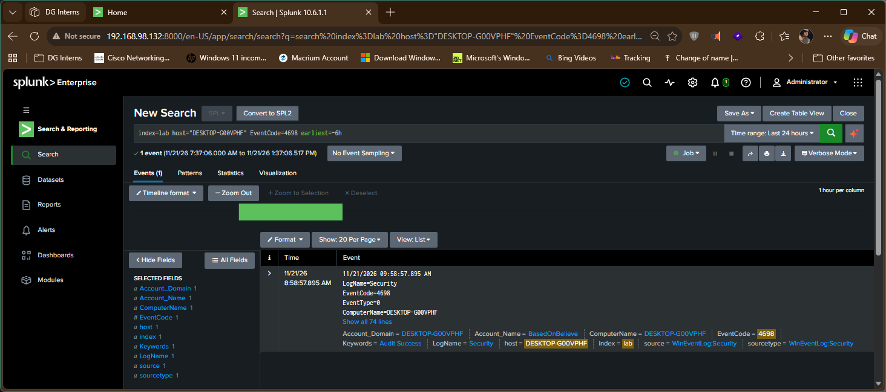

# Atomic Test: T1053.005 Scheduled Task

**Week 5 | Hands-on task 4 (Atomic Red Team) | Folder: Findings**

## Goal
Create a scheduled task with Atomic Red Team and find the evidence in Sysmon and the Security log in Splunk.

## Technique
- **ATT&CK:** T1053.005, Scheduled Task: Scheduled Task Local
- **Atomic test:** T1053.005-2, 
- **What it does:** creates a task with schtasks.exe /create ...

## Commands
```powershell
Invoke-AtomicTest T1053.005 -ShowDetailsBrief
Invoke-AtomicTest T1053.005 -TestNumbers 2 -ShowDetails
Get-Date
Invoke-AtomicTest T1053.005 -TestNumbers 2
Get-Date
Invoke-AtomicTest T1053.005 -TestNumbers 2 -Cleanup
```



## Evidence

| Source | Event | Key fields | Result count |
|---|---|---|---|
| Sysmon | EID 1, `schtasks.exe` | CommandLine: [[ ]]; ParentImage: [[ ]]; User: [[ ]] | [[ ]] |
| Security | 4698 (task created) | none | **0** |

```
index=lab host="DESKTOP-G00VPHF" EventCode=1 schtasks earliest=-30m
| table _time, Image, CommandLine, ParentImage, User
```
```
index=lab host="DESKTOP-G00VPHF" EventCode=4698 earliest=-30m
```



**No 4698 Event**



## Why there was no Event 4698
I checked the audit policy:
```
auditpol /get /subcategory:"Other Object Access Events"
```
It showed **No Auditing**, so Windows never wrote Event 4698.



## Detection
- **Existing detection fired:** No.
- **Gap 1:** scheduled task creation is not audited in the Security log (Other Object Access Events = No Auditing).
- **Gap 2:** no rule watches `schtasks /create` in Sysmon.
- **Candidate rule:**
  ```
  index=lab EventCode=1 Image="*\\schtasks.exe" CommandLine="*/create*"
  | table _time, host, User, CommandLine, ParentImage
  ```
  Did it find my test event? Yes
- **Recommendation:** enable Other Object Access Events auditing and forward 4698 to Splunk.

## After enabling auditing 
```
auditpol /set /subcategory:"Other Object Access Events" /success:enable /failure:enable
```
- Re-ran the test. Event 4698 results: 1
- Fields seen: 
    - LogName=Security
    - Task Name: \spawn
    - Account Name: BasedOnBelive 
    - Account Domain: DESKTOP-G00VPHF





## What I learned
4698 initially didn't show up in my splunk SPL search because it had no audit settings in my Windows machine, but after I turned the Success and Failure audit setting using `auditpol`, the log showed up. 

This emphasizes the importance of audit setting in collecting telemetry in endpoint devices. 