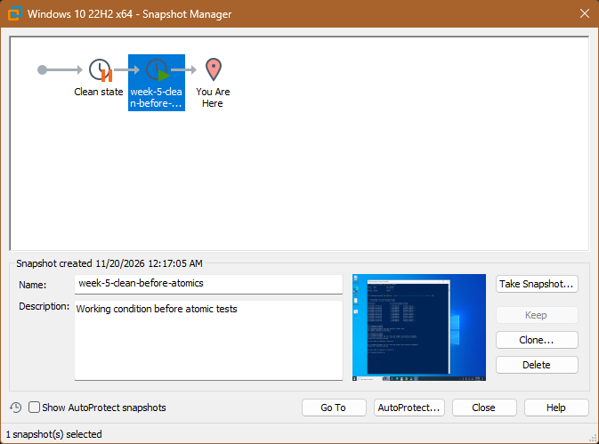
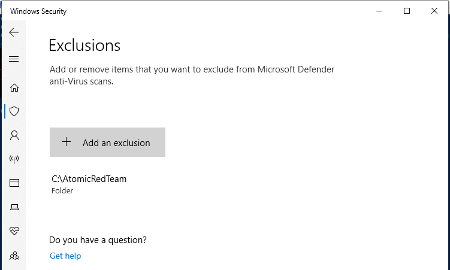
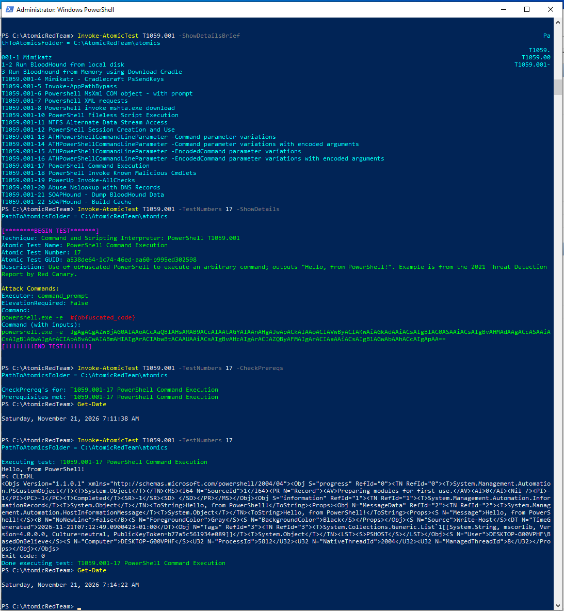
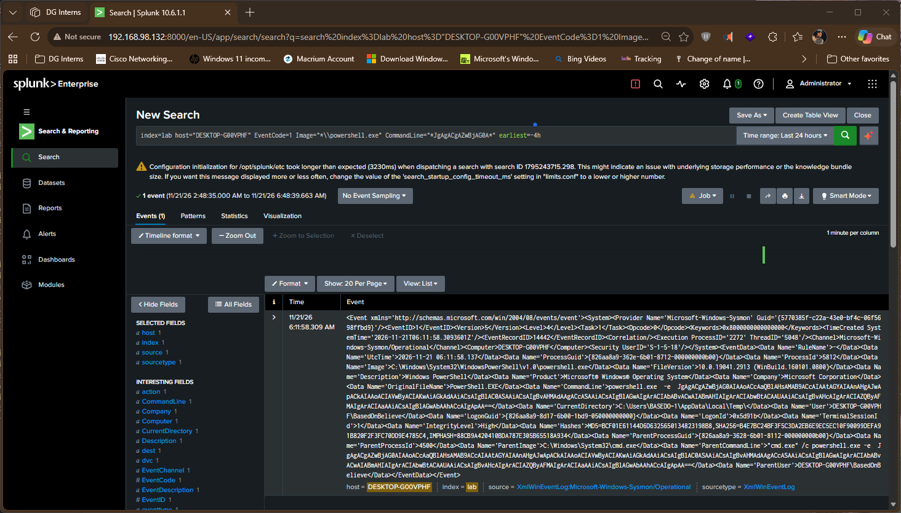
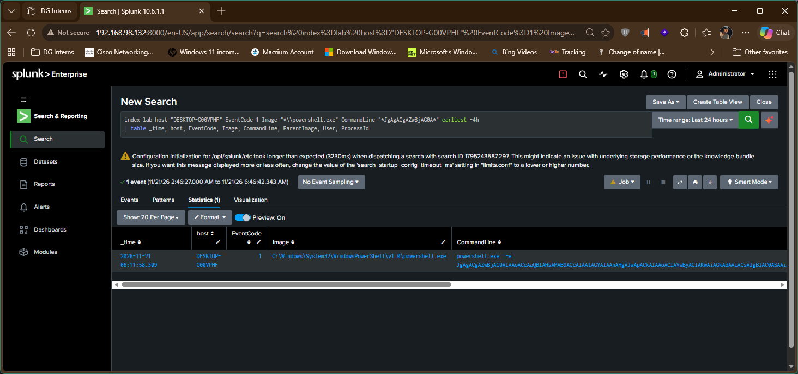
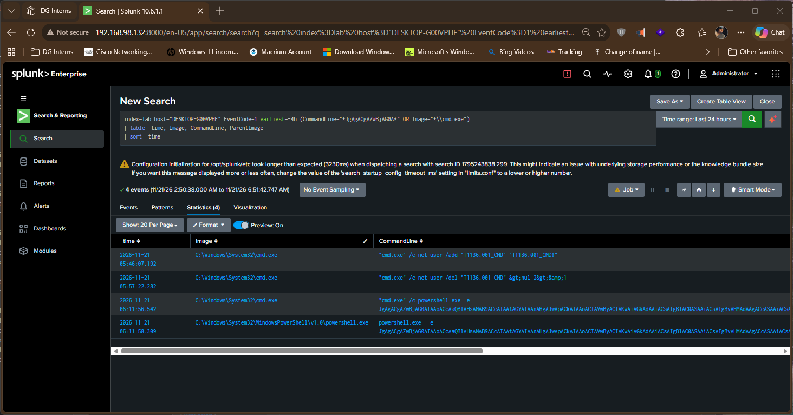

# Atomic Test: T1059.001 PowerShell (Test 17)

**Week 5 | Hands-on task 4 (Atomic Red Team) | Folder: Findings**

## Goal
Run an obfuscated PowerShell command with Atomic Red Team and find the evidence in Sysmon and Splunk.

## Technique
- **ATT&CK:** T1059.001, Command and Scripting Interpreter: PowerShell
- **Atomic test:** T1059.001-17, "PowerShell Command Execution"
- **What it does:** runs `powershell.exe -e <encoded string>` from `cmd.exe`. The decoded command prints "Hello, from PowerShell!". It is harmless and makes no downloads.
- **Why this test:** tests 1 and 2 (Mimikatz, BloodHound) need internet to download tools, and my lab is isolated.

## Setup
- Windows VM snapshot taken first: `week5-clean-before-atomics`
- Atomic Red Team installed in `C:\AtomicRedTeam` with a Defender exclusion for that folder (removed afterwards)




## Commands
```powershell
Invoke-AtomicTest T1059.001 -TestNumbers 17 -ShowDetails
Invoke-AtomicTest T1059.001 -TestNumbers 17 -CheckPrereqs
Get-Date
Invoke-AtomicTest T1059.001 -TestNumbers 17
Get-Date
```

## Output
- Prerequisites: met
- Test output: `Hello, from PowerShell!`, exit code 0
- Run time: 7:11:38 to 7:14:22 AM (Windows time, +01:00)



## Evidence in Sysmon and Splunk

| Item | Result |
|---|---|
| Sysmon Event ID | 1 (Process Create) |
| Key fields | Image: `powershell.exe`; CommandLine: contains `-e` and the encoded string; ParentImage: cmd.exe; User: BasedOnBelieve |
| Splunk search used | see below |
| Result count | 1 |

```
index=lab host="DESKTOP-G00VPHF" EventCode=1 Image="*\\powershell.exe" CommandLine="*JgAgACgAZwBjAG0A*" earliest=-4h
| table _time, host, EventCode, Image, CommandLine, ParentImage, User, ProcessId
```





**Note:** my first searches matched only part of the encoded string and returned nothing, because Splunk searches whole tokens. A wildcard on `CommandLine` fixed it.

## Detection
- **Existing detection fired:** No. I had no rule for encoded PowerShell.
- **Gap:** no alert on `powershell.exe -e` / `-EncodedCommand`.
- **Candidate rule** (it matched my test event):
  ```
  index=lab EventCode=1 Image="*\\powershell.exe" (CommandLine="* -e *" OR CommandLine="* -enc*" OR CommandLine="* -EncodedCommand*")
  | table _time, host, User, CommandLine, ParentImage
  ```
- **Other gap:** PowerShell script block logging (Event 4104) is not forwarded to Splunk. 

## Cleanup
The test lists no cleanup commands. 

## What I learned
Attackers use encoded strings to obfuscate their commands and evade detections or hide intent. 