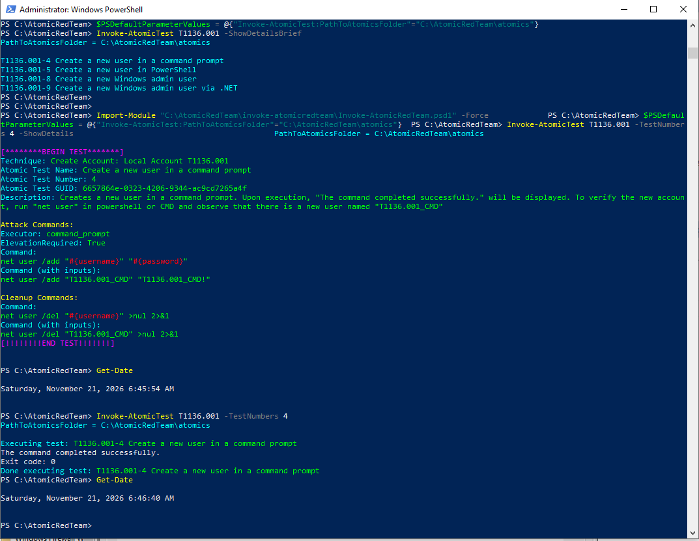
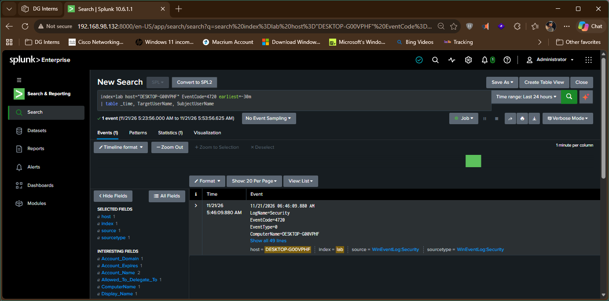
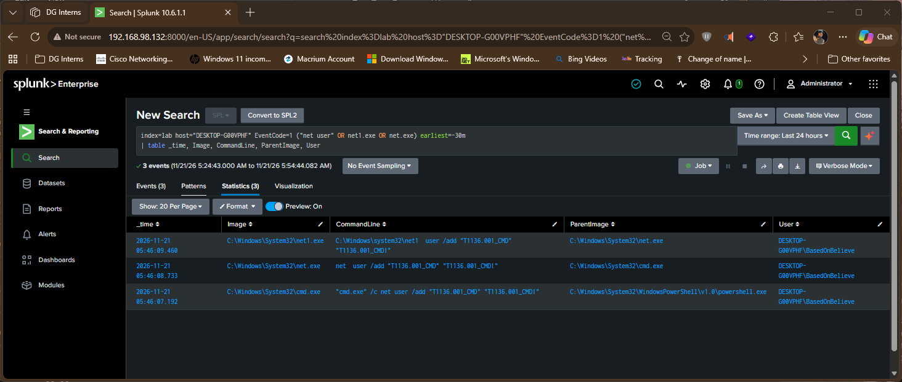
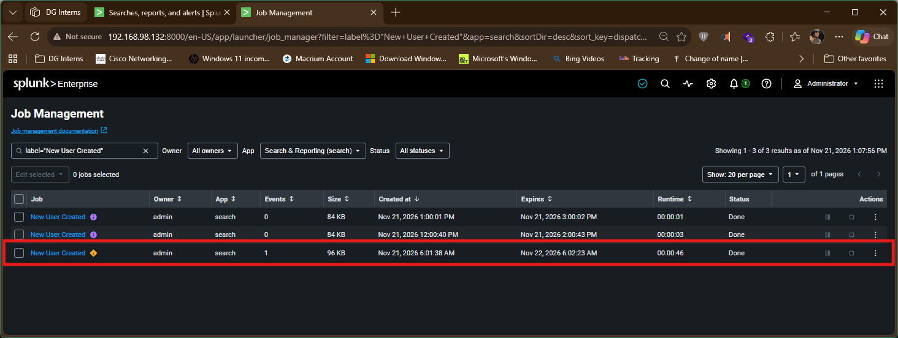

# Atomic Test: T1136.001 Create Local Account

**Week 5 | Hands-on task 4 (Atomic Red Team) | Folder: Findings**

## Goal
Create a local account with Atomic Red Team and check whether my "New User Created" Splunk alert (from Week 4) actually fires.

## Technique
- **ATT&CK:** T1136.001, Create Account: Local Account
- **Atomic test:** T1136.001-4, Create a new user in a command prompt
- **Options listed:** 4 (command prompt), 5 (PowerShell), 8 (Windows admin user), 9 (admin user via .NET)
- **What it does:** creates a new local user on the Windows VM. 

## Setup
- Snapshot `week5-clean-before-atomics`; Atomic Red Team in `C:\AtomicRedTeam`
- My alert "New User Created" searches for EventCode 4720. It was created in Week 4 but never triggered.

## Commands
```powershell
Invoke-AtomicTest T1136.001 -TestNumbers 4 -ShowDetails
Get-Date
Invoke-AtomicTest T1136.001 -TestNumbers 4
Get-Date
Invoke-AtomicTest T1136.001 -TestNumbers 4 -Cleanup
```



## Evidence

| Source | Event | Key fields | Result count |
|---|---|---|---|
| Security | 4720 (account created) | TargetUserName: BasedOnBelieve; SubjectUserName: T1136.001_CMD! | 1 |
| Sysmon | EID 1 (process create) | Image: net.exe, cmd.exe, powershell.exe; CommandLine: net user /add "T1136.001_CHD" "T1136.001 _CMD!"; ParentImage: C:\Windows\System32\cmd. exe | 3 |

```
index=lab host="DESKTOP-G00VPHF" EventCode=4720 earliest=-30m
| table _time, TargetUserName, SubjectUserName
```
```
index=lab host="DESKTOP-G00VPHF" EventCode=1 ("net user" OR net1.exe OR net.exe) earliest=-30m
| table _time, Image, CommandLine, ParentImage, User
```




## Alert check
- **"New User Created" triggered:** Yes
- Time Triggered: Nove 21, 2026 6:02:23 AM 



## Detection
- **Existing detection fired:** Yes
- **Gap:** alert only covers 4720; no alert for the net.exe command line or for group membership changes (4732)

## What I learned
In week-4 I created alerts but never tested them, this week getting to test if the **New User Created** alert fires makes the difference. 

Untested alerts are risky, alerts need to be tested to ensure they fire when the conditions are met. 
