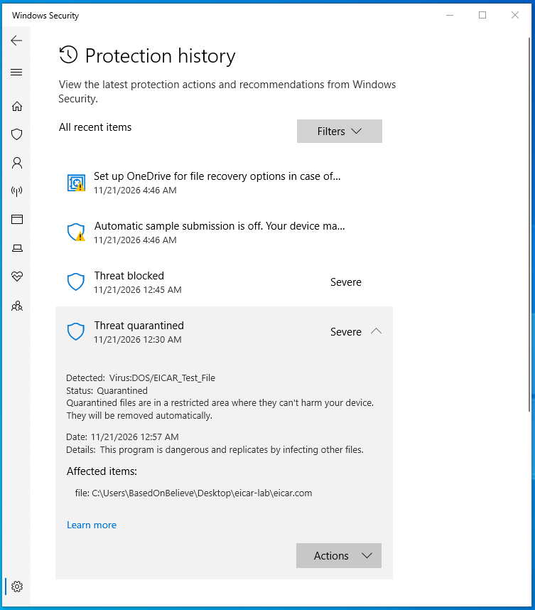
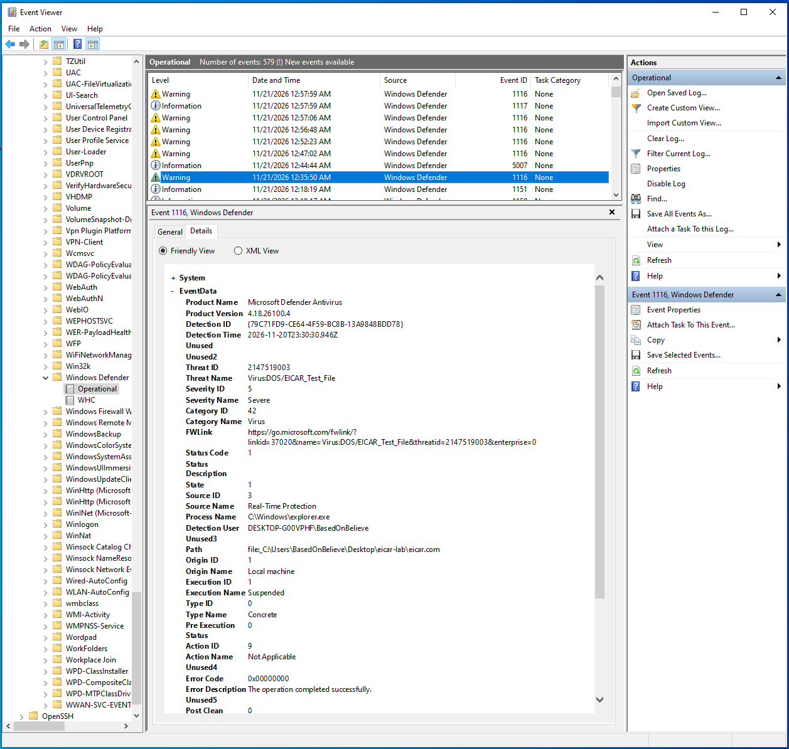
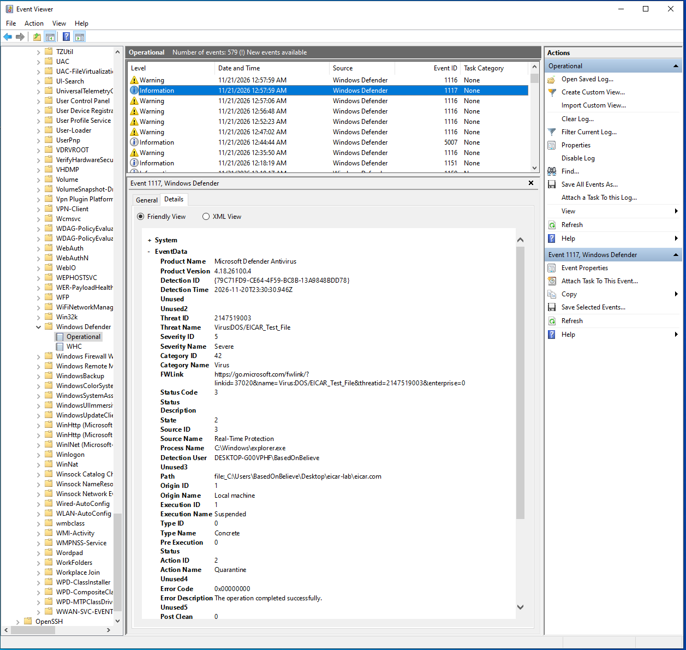
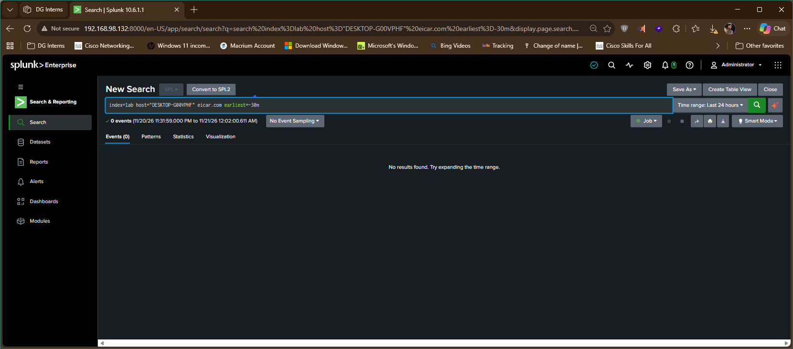
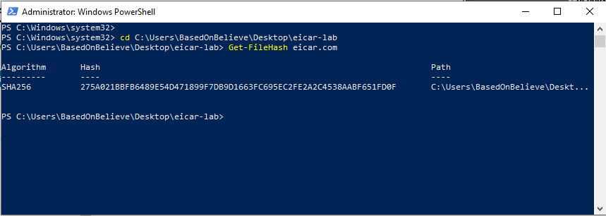
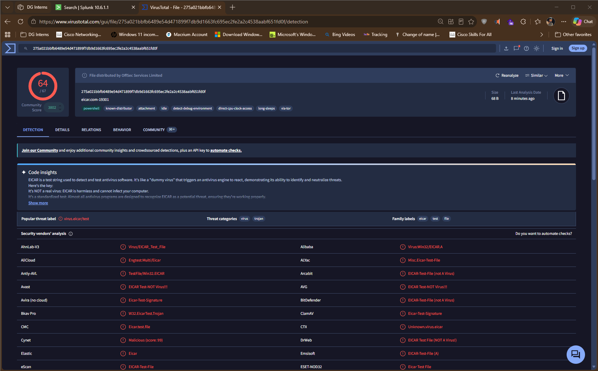

# EICAR Triage on the Windows VM

**Week 5 | Hands-on task 2 (Safe Malware Triage) | Folder: Findings**

## Goal
Drop the harmless EICAR test file on the Windows VM and find what Defender and Sysmon recorded, without using live malware.

## Environment
- Windows 10 VM (host `DESKTOP-G00VPHF`) on the isolated 192.168.98.0/24 network
- Microsoft Defender real-time protection on
- Sysmon (SwiftOnSecurity config) forwarded to Splunk (`lab` index)
- Done before installing Atomic Red Team, so the Defender exclusion did not apply

## Steps and commands
1. Checked Defender was on:
   ```powershell
   Get-MpComputerStatus | Select AntivirusEnabled, RealTimeProtectionEnabled
   ```
   Result: True / True
2. My effort to download the file from `eicar.org` failed because Windows Defender restricted the download of the Malicious app, so I created the EICAR test file as `eicar.com` in `/eicar lab` using Notepad paste by copying the line of code from the website.
3. Recorded what happened on save: Defender popup / PowerShell "contains a virus" error / Qurantine Action. 

## Evidence

| Source | What I saw | Screenshot |
|---|---|---|
| Windows Security - Protection history | Virus/EICAR_TEST_FILE, Severe, Threat Quarantined | `eicar-01-defender-detection.png` |
| Event Viewer - Windows Defender  Operational | Evend IDs 1116 and 1117, Action: Quarantine | `eicar-02-defender-eventviewer.png` |
| Sysmon (Splunk and Event Viewer) | Nothing seen | `eicar-03-splunk-sysmon.png` |








Splunk search used for Sysmon: 
```
index=lab host="DESKTOP-G00VPHF" eicar earliest=-30m
```
Result count: 0

## IOCs

| Type | Value | Reputation |
|---|---|---|
| File hash (SHA256) | 275a021bbfb6489e54d471899f7db9d1663fc695ec2fe2a2c4538aabf651fd0f | Malicious |
| Filename | eicar.com | Test file |
| Path | `C:\Users\User\Desktop\eicar lab` | |

## Verdict
Benign test file (EICAR), detected and quarantined/removed by Defender. No real malware was used.

## Detection gaps
- Defender logs are not in my Splunk inputs (only Security and Sysmon), so Defender detections are not searchable in the SIEM. 
- Sysmon file events: EID 11 was not logged for eicar.com. Week 3 showed .txt was also not logged under this config.  This could be due to the .com extension not included in the Sysmon config file.

## What I learned
I saw the importance of endpoint protection using tools just as Windows Defender. 

Windows defender did not allow eicar.com to be downloaded on the VM from the website, it flagged it as a Virus file and restricted the download which demonstrated how proactive host-based antivirus are in defending against malicious file download.

It triggered two operational alerts/events, the first being Event ID 1116 (Warning) where it alerted the user through a popup, and Event ID 1117 (Informational) when it took action (Quarantine) on the Virus. 