# Phishing Sample 1: Fake OKX Wallet Extension Lure (sample-10.eml)

**Week 5 | Hands-on task 1 (Phishing Analysis) | Folder: Findings**

## Goal
Analyse one public phishing sample: read the headers, check URLs without clicking, check reputation, give a verdict and build an IOC table.

## Sample
- **Source:** phishing_pot repository on GitHub, file `sample-10.eml` (not copied into this repo)
- **Handling:** read as text inside my Kali VM with a Python script (`triage.py`) that parses headers and URLs and hashes attachments without running them. No links were opened.
- **Recipient anonymised by the dataset** as `phishing@pot`

## Basic details

| Field | Value |
|---|---|
| Sender | OKX Extension <hpayMonitorPlatform@handpay[.]com[.]cn> |
| Recipient | phishing@pot (anonymised) |
| Subject | rodrigo-f-p ⭐ 4.7/5 Rating: OKX Web3 Extension on Chrome Web Store |
| Date | Wed, 08 Jul 2026 07:16:23 +0000 |
| Return-Path | hpayMonitorPlatform@handpay[.]com[.]cn (same as From) |
| Reply-To | not present |
| Message-ID | <1783494983.a846f192f19a8fae@handpay[.]com[.]cn> |
| X-Originating-IP | 5[.]188[.]28[.]177 |

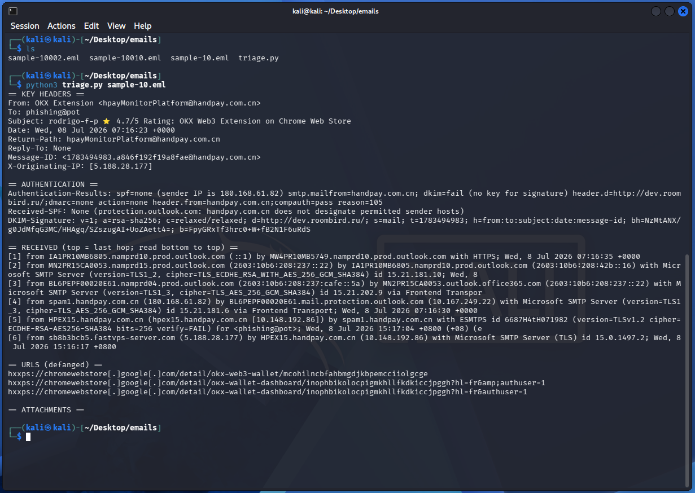

## Authentication-Results

| Check | Result | Meaning |
|---|---|---|
| SPF | none (IP 180[.]168[.]61[.]82, smtp.mailfrom handpay[.]com[.]cn) | The sender domain publishes no SPF policy, so nothing was verified |
| DKIM | fail (no key for signature), header.d = `http://dev.roombird.ru/` | Signing "domain" is a malformed URL and unrelated to the From domain |
| DMARC | none, action=none | No DMARC policy applied |
| compauth | pass, reason=105 | Microsoft's own combined check. It passed even though SPF, DKIM and DMARC did not. |

A pass from the receiving server is not proof the email is safe.

## Received chain (read bottom to top)

| Hop | Detail |
|---|---|
| 6 (origin) | `sb8b3bcb5.fastvps-server[.]com` (5[.]188[.]28[.]177) to `HPEX15.handpay[.]com[.]cn` (internal 10.148.192.86), 07:16:17 UTC |
| 5 | `HPEX15` to `spam1.handpay[.]com[.]cn`, TLS verify=FAIL |
| 4 | `spam1.handpay[.]com[.]cn` (180[.]168[.]61[.]82) to Microsoft's protection service, 07:16:30 UTC |
| 3 to 1 | Internal Microsoft hops to the mailbox |

**My interpretation (inference, not proven):** the message was injected from a VPS into handpay's own mail server, which relayed it on. This suggests that mail infrastructure was abused, not that the real OKX or Google sent it.

## URL analysis (not clicked)

| URL | Notes |
|---|---|
| hxxps://chromewebstore[.]google[.]com/detail/okx-web3-wallet/[inophbikolocpigmkhllfkdkiccjpggh] | Looks like a normal store listing |
| hxxps://chromewebstore[.]google[.]com/detail/[look-alike OKX wallet name using Cyrillic letters]/inophbikolocpigmkhllfkdkiccjpggh | Different extension ID and a look-alike name using Cyrillic characters |

- The look-alike URL appears twice in the email (HTML part with `&amp;`, plain-text part with `&`). It is one IOC.
- The domain is Google's real domain, so domain reputation tells me little. The IOC to track is the **extension ID**.
- My interpretation: the lure tries to get the user to install a look-alike wallet extension.

## Attachments
None, so there are no attachment hashes.

## Reputation checks

| Indicator | Tool | Result |
|---|---|---|
| 5[.]188[.]28[.]177 (RU, AS200487 "ooo vps") | VirusTotal | 0/92, no vendor flagged it |
| | AbuseIPDB | 0%, low risk, not found in the database |
| | AlienVault OTX | 0 pulses, URLs and files; 21 passive DNS records; reverse DNS `sb8b3bcb5.fastvps-server[.]com` |
| 180[.]168[.]61[.]82 (Shanghai, CN, AS4812 China Telecom) | VirusTotal | 0/92, no vendor flagged it |
| | AbuseIPDB | 0%, low risk, not found in the database |
| | AlienVault OTX | 0 pulses, passive DNS, URLs and files |
| handpay[.]com[.]cn | urlscan.io | No classification. Age 23 days means the url is only 23 days old which suggesta newly created url |
| roombird[.]ru | urlscan.io | Scans of `dev.roombird[.]ru/` exist (about 23 days ago and 10 hours ago), including one URL with the DMARC header text appended |
| handpay[.]com[.]cn, roombird[.]ru | VirusTotal / OTX | Not rated / No result |
| Extension ID `inophbikolocpigmkhllfkdkiccjpggh` and look-alike URL | VirusTotal / OTX / urlscan | No result |
| Full headers | MXToolbox | Header fields parsed, received delay 0 seconds; no SPF/DKIM detail shown |

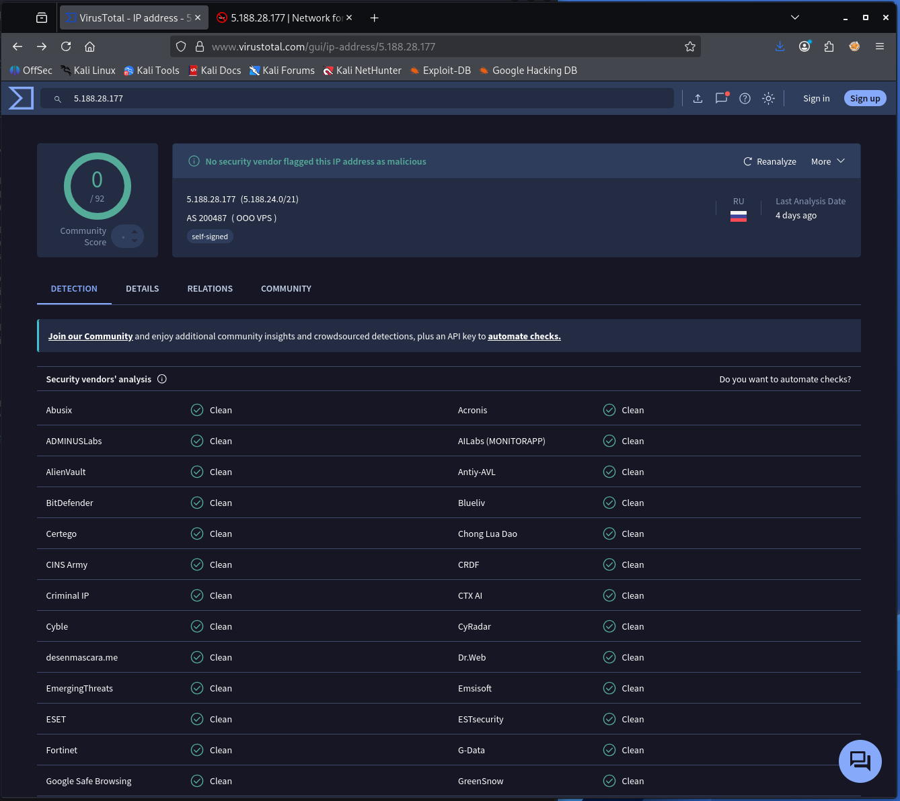
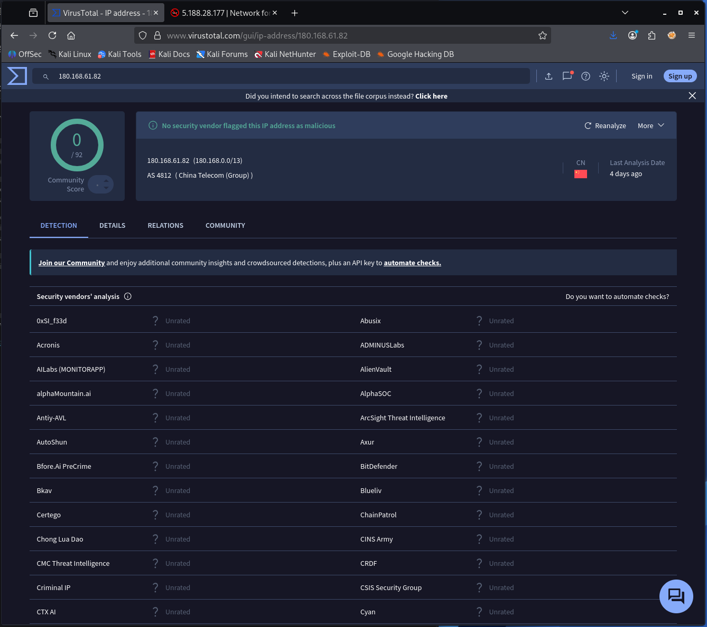
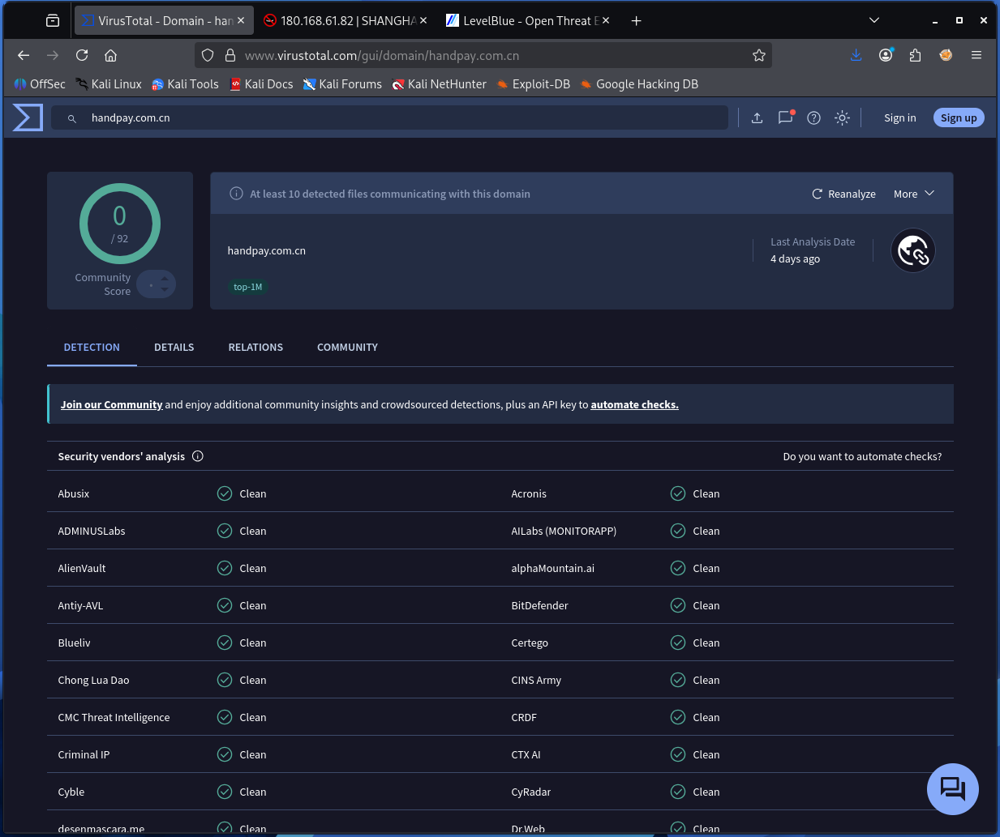
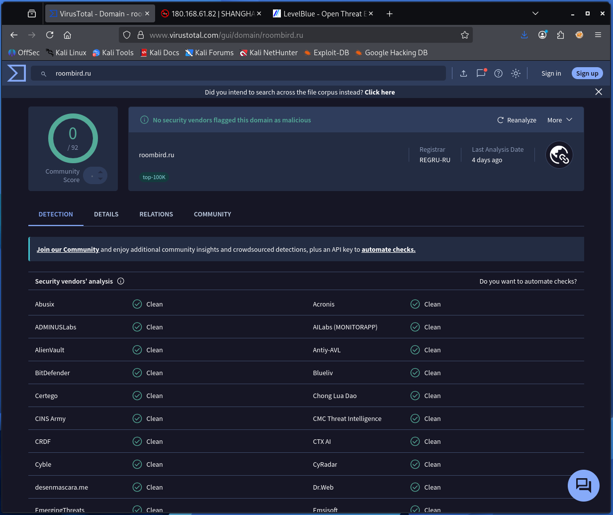
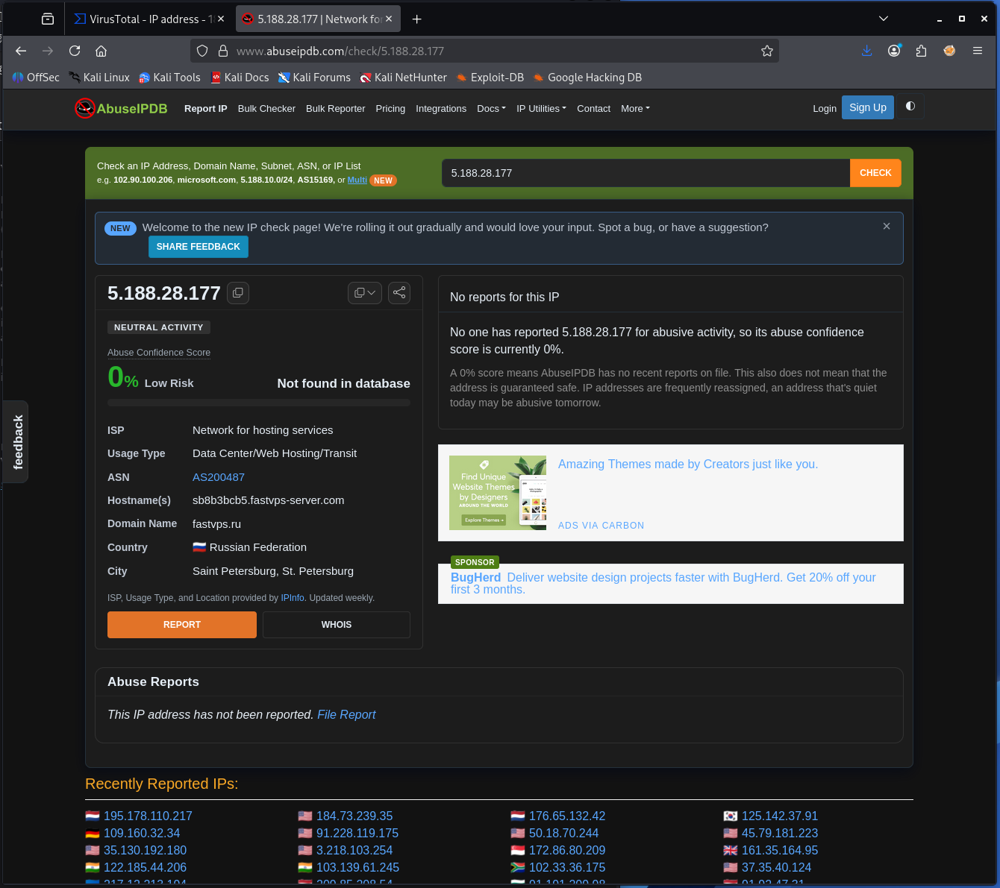
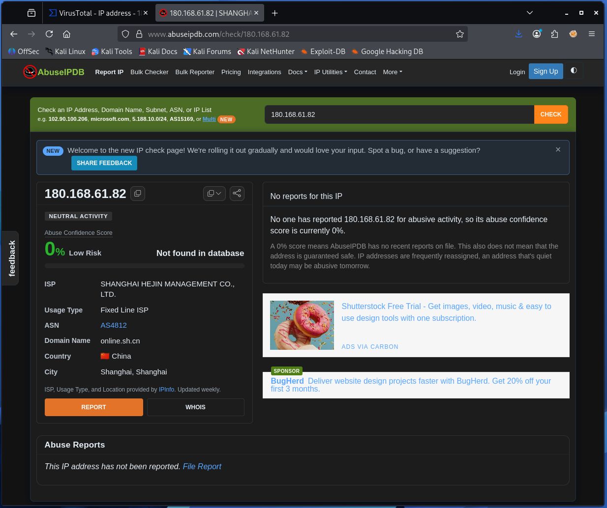
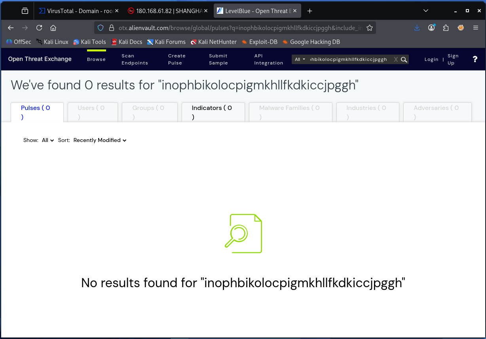
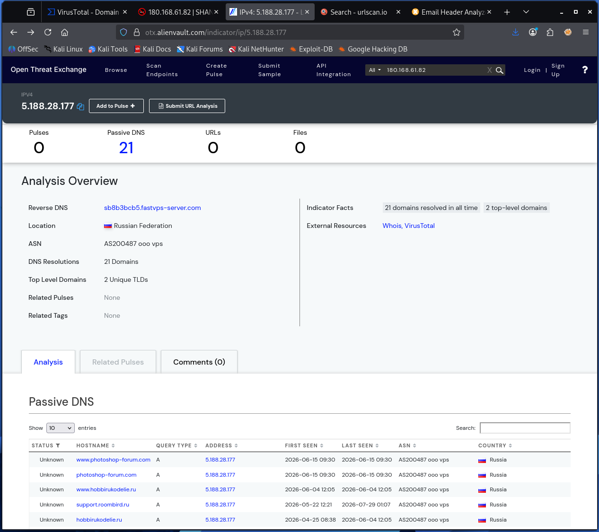
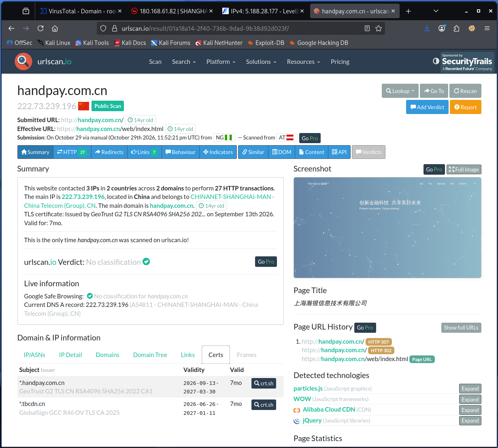
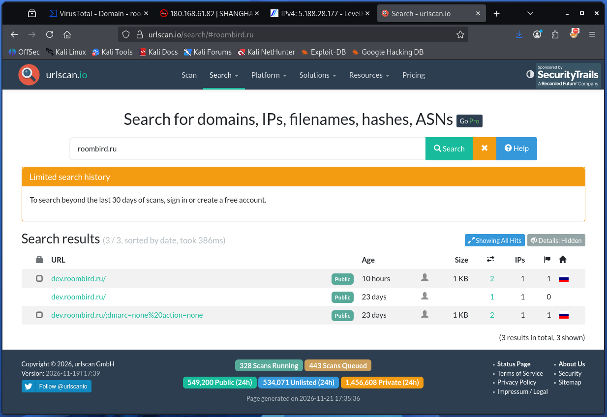
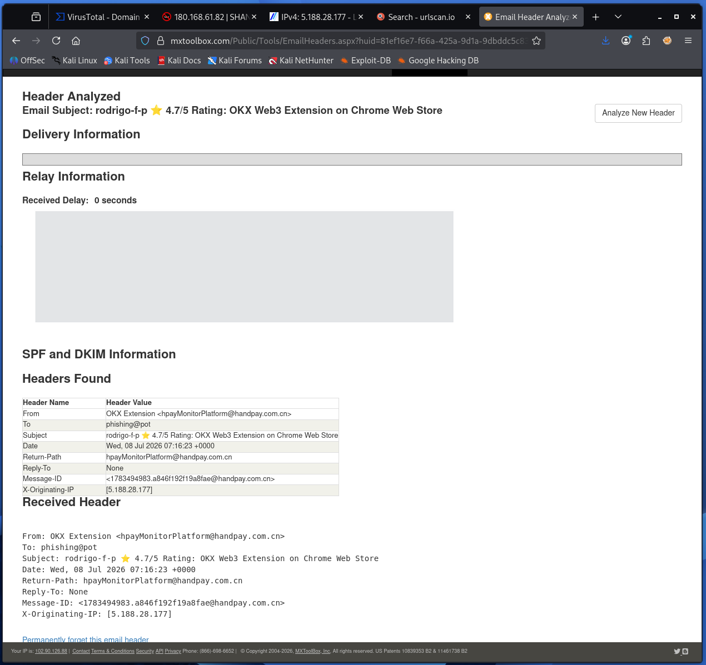

**Useful finding from OTX passive DNS for the origin IP:** it also resolved `support.roombird[.]ru` (first seen 2026-05-22, last seen 2026-07-29), the same domain that appears in the malformed DKIM signature. This suggests the DKIM signature came from the same VPS. Other domains seen on the IP include photoshop-forum[.]com and hobbirukodelie[.]ru, so it may be shared or compromised hosting. 

## IOC table (defanged)

| Type | Value | Context | Reputation |
|---|---|---|---|
| IP | 5[.]188[.]28[.]177 | Origin, first Received hop, X-Originating-IP | Clean on VT/AbuseIPDB; 0 OTX pulses |
| IP | 180[.]168[.]61[.]82 | `spam1.handpay[.]com[.]cn`, last hop before Microsoft | Clean on VT/AbuseIPDB; 0 OTX results |
| Domain | handpay[.]com[.]cn | Sender, Return-Path, Message-ID domain; relayed the mail | urlscan: no classification |
| Domain | roombird[.]ru | DKIM `d=` value; resolves to the origin IP | urlscan scans exist |
| Domain | fastvps-server[.]com | Origin reverse DNS | Malicious |
| Email | hpayMonitorPlatform@handpay[.]com[.]cn | Sender | n/a |
| Extension ID | inophbikolocpigmkhllfkdkiccjpggh | Look-alike "wallet dashboard" listing | Clean on VT and OTX |
| URL | hxxps://chromewebstore[.]google[.]com/detail/[look-alike name]/inophbikolocpigmkhllfkdkiccjpggh | Lure link | Clean on VT |
| Message-ID | 1783494983.a846f192f19a8fae@handpay[.]com[.]cn | Message identifier | n/a |
| Attachment hash | none | | n/a |

## Verdict
**Malicious (phishing).**

Justification:
- The display name impersonates OKX, but the sender domain is unrelated.
- SPF is none, DKIM fails with a malformed signing domain, and no DMARC policy applies.
- The mail originates from a VPS and was relayed through a third-party mail server.
- The link points to a look-alike extension with a Cyrillic look-alike name and a different extension ID.
- Reputation tools showed nothing bad, so this verdict rests on the content and header evidence, not on reputation.

## Red flags identified
- Display name does not match the sender address
- Failed or missing authentication (SPF none, DKIM fail, no DMARC)
- Origin is a VPS, not the brand's own mail servers
- Look-alike extension name using Cyrillic characters
- Real Google domain used so the link looks trustworthy
- Fake rating/review notification as the lure

## Recommendations
- Block the sender address and the origin IP at the mail gateway.
- Search mail logs for the same sender, subject pattern and extension ID.
- Alert on messages that link to Chrome Web Store IDs outside an approved list. 
- Warn users that review notifications from "extension stores" are a common lure.

## What I learned
Reputation sources may show clean result or no record at all but that does not automatically determine the verdict of an email, additional checks should be carried out including header information and results should be correlated across multiple threat intelligence sources.

From this analysis, reputation sources were clean but content and headers showed the attack; compauth pass vs SPF/DKIM none; and passive DNS in OTX linked the DKIM domain to the origin IP.