# Phishing Sample 2: French "CPF file update" lure via Bing redirect (sample-10002.eml)

**Week 5 | Hands-on task 1 (Phishing Analysis) | Folder: Findings**

## Goal
Analyse one public phishing sample: read the headers, check URLs without clicking, check reputation, give a verdict and build an IOC table.

## Sample
- **Source:** phishing_pot repository on GitHub, file `sample-10002.eml` (not copied into this repo)
- **Handling:** read as text inside my Kali VM with `triage.py`, which parses headers and URLs and hashes attachments without running them. No links were opened.
- **Recipient:** the To header is `Undisclosed recipients:;`. ARC results show delivery to a hotmail[.]com mailbox.
- **Lookup timing:** reputation lookups were done in November 2026, about seven months after the email was sent. Results reflect that date, not the send date.

## Basic details

| Field | Value |
|---|---|
| Sender | 9948780305@cbrc[.]com[.]ph (no display name) |
| Recipient | Undisclosed recipients (hotmail[.]com mailbox per ARC) |
| Subject | Dernière mise à jour de votre dossier CPF |
| Date | Tue, 14 Apr 2026 04:37:37 +0000 |
| Return-Path | 9948780305@cbrc[.]com[.]ph (same as From) |
| Reply-To | not present |
| Message-ID | <TYZPR03MB878185ACE91378E52626E58D96252@TYZPR03MB8781[.]apcprd03[.]prod[.]outlook[.]com> |
| X-Originating-IP | not present |

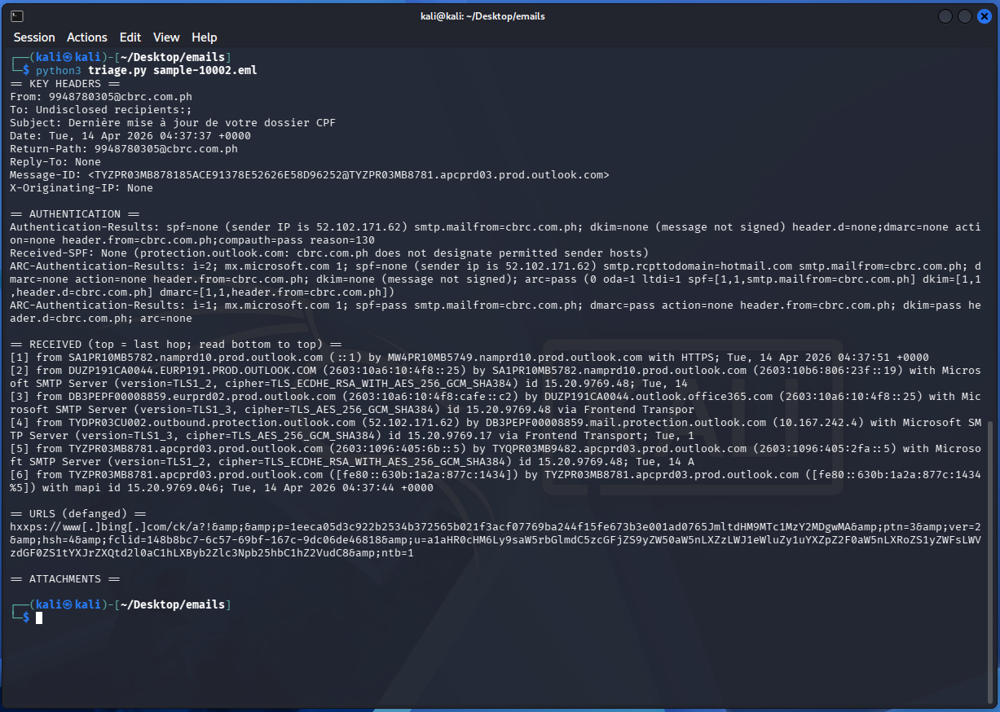

## Authentication-Results

| Check | Result | Meaning |
|---|---|---|
| SPF | none (IP 52[.]102[.]171[.]62), smtp.mailfrom cbrc[.]com[.]ph | Received-SPF says the domain does not designate permitted sender hosts, so nothing was verified |
| DKIM | none (message not signed) | MXToolbox also found no DKIM-Signature header in the message |
| DMARC | none, action=none, header.from cbrc[.]com[.]ph | MXToolbox found no DMARC record for the domain on 2026-11-22 |
| compauth | pass, reason=130 | Microsoft's combined check passed even though SPF, DKIM and DMARC were none at the final hop. I did not verify what reason code 130 means. |
| ARC i=1 | SPF pass, DKIM pass (header.d=cbrc[.]com[.]ph), DMARC pass, cv=none | First Microsoft hop recorded the message as authenticated for cbrc[.]com[.]ph |
| ARC i=2 | SPF none, DKIM none, DMARC none, arc=pass, cv=pass | Later hop recorded no result. The ARC chain itself validated. |
| Authentication-Results-Original | dkim=none, dmarc=none | Agrees with the final result, not with ARC i=1 |

**Observations (unresolved):**
- ARC i=1 reports DKIM pass for cbrc[.]com[.]ph, but the message has no DKIM signature at all.
- ARC i=1 reports DMARC pass, but a DNS lookup today finds no DMARC record. DNS today may not match the records at send time (April 2026), so this is not conclusive.
- I could not explain these conflicts from the headers alone.

**My interpretation (inference, not proven):** the message was created in a Microsoft 365 mailbox using the cbrc[.]com[.]ph domain (possibly a compromised account) and relayed through Microsoft's outbound service. The Message-ID host matches the first MAPI hop, which supports creation inside Exchange Online. The `multipart/none` Content-Type and the `===============...==` boundary style suggest the body was built by a script (inference).

## Received chain (read bottom to top)

| Hop | Time (UTC) | Detail |
|---|---|---|
| 1 (origin) | 04:37:44 | `TYZPR03MB8781` (fe80::630b:1a2a:877c:1434) to itself, with **mapi**: mailbox submission inside Exchange Online |
| 2 | 04:37:44 | `TYZPR03MB8781` to `TYQPR03MB9482`, Microsoft SMTP, TLS1.2 |
| 3 | 04:37:47 | `TYDPR03CU002.outbound.protection.outlook[.]com` (52[.]102[.]171[.]62) to `DB3PEPF00008859.mail.protection.outlook[.]com` (10[.]167[.]242[.]4), TLS1.3 |
| 4 | 04:37:48 | `DB3PEPF00008859` to `DUZP191CA0044.outlook.office365[.]com`, TLS1.3 |
| 5 | 04:37:49 | `DUZP191CA0044` to `SA1PR10MB5782`, TLS1.2 |
| 6 | 04:37:51 | `SA1PR10MB5782` to `MW4PR10MB5749`, HTTPS (mailbox delivery) |

(MXToolbox numbers hops from the origin; `triage.py` numbers them from the top. This table follows MXToolbox.)

Total delay was 7 seconds. Every hop is Microsoft infrastructure and there is no external originating IP, so the reputation of 52[.]102[.]171[.]62 says little about this sender. MXToolbox flagged hops 1, 3 and 6 as "on a blacklist". Hops 1 and 6 are link-local or loopback addresses, so I treat those flags as parsing artefacts. Hop 3 is the Microsoft outbound IP above. The output did not say which list.

## Received chain (read bottom to top)

| Hop | Detail |
|---|---|
| 6 (origin) | Internal Exchange Online mailbox submission (`TYZPR03MB8781`, MAPI), 04:37:44 UTC |
| 5 | `TYZPR03MB8781` to `TYQPR03MB9482` (Microsoft SMTP, TLS1.2) |
| 4 | `TYDPR03CU002.outbound.protection.outlook[.]com` (52[.]102[.]171[.]62) to `DB3PEPF00008859.mail.protection.outlook[.]com` (TLS1.3) |
| 3 to 1 | Internal Microsoft hops to the mailbox, last at 04:37:51 UTC |

Every hop is Microsoft infrastructure and there is no external originating IP, so the reputation of 52[.]102[.]171[.]62 says little about this sender. `triage.py` truncates long Received lines, so some hop timestamps are cut off. 

## URL analysis (not clicked)

| URL | Notes |
|---|---|
| hxxps://www[.]bing[.]com/ck/a?...&u=a1aHR0cHM6Ly9saW5rbGlmdC5zcGFj... | Bing tracking redirect that hides the real destination |
| hxxps://linklift[.]space/renting-vs-buying-navigating-the-real-estate-market-with-a-professional-agent/ | Destination decoded from the base64 `u=` value (leading `a1` removed). Decoded in the VM, not visited. |

- bing[.]com is a legitimate domain, so its reputation tells me little. The IOC to track is `linklift[.]space`.
- The decoded path is an English real-estate article, which does not match the French "CPF file" subject. urlscan shows `linklift[.]space` appearing in scans alongside CPF-themed pages (see reputation checks). My inference is that the domain acts as a redirector or tracker, but I did not open it to confirm what it serves.
- `triage.py` did not print the body text, so I did not review the visible link text.

## Attachments
None shown by `triage.py`, so there are no attachment hashes for this sample. Hashing is demonstrated in Sample 3.

## Reputation checks

| Indicator | Tool | Result |
|---|---|---|
| linklift[.]space | VirusTotal | **2/92 vendors flagged it malicious** |
| | Whois (VT details) | Created 2025-05-08 (about 11 months before the email). Registrant hidden behind a privacy service (Withheld for Privacy LLC, Delaware, US). Name servers `dns1/dns2.namecheaphosting[.]com`. Status clientTransferProhibited. |
| | AlienVault OTX | Not found |
| | urlscan.io | 14 scans involving the domain, newest 8 hours old and oldest about 24 days old at lookup. Targets: `formationcpf[.]online` (4), `cpf[.]maformationpro[.]org` (2), `opco-fr[.]aff24[.]workers[.]dev` (3), `meriggicatering[.]com/DUVzTTavlOw/upload/vr/` (1), `www[.]bing[.]com/ck/a?...` (2) and `www[.]google[.]com` (2). |
| cbrc[.]com[.]ph | VirusTotal | 1/92. Forcepoint ThreatSeeker categorises it as spam. |
| | AlienVault OTX | Indicator found with passive DNS and files tabs, 1 URL listed |
| | urlscan.io | No result |
| 52[.]102[.]171[.]62 (Microsoft outbound, AS8075, Tokyo) | VirusTotal | 0/92 |
| | AbuseIPDB | 11% confidence ("Caution"), 228 reports from 31 reporters, latest report 1 day before lookup. Most recent reports are mainly mail-server rejects tagged Brute-Force. One report mentions a rejected message from a `cpf-formation2209@bptikpjateng[.]org` sender. |
| Bing redirect URL (undecoded) | VirusTotal | 0/93 |
| Decoded linklift[.]space URL | VirusTotal | 0/91 |
| Full headers | MXToolbox | Full relay table parsed (6 hops, 7 s total). DMARC: no record found for cbrc[.]com[.]ph. DKIM: no signature header. SPF and DKIM alignment failed. Blacklist flags on hops 1, 3 and 6 (see Received chain). |

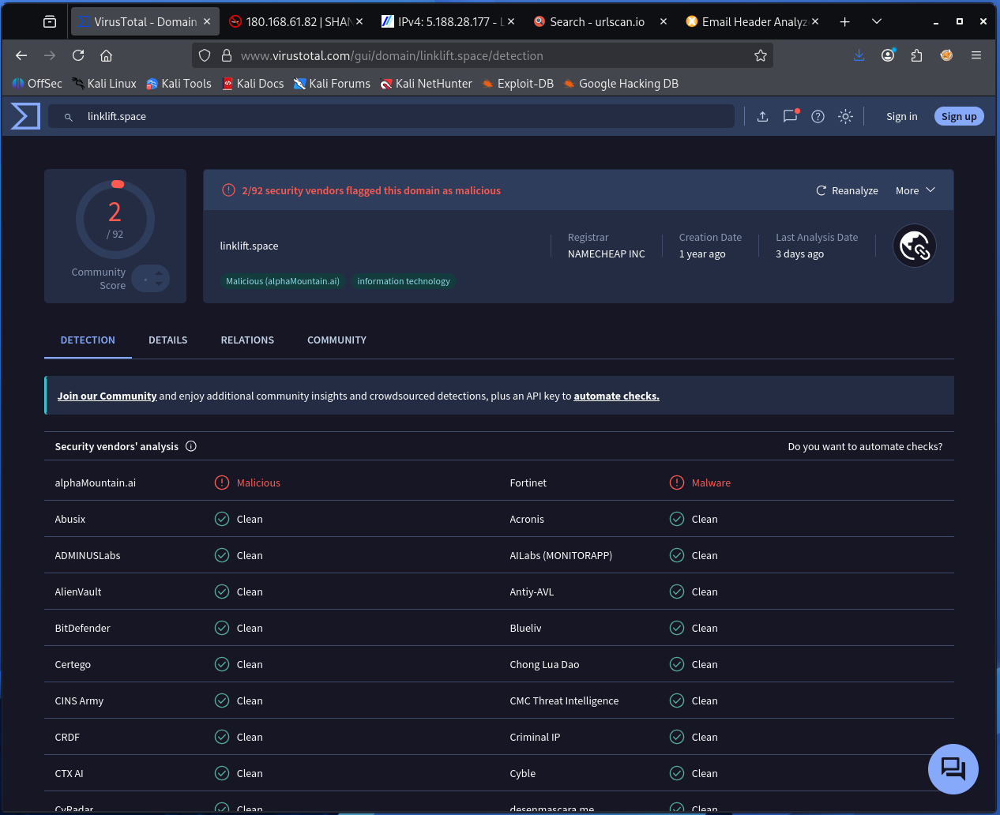
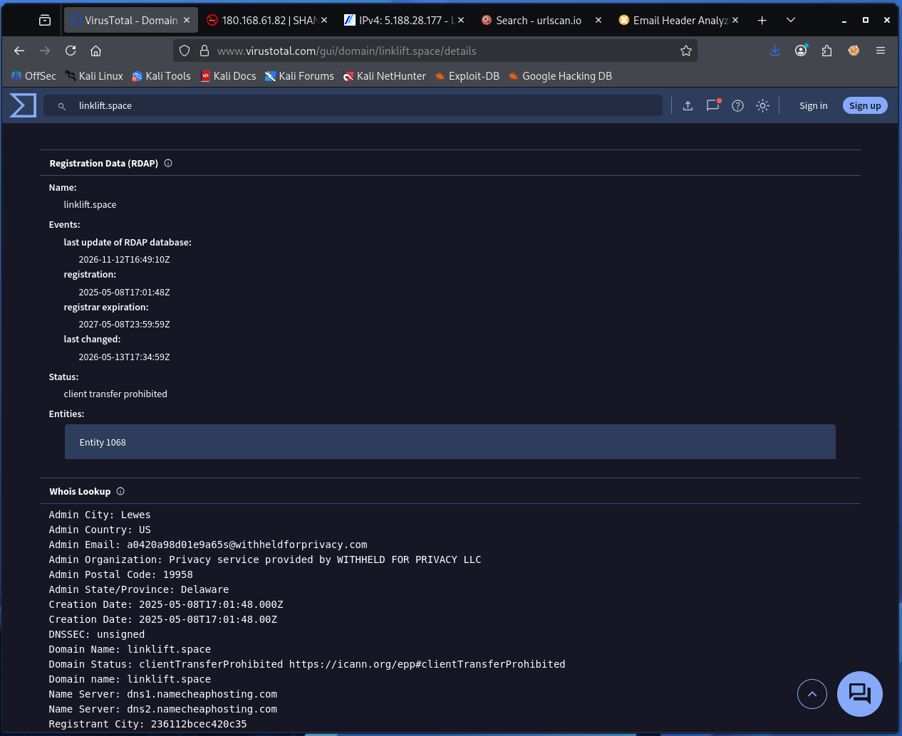
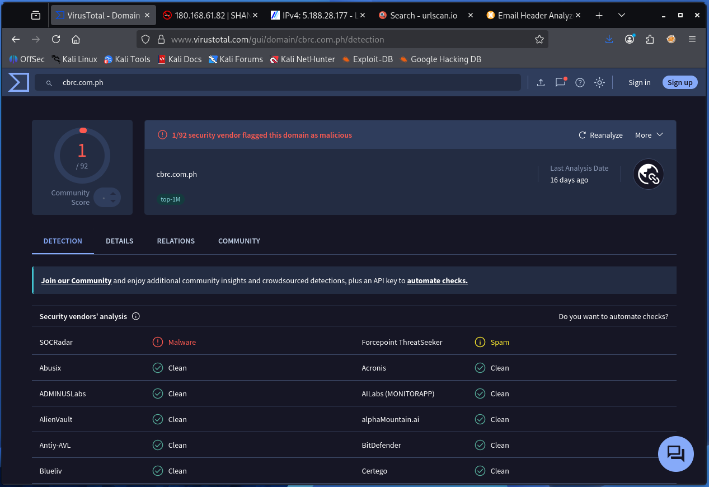
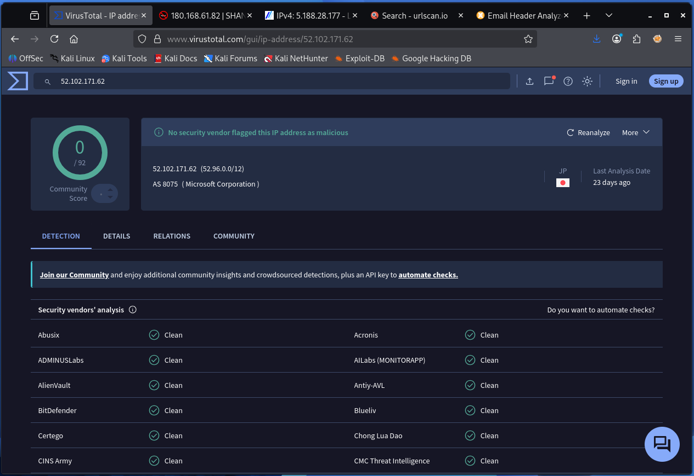
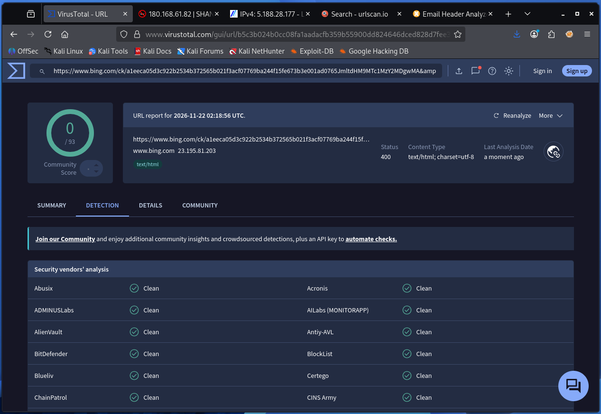
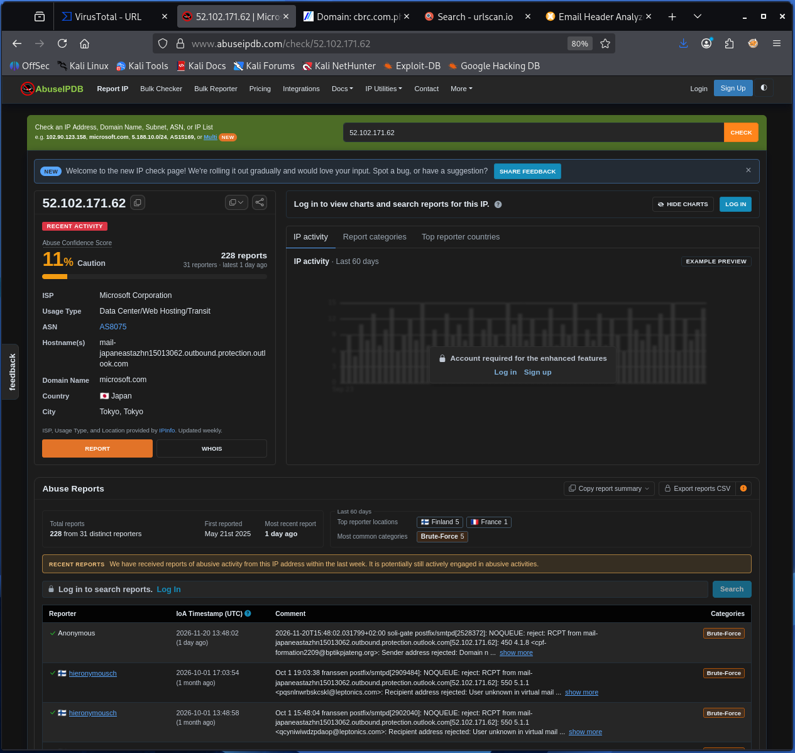
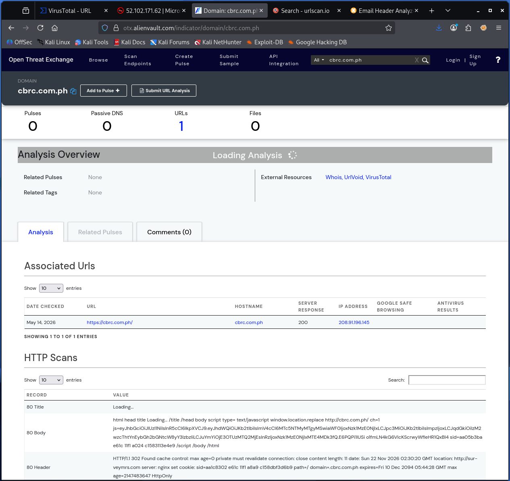
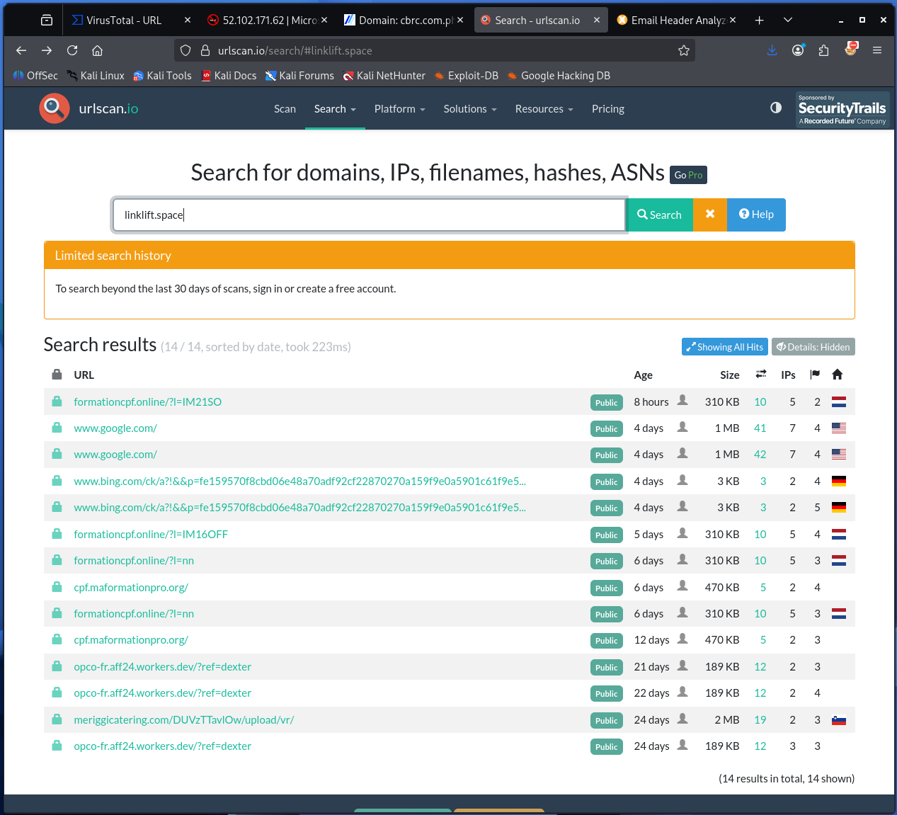
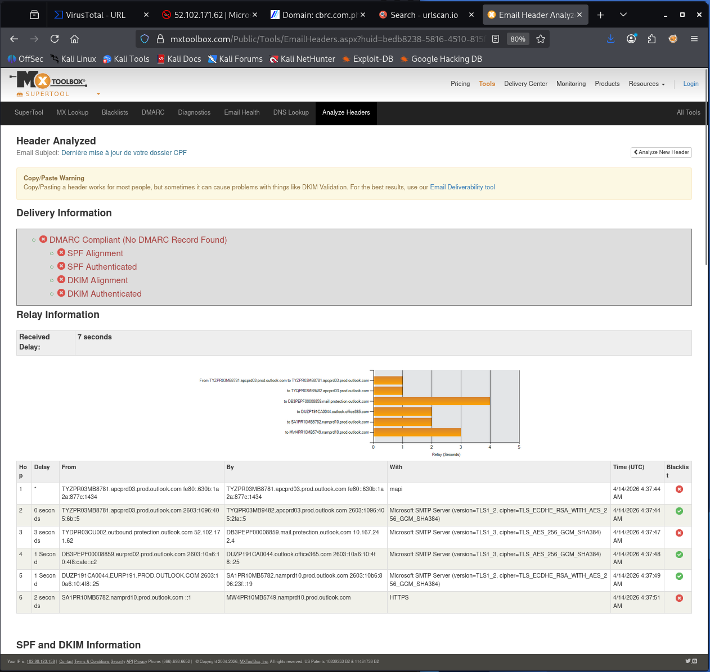
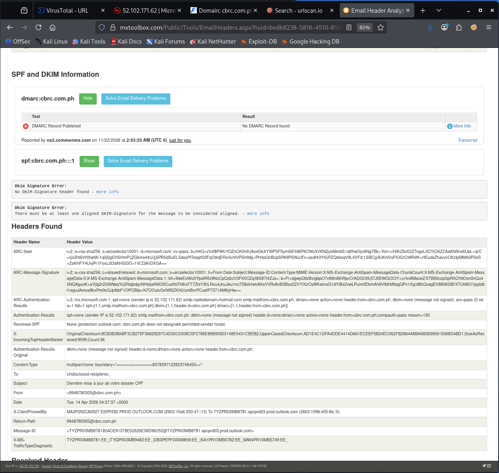

**Useful findings from the reputation checks:**
- **Shared sender IP:** 52[.]102[.]171[.]62 is a Microsoft Exchange Online outbound IP used by many tenants. Its abuse reports come from unrelated mail and say little about this sender. One report does mention a CPF-themed sender being rejected, which suggests the same kind of CPF lure was sent through Microsoft infrastructure more than once. This is third-party, anonymous data and I did not verify it.
- **Redirector domain:** `linklift[.]space` is about 18 months old at lookup, so it is not newly registered. It is flagged by 2 of 92 vendors, and the urlscan results link it to several French CPF-themed domains that did not appear in the email (listed below). I did not check how each one relates to `linklift[.]space`.
- **Ongoing activity:** urlscan scans from the days before lookup include Bing `ck/a` redirect URLs involving `linklift[.]space`, so this redirect pattern was still in use well after the April 2026 send date. These were different Bing URLs from the one in this email.

## Related indicators (seen in urlscan, not present in the email)

| Type | Value | Context |
|---|---|---|
| Domain | formationcpf[.]online | Appears in 4 urlscan scans involving linklift[.]space |
| Domain | cpf[.]maformationpro[.]org | Appears in 2 urlscan scans involving linklift[.]space |
| Domain | opco-fr[.]aff24[.]workers[.]dev | Appears in 3 urlscan scans involving linklift[.]space |
| URL | meriggicatering[.]com/DUVzTTavlOw/upload/vr/ | Appears in 1 urlscan scan involving linklift[.]space |
| Domain | bptikpjateng[.]org | CPF-themed sender in an AbuseIPDB report for 52[.]102[.]171[.]62 |

These are context for hunting, not confirmed parts of this email.

## IOC table (defanged)

| Type | Value | Context | Reputation |
|---|---|---|---|
| Email | 9948780305@cbrc[.]com[.]ph | Sender and Return-Path | n/a |
| Domain | cbrc[.]com[.]ph | Sender domain, ARC i=1 DKIM d= | VT 1/92 (Forcepoint: spam); OTX has data; urlscan no result |
| IP | 52[.]102[.]171[.]62 | Microsoft outbound IP seen by the SPF check | VT 0/92; AbuseIPDB 11% (shared Microsoft IP) |
| Domain | linklift[.]space | Decoded redirect destination | VT 2/92 malicious; OTX not found; created 2025-05-08; urlscan scans linked to CPF-themed pages |
| URL | hxxps://www[.]bing[.]com/ck/a?...(full URL in sample) | Lure link (redirect) | VT 0/93 |
| URL | hxxps://linklift[.]space/renting-vs-buying-navigating-the-real-estate-market-with-a-professional-agent/ | Decoded destination | VT 0/91 |
| Message-ID | TYZPR03MB878185ACE91378E52626E58D96252@TYZPR03MB8781[.]apcprd03[.]prod[.]outlook[.]com | Message identifier | n/a |
| Attachment hash | none | | n/a |

## Verdict
**Malicious (phishing / scam lure), moderate confidence.**

**Justification:**
- The subject uses an official-sounding French government training-account theme (CPF) and the mail was sent to undisclosed recipients from a bare numeric address with no display name.
- The only link is a Bing redirect that hides its destination, `linklift[.]space`, which 2 of 92 VirusTotal vendors flag as malicious. The sender domain is flagged as spam by one vendor.
- urlscan links `linklift[.]space` to several CPF-themed domains, which matches the subject of the email. This is a correlation, not proof of the redirect chain.
- SPF, DKIM and DMARC were none at the final hop, and the message passed through Microsoft infrastructure only, which suggests abuse of a legitimate or compromised tenant (inference).
- Reputation was weak and mixed (most single lookups clean), so this verdict rests mainly on the content, link and correlation evidence.

**Limitation:** 
- Language: The email body is written in French.
- The meaning of compauth reason 130 and the cause of the ARC conflicts were not verified.

## Red flags identified
- Generic numeric sender with no display name
- Undisclosed recipients (mass mailing)
- Missing authentication at the final hop (SPF none, DKIM none, DMARC none)
- ARC results that conflict with the final results for the same domain
- Link hidden behind a Bing redirect
- Subject and destination mismatch (French CPF theme versus English real-estate page)
- Redirect destination flagged by 2 vendors and linked in urlscan to CPF-themed pages
- Sender domain flagged as spam
- Official-sounding subject about a government training account (CPF)
- No DKIM signature and no DMARC record for the sender domain
- ARC i=1 pass results that contradict the original and final results
- Unusual MIME structure (`multipart/none`, script-style boundary), suggesting a scripted message

## Recommendations
- Block the sender address and domain at the mail gateway, and report the message to Microsoft and the domain owner as a possible compromised tenant account.
- Block `linklift[.]space` and alert on Bing `ck/a` links whose `u=` value decodes to it.
- Search mail logs for the same subject, the sender address and the `linklift[.]space` domain.
- Hunt for the related CPF-themed domains listed above.
- Warn users that "CPF update" messages are a common lure.

## What I learned
- A message can look authenticated at one hop and not at another. ARC showed pass at the first Microsoft hop and none at the last, and compauth still passed, so one authentication result should never decide the verdict alone.
- Sending through Microsoft infrastructure makes IP reputation almost useless. The shared outbound IP had a low abuse score driven by unrelated mail.
- Redirectors such as Bing `ck/a` hide the real destination, so decode the link before checking reputation. The decoded URL looked clean on VirusTotal, while the domain and urlscan correlation gave the useful signal.
- Correlating urlscan results with the subject theme showed a campaign link that single-indicator reputation checks missed.