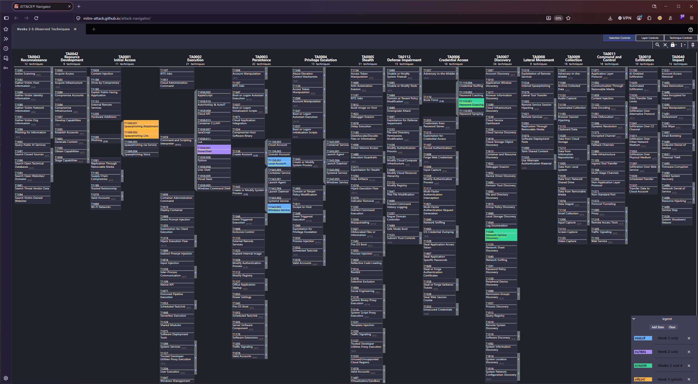
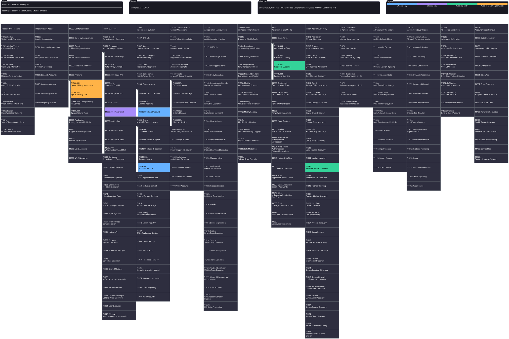

# ATT&CK Map: Techniques Observed in Weeks 2 to 5

**Week 5 | Hands-on task 3 (ATT&CK Map) | Folder: Findings**

## Goal
Build an ATT&CK Navigator layer for the techniques I performed or analysed in Weeks 2 to 5, then document each technique: why it was included, which week it was observed in, and which log source captured it.

## Layer
- **Tool:** MITRE ATT&CK Navigator (free, hosted version), Enterprise matrix, ATT&CK v20
- **Layer name:** Weeks 2-5 Observed Techniques
- **Colour key:** blue = Week 2 only, purple = Week 3 only, green = Weeks 2 and 4, orange = Week 5 phishing samples

### Exported files (saved in the Findings folder)
| File | Format | What it is |
|---|---|---|
| [attack-layer-weeks2-5.json](../Findings/attack-navigator/attack-layer-weeks2-5.json) | JSON | Navigator layer export. It can be re-imported with Open Existing Layer, Upload from local. |
| [attack-layer-weeks2-5.svg](../Findings/attack-navigator/attack-layer-weeks2-5.svg) | SVG | Vector export of the layer, readable at any zoom level. |
| [attack-navigator-layer.png](../Findings/attack-navigator/attack-navigator-layer.png) | PNG | Screenshot of the layer in Navigator. |

The JSON was exported from Navigator after building and checking the layer, so it contains the technique colours, comments and the Week and Detection source metadata for each technique.

## Log sources used across the lab
| Source | What it provided |
|---|---|
| Event Viewer (Windows Security, System, PowerShell Operational logs) | Account, logon, service and script-block events |
| Sysmon | Process creation (Event 1), network connection (Event 3), file creation (Event 11), registry value set (Event 13) |
| auditd (Linux) | Authentication records and command execution on the Linux host |
| Splunk | Central search and alerting over the three sources above |

## Techniques summary

| Technique | Tactic | Week | Why included |
|---|---|---|---|
| T1046 Network Service Discovery | Discovery | 2, 4 | I ran `nmap` scans in Week 2 and `nmap` SYN scans in Week 4 to find open services |
| T1110.001 Brute Force: Password Guessing | Credential Access | 2, 4 | In Week 4 I ran an SSH brute force with the rockyou wordlist. In Week 2 I used `net use` to simulate failed logons. |
| T1136.001 Create Account: Local Account | Persistence | 2 | I created a local account with `net user /add` |
| T1543.003 Create or Modify System Process: Windows Service | Persistence, Privilege Escalation | 2 | I created a service with `sc.exe create` |
| T1059.001 Command and Scripting Interpreter: PowerShell | Execution | 3 | I simulated process and file creation using PowerShell [[confirm this was PowerShell]] |
| T1566.002 Phishing: Spearphishing Link | Initial Access | 5 | All three phishing samples carried lure links (see Weeks 5 Samples 1 to 3) |
| T1566.001 Phishing: Spearphishing Attachment | Initial Access | 5 | Sample 3 carried a PDF attachment. Low confidence: VirusTotal found it malformed with no payload. |
| T1656 Impersonation | Defense Evasion | 5 | Sample 1 used an OKX display name on an unrelated domain. Sample 3 used a YETI giveaway display name. |

## Log source and detection per technique

| Technique | Week | Log source | Event / record that captured it | Detection logic (Splunk search over that source) |
|---|---|---|---|---|
| T1046 | 2, 4 | Sysmon, auditd, Splunk | Sysmon Event 1 (`nmap.exe` process and command line) and Event 3 (outbound connections to many ports) if `nmap` ran on a Windows host. auditd `EXECVE` / `SYSCALL` records for `nmap` if it ran on the Linux host. [[confirm which host ran nmap and which log showed it]] | Many connections from one source to many destination ports in a short window, or a process-creation hit for `nmap` |
| T1110.001 | 4 | auditd, Splunk | auditd `USER_AUTH` and `USER_LOGIN` records with `res=failed` from `sshd`, many in a short window from one source address | Count of failed SSH authentications per source address above a threshold |
| T1110.001 | 2 | Event Viewer (Security), Splunk | Security Event 4625 (failed logon). The `net use` attempts appear as network logons (logon type 3). | Repeated 4625 events for the same account or source |
| T1136.001 | 2 | Event Viewer (Security), Sysmon, Splunk | Security Event 4720 (user account created). Sysmon Event 1 for `net.exe` / `net1.exe` with `user ... /add` in the command line. | Event 4720, or process creation of `net.exe` with `/add` |
| T1543.003 | 2 | Event Viewer (System, Security), Sysmon, Splunk | System Event 7045 (new service installed). Security Event 4697 if the audit policy captures it. Sysmon Event 1 for `sc.exe` with `create`. Sysmon Event 13 (registry value set under the Services key) if the Sysmon config includes it. | Event 7045, or process creation of `sc.exe` with `create` |
| T1059.001 | 3 | Sysmon, Event Viewer (PowerShell Operational), Splunk | Sysmon Event 1 (`powershell.exe` and command line) and Event 11 (file created). PowerShell Event 4104 (script block) if script block logging was enabled. [[confirm which of these you saw]] | Process creation of `powershell.exe` with suspicious arguments, file creation events from that process |
| T1566.002 | 5 | Manual analysis (no SIEM) | `triage.py` header and URL extraction, urlscan.io, VirusTotal, AlienVault OTX | See proposed detections below |
| T1566.001 | 5 | Manual analysis (no SIEM) | `triage.py` attachment hashing (SHA256), VirusTotal Code Insight | See proposed detections below |
| T1656 | 5 | Manual analysis (no SIEM) | Header review of the From display name versus the sender address | See proposed detections below |

### Proposed detections for the Week 5 techniques (not implemented in the lab)
These samples were analysed offline in a VM, so no mail gateway or SIEM rule fired. These are detections I would add, taken from the Week 5 phishing analysis recommendations:
- Alert on Chrome Web Store links whose extension ID is outside an approved list (Sample 1).
- Alert on Bing `ck/a` links whose `u=` value decodes to a flagged domain (Sample 2).
- Alert on mail with DKIM `d=` of a known sender domain whose Reply-To domain differs from the From domain (Sample 3).
- Block attachments by SHA256 and search mail logs for the same hash (Sample 3).
- Flag a From display name that names a brand when the sender domain does not belong to it (Samples 1 and 3).

## What I learned
- Each technique left a different kind of evidence: Event Viewer for accounts, logons and services, Sysmon for process and file activity, and auditd for Linux authentication.
- One technique can span Windows and Linux. Password guessing appeared as Windows 4625 events in Week 2 and as auditd failed-authentication records in Week 4, so detection logic needs to cover both.
- The same command can be caught by more than one source. For example `net user /add` shows up in Event Viewer (4720) and in Sysmon Event 1.
- Phishing techniques are caught by different means: header and URL analysis, not endpoint logs. 