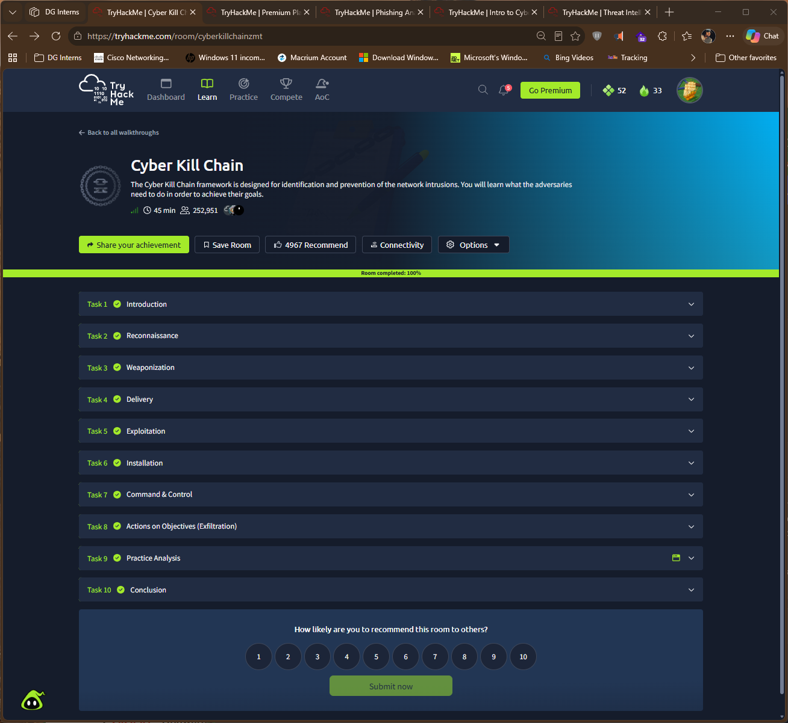

# TryHackMe: Cyber Kill Chain

**Week 5 | Folder: Writeups**

| | |
|---|---|
| Room | Cyber Kill Chain |
| Link | https://tryhackme.com/room/cyberkillchainzmt |
| Difficulty | Easy |
| Date completed | 20/11/2026 |
| Status | Completed |

## Goal
Learn the seven phases of the Lockheed Martin Cyber Kill Chain, how defenders can disrupt each phase, and where the model falls short.

## Task overview

| Task | Topic | What I did |
|---|---|---|
| 1 | Introduction | Read how the framework (introduced by Lockheed Martin in 2011) describes the steps of an intrusion |
| 2 | Reconnaissance | Identified how OSINT tools and platforms aids |
| 3 | Weaponization | Learnt the difference tactics attackers can adopt to turn raw information into actionable tools |
| 4 | Delivery | Learnt the different methods attackers use to transmit payload unto target devices |
| 5 | Exploitation | Learnt the different signs of exploitation to look out for |
| 6 | Installation | Learnt how attackrs leverage web shells on victims for persistence |
| 7 | Command and Control | Got introduced to the C2 channels used by attackers |
| 8 | Actions on Objectives | Learnt about the diiferent objectives an attacker may wish to accomplish on a victim |
| 9 | Practice analysis | Matched attacker activity to kill chain phases |
|10 | Conclusion

## The seven phases in my own words

| Phase | What the attacker does | A defender action that fits |
|---|---|---|
| Reconnaissance | Researches the target: emails, staff, technology, exposed services | Limit public information; monitor for scanning |
| Weaponization | Builds the attack tool, such as a malicious document or exploit | Threat intelligence on known tooling |
| Delivery | Sends it: email, web, USB | Email filtering, user awareness |
| Exploitation | Triggers a weakness to run code | Patching, application controls |
| Installation | Plants a backdoor or persistence | Endpoint monitoring, autorun and task alerts |
| Command and Control | Opens a channel to control the system | DNS and network filtering, blocking known C2 |
| Actions on Objectives | Carries out the goal: data theft, destruction, more access | Data loss controls, network segmentation |

## Commands and tools
No terminal commands were needed. This room is browser-based reading plus an interactive analysis exercise. 

## Screenshots

## Strengths and limits of the model
- **Strength:** a simple, linear story that shows where an attack can be stopped.
- **Limits:** Assumes a fixed order, focuses on the perimeter, weak after initial access. This is why it is often paired with ATT&CK.

## How this shows up in my lab
- My Week 2 to 5 attacks map onto the chain: Nmap scans are Reconnaissance, the Hydra SSH brute force is Exploitation, and the Atomic tests for a new local account and a scheduled task are Installation.
- I used this mapping in my Q6 note (ATT&CK vs Kill Chain) and in the incident report.

## What I learned
The chain is useful for explaining an attack story and choosing where to mitigate/stop it; stopping an attack early costs the attacker more; the model needs ATT&CK for post-compromise detail.