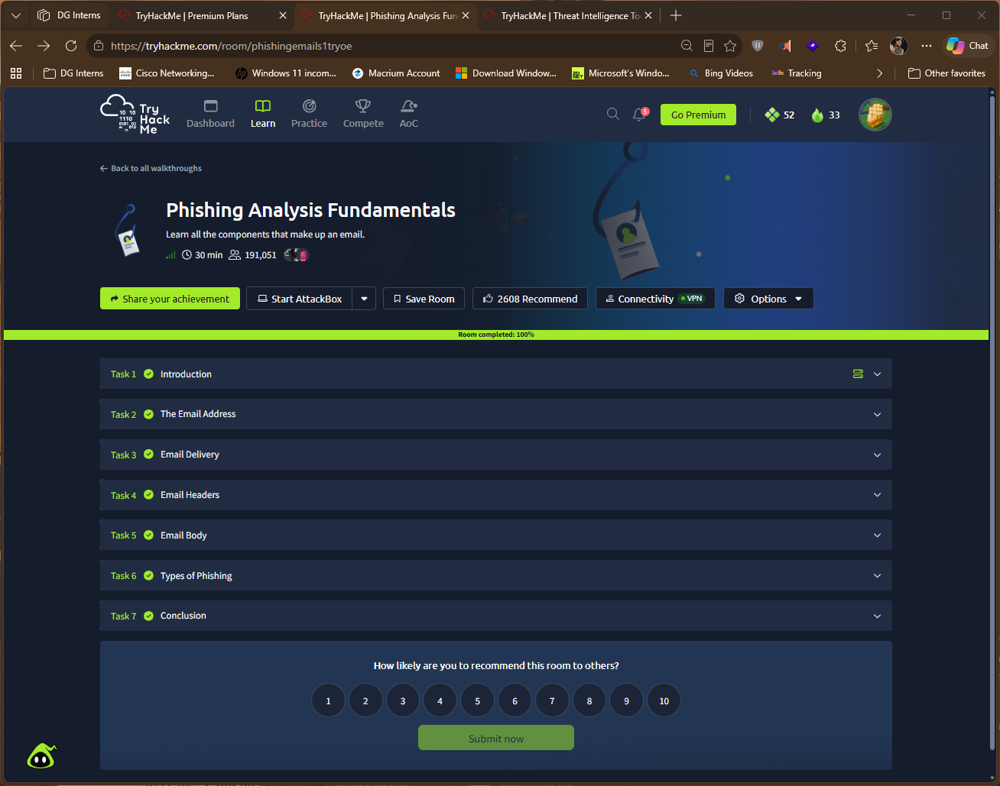

# TryHackMe: Phishing Analysis Fundamentals

**Week 5 | Folder: Writeups**

| | |
|---|---|
| Room | Phishing Analysis Fundamentals (also listed as Phishing Emails 1) |
| Link | https://tryhackme.com/room/phishingemails1tryoe |
| Difficulty | Easy |
| Date completed | 20/11/2026 |
| Status | Completed |

## Goal
Learn how email is delivered, how to read headers and bodies, how attachments are reconstructed, and how to recognise the main types of phishing.

## Task overview

| Task | Topic | What I did |
|---|---|---|
| 1 | Introduction | Read the difference between spam and phishing |
| 2 | The email address | Learned the parts of an address and common sender fields |
| 3 | Email delivery | Learned how a message moves between servers |
| 4 | Email headers | Read From, Reply-To, Return-Path, Received and authentication fields |
| 5 | Email body and attachments | Compared the rendered email with its source and rebuilt an attachment from encoded text |
| 6 | Types of phishing | Read about spoofed brands, BEC and other types, then analysed a sample email |
| 7 | Conclusion |

(Check the task numbers against the room.)

## Commands and tools

| Action | Tool |
|---|---|
| Opened raw email samples on the room's machine | Thunderbird |
| Decoded an attachment stored as base64 text | CyberChef (From Base64 recipe) and PDF converter |
| Identified attachment file types using `Content-Type` | Manual header reading |
| Defanged an IP address | Cyberchef (Defang IP Address)
| Checked the sender and reply address | Manual header reading |

## Screenshots

Do not screenshot flags or answers.

## Key header fields in my own words

| Field | What it tells me | What looks suspicious |
|---|---|---|
| From | Sender shown to the user | Display name does not match the address |
| Return-Path | Where bounces go | Different domain from From |
| Reply-To | Where replies go | Different from From |
| Received | Servers the message passed through | Unexpected origin |
| Authentication results | SPF, DKIM, DMARC outcomes | Fail or none |

## How this shows up in my lab
- My three phishing samples (sample-10, sample-10002, sample-10010) used the same method: read the headers, list URLs without clicking, hash attachments and check reputation.
- I wrote a small Python script, `triage.py`, to pull out the fields above safely.
- Sample 3 had a Reply-To domain different from the sender, which matches the red flag from this room. This links to my Q2 and Q4 notes.

## What I learned
The visible From address can be misleading; the source of an email shows what the rendered view hides; attachments and links should be checked safely, not opened. 