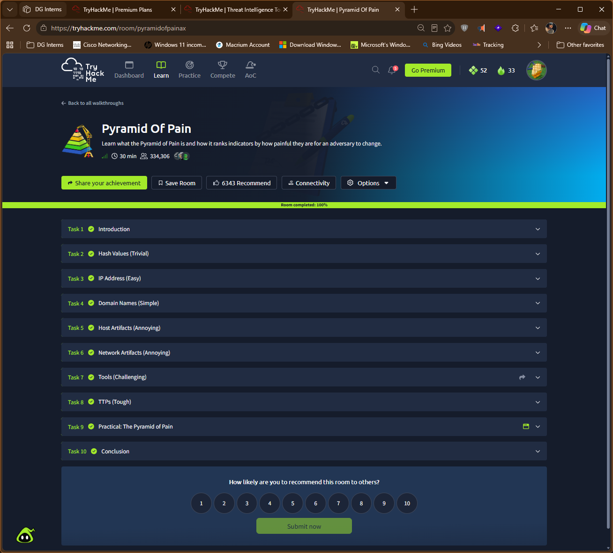

# TryHackMe: Pyramid of Pain

**Week 5 | Folder: Writeups**

| | |
|---|---|
| Room | Pyramid Of Pain |
| Link | https://tryhackme.com/room/pyramidofpainax |
| Difficulty | Easy |
| Date completed | Before the internship |
| Status | Completed |

## Goal
Learn how different indicators rank by how painful it is for an attacker to change them, and how to use that when choosing detections.

## Task overview

| Task | Level | What I did |
|---|---|---|
| 1 | Introduction | Read the concept |
| 2 | Hash values (trivial) | Looked up file hashes with open-source tools |
| 3 | IP addresses (easy) | Read sandbox report data and looked up IP details |
| 4 | Domain names (simple) | Studied domains, look-alike (Punycode) tricks and URL shorteners |
| 5 | Host artifacts (annoying) | Read about registry keys, dropped files and process behaviour |
| 6 | Network artifacts (annoying) | Looked at traffic indicators such as User-Agent strings |
| 7 | Tools (challenging) | Read about how detecting tools forces attackers to change them |
| 8 | TTPs (tough) | Read about behaviour-based detection |
| 9 | Practical | Completed the interactive exercise |
| 10 | Conclusion | 

## The pyramid in my own words

| Level | Example | Difficulty for attacker | Why |
|---|---|---|---|
| Hash values | File SHA256 | Trivial | Changing one byte gives a new hash |
| IP addresses | C2 server IP | Easy | New server or proxy, including fast-flux style rotation |
| Domain names | Phishing domain | Simple | Register another domain |
| Host and network artifacts | Registry key, User-Agent, URL pattern | Annoying | Needs tool or config changes |
| Tools | Password cracker, malware family | Challenging | Needs new tooling |
| TTPs | How they gain access and move | Tough | Needs a different way of working |

## Commands and tools
No terminal commands. Browser tools I used:

| Tool | Used for |
|---|---|
| VirusTotal, `Get-FileHash` | Hash and IP reputation |
| ANY.RUN public reports | Reading connections and processes |
| IP / ASN lookup site | IP ownership |
| URL preview / unshortener | Revealing the real link |
| MetaDefender Cloud - OPSWAT | Hash and IP Reutation |

## Screenshots

Do not screenshot answers or flags.

## How this shows up in my lab
- **Hash (trivial):** the EICAR file is detected by its hash or signature, which is easy to evade by changing the file.
- **IP and domain:** my phishing samples gave IPs and domains for blocklists, but sample 1 had clean reputation everywhere, so IOCs alone were not enough.
- **Behaviour (tough):** my Snort rule for Nmap SYN scans and my Splunk searches for encoded PowerShell and SSH brute force detect behaviour, so they are harder to evade.
- I used this in my Q5 note and my IOC cheat sheet.

## What I learned
Blocking hashes and IPs is quick but short-lived; behaviour detections last longer; combining both yield better result.