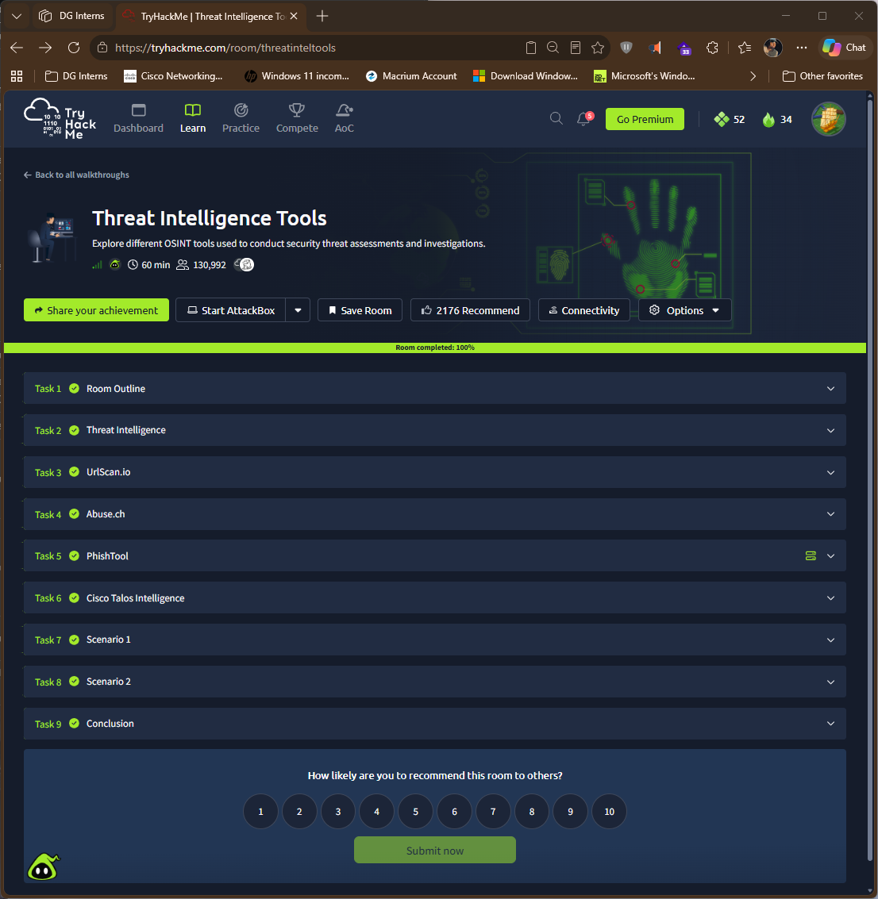

# TryHackMe: Threat Intelligence Tools (Optional)

**Week 5 | Folder: Writeups**

| | |
|---|---|
| Room | Threat Intelligence Tools |
| Link | https://tryhackme.com/room/threatinteltools |
| Difficulty / time (as listed) | Easy, about 60 minutes |
| Date completed | 22/11/2026 |
| Status | Completed (optional room) |

## Goal
Use free OSINT tools to investigate URLs, malware indicators and phishing emails, and learn what each tool is for.

## Task overview

| Task | Topic | What I did |
|---|---|---|
| 1 | Room outline | Read the objectives |
| 2 | Threat intelligence | Reviewed the intel classifications |
| 3 | UrlScan.io | Read a scan result and the information it shows about a site |
| 4 | Abuse.ch | Explored its platforms (below) |
| 5 | PhishTool | Looked at an email's headers and path with a phishing analysis tool |
| 6 | Cisco Talos Intelligence | Looked up reputation and ownership details |
| 7 | Scenario 1 | Investigated victim address  through the headers and attachment on Virustotal |
| 8 | Scenario 2 | Extracted attachment hash and investigated it on Virustotal to get the name and malware family |
| 9 | Conclusion | 

## Tools in my own words

| Tool | What it is for |
|---|---|
| urlscan.io | Scans a site safely and lists requests, domains, IPs and technologies |
| MalwareBazaar | Sharing malware samples |
| URLhaus | Malware distribution URLs |
| Feodo Tracker | Botnet command and control servers |
| SSL Blacklist | Malicious SSL certificates and JA3 fingerprints |
| ThreatFox | Sharing and searching IOCs |
| PhishTool | Reading email headers, links and attachments |
| Cisco Talos Intelligence | IP and domain reputation and threat research |

## Screenshots

Do not screenshot answers or flags.

## How this shows up in my lab
- I used urlscan.io, VirusTotal, AlienVault OTX and AbuseIPDB on my three phishing samples to check domains, IPs and hashes.
- The room's other tools (URLhaus, ThreatFox, Talos) did not feature in my sample analysis. 
- This fed the "IOC Type, Where to Find It, Tool to Check It" cheat sheet.

## What I learned
A clean result on one tool does not prove safety.

Different tools cover different indicator types; it's good practice to always check more than one source. 
